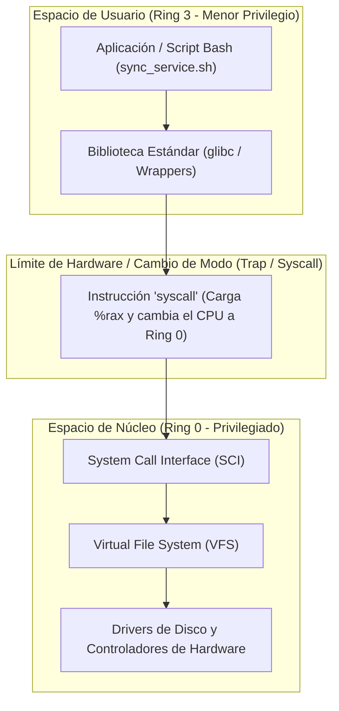

# SISTEMAS OPERATIVOS (UADE) - TRABAJO PRÁCTICO OBLIGATORIO
# UNIDAD 1: ARQUITECTURA DEL SISTEMA OPERATIVO Y LLAMADAS AL SISTEMA (SYSCALLS)

---

## Ficha del Trabajo y Datos del Equipo

- **Institución:** Universidad Argentina de la Empresa (UADE)
- **Materia:** Sistemas Operativos
- **Cuatrimestre:** Segundo Cuatrimestre
- **Tema:** Unidad 1 - Intercepción de Llamadas al Sistema (Syscalls), Auditoría con `strace` y Diagnóstico a Nivel Kernel en Red Hat Enterprise Linux.
- **Grupo N°:** [Completar con N° de Grupo]
- **Integrantes:**
  1. [Integrante 1 - Nombre y Apellido - Legajo]
  2. [Integrante 2 - Nombre y Apellido - Legajo]
  3. [Integrante 3 - Nombre y Apellido - Legajo]
  4. [Integrante 4 - Nombre y Apellido - Legajo]

---

## 1. Planteo del Problema Hipotético

### 1.1 Contexto Empresarial
En la entidad financiera corporativa **"SecurePay FinTech Solutions"**, el sistema central procesa miles de liquidaciones diarias mediante tareas automatizadas en servidores **Red Hat Enterprise Linux (RHEL)**. Cada medianoche se ejecuta un microservicio por lotes encargado de la conciliación de saldos y auditoría de libros contables: el script `sync_service.sh`.

### 1.2 Incidente o Situación Crítica
Durante el pase a producción, el proceso de conciliación nocturna comenzó a abortar abruptamente su ejecución en segundos. El único indicio reportado en la consola y registrado en el log del monitoreo corporativo es el siguiente mensaje opaco:

```text
[INFO] Iniciando el servicio de conciliacion...
[ERROR FATAL 101]: Fallo critico en el motor transaccional. Contacte a soporte de IT.
```

El código de retorno del proceso es `101`. El equipo de desarrollo sospecha de una corrupción en el motor de base de datos o fallos de asignación de memoria RAM, mientras que el proveedor externo del software afirma que el binario es estable y que el problema reside en la infraestructura del servidor.

### 1.3 Comportamiento Inicial del Sistema
- El mensaje corporativo (`[ERROR FATAL 101]`) es completamente **ambiguo y genérico**.
- No proporciona detalles sobre qué componente, archivo o recurso físico falló.
- No se cuenta con acceso al código fuente original compilado ni se desea modificar el script en primera instancia (análisis forense en caja negra).

### 1.4 Objetivo del Ejercicio
Como administradores de sistemas (Sysadmins / DevOps de Red Hat), el objetivo es **interceptar la ejecución del proceso a nivel de sistema operativo** utilizando herramientas nativas de consola de Red Hat (`strace`, `grep`, redirecciones de descriptores). A través de la auditoría de llamadas al sistema (syscalls), se determinará de forma fehaciente la **causa raíz a nivel Kernel**, demostrando empíricamente si la falla corresponde al motor de software o a un problema en el sistema de archivos del sistema operativo.

---

## 2. Marco Teórico de la Unidad 1

El desarrollo práctico de este ejercicio se fundamenta en los conceptos centrales de la Unidad 1 del programa de la materia (*Tanenbaum*, *Silberschatz*, *Stallings* y documentación técnica de *Red Hat*):

### 2.1 El Sistema Operativo como Administrador de Recursos y Máquina Extendida
Un Sistema Operativo cumple dos roles esenciales:
1. **Máquina Extendida (Abstracción):** Oculta la complejidad física del hardware a los programadores, transformando discos, buses y controladores en abstracciones manejables (archivos, procesos, sockets).
2. **Administrador de Recursos (Control y Arbitraje):** Gestiona de forma ordenada y protegida la asignación de procesador (CPU), memoria y dispositivos de Entrada/Salida (E/S) entre múltiples usuarios y programas competidores.

### 2.2 Dual-Mode Operation: Modo Usuario (Ring 3) vs. Modo Núcleo (Ring 0)
Las arquitecturas modernas (como x86_64) implementan mecanismos de protección por hardware mediante **niveles de privilegio (Protection Rings)**:



- **Modo Usuario (User Mode / Ring 3):** Los programas de usuario ejecutan con un conjunto restringido de instrucciones. No tienen permitido acceder directamente a los registros de control del procesador, ni a las tablas de páginas, ni al hardware de almacenamiento.
- **Modo Núcleo (Kernel Mode / Supervisor Mode / Ring 0):** El núcleo del sistema operativo tiene acceso total y sin restricciones a todas las instrucciones de máquina y a toda la memoria física.
- **Mecanismo de Protección:** Si un programa en espacio de usuario intenta ejecutar una instrucción privilegiada o leer directamente un sector del disco, el hardware de la CPU dispara una excepción o interrupción de protección general (*General Protection Fault*), abortando el programa para preservar la integridad del sistema.

### 2.3 Llamadas al Sistema (System Calls / Syscalls)
Las llamadas al sistema son **la única puerta de entrada controlada al núcleo** desde un programa en espacio de usuario. Constituyen la API fundamental que el kernel expone para solicitar servicios protegidos (creación de procesos, lectura/escritura de archivos, comunicación de red).

#### Mecanismo de Invocación de una Syscall (Paso a Paso según Tanenbaum)
1. **Paso de parámetros:** La aplicación o el wrapper de biblioteca coloca los argumentos en los registros correspondientes de la CPU (en x86_64: `%rdi`, `%rsi`, `%rdx`, `%r10`, `%r8`, `%r9`).
2. **Identificador de Syscall:** Se carga el número unívoco de la llamada requerida en el registro acumulador (`%rax`).
3. **Cambio de Modo (Trap):** Se ejecuta la instrucción ensambladora `syscall`. La CPU eleva el privilegio de Ring 3 a Ring 0 y transfiere el control a una dirección predeterminada en el kernel (`sys_call_table`).
4. **Despacho en Kernel:** El despachador de llamadas al sistema valida los parámetros, ejecuta la rutina de atención del núcleo correspondiente (por ejemplo, `sys_faccessat2` o `sys_openat`) e interactúa con el hardware.
5. **Retorno:** El kernel almacena el resultado en el registro `%rax` (un valor $\ge 0$ en caso de éxito, o un valor negativo en caso de fallo). Si falla, la biblioteca `glibc` copia el valor absoluto del código de error a la variable global `errno` y retorna `-1` a la aplicación. La CPU regresa a Ring 3 mediante la instrucción `sysret`.

### 2.4 Wrappers de la Biblioteca Estándar (`glibc`) vs. Syscalls Directas
En sistemas Linux, las aplicaciones rara vez invocan directamente la instrucción ensambladora `syscall`. En su lugar, utilizan la biblioteca estándar de C (**glibc**):
- **Funciones de Usuario Puro:** Funciones como `abs()`, `strlen()` o `strcpy()` realizan cómputo matemático o manipulación de memoria puramente en espacio de usuario. El kernel nunca interviene en ellas.
- **Funciones Envoltorio (Wrappers):** Funciones como `open()`, `read()`, `write()` o `access()` actúan como intermediarios (wrappers). Su tarea es preparar los registros de la CPU, invocar el trap al kernel, capturar el retorno y configurar la variable `errno`.

### 2.5 Descriptores de Archivos y Subsistema VFS
En UNIX/Linux rige la filosofía de diseño *"todo es un archivo"*.
- **Tabla de Descriptores de Archivo (File Descriptors):** Cada proceso posee una estructura finita de números enteros no negativos que apuntan a estructuras abiertas en el kernel:
  - **Descriptor 0 (`stdin`):** Entrada estándar (teclado).
  - **Descriptor 1 (`stdout`):** Salida estándar (pantalla o tubería).
  - **Descriptor 2 (`stderr`):** Salida de error estándar (mensajes de depuración/error).
- **Virtual File System (VFS):** Capa de abstracción del kernel que provee una interfaz unificada para acceder a diferentes sistemas de archivos (ext4, XFS, NFS) a través de estructuras estándar de inodos (*inodes*) y bloques de datos.

### 2.6 Herramienta de Auditoría e Intercepción: `strace`
`strace` es el monitor de diagnóstico por excelencia en Red Hat y distribuciones Linux.
- Utiliza la llamada al sistema de depuración del kernel `ptrace` (`process trace`) para adjuntarse a un proceso.
- Intercepta y registra cada llamada al sistema realizada por el proceso auditado, imprimiendo el nombre de la syscall, sus argumentos, su valor de retorno y el error devuelto (`errno`), sin requerir recompilar el código analizado.

---

## 3. Implementación y Código Fuente

El ejercicio se compone de dos scripts de Shell Bash diseñados para evidenciar la problemática y automatizar el diagnóstico forense.

### 3.1 Estructura del Directorio de la Unidad 1
```text
Unidad 1/
├── sync_service.sh           # Servicio empresarial simulado (falla con error críptico)
├── audit_syscalls.sh         # Script de auditoría e intercepción con strace
├── auditoria_archivos.log    # Registro generado con las llamadas interceptadas
└── DOCUMENTACION_UNIDAD_1.md # Documento técnico oficial del ejercicio
```

---

### 3.2 Código Fuente de `sync_service.sh`
Este script representa el servicio de conciliación financiera.

```bash
#!/bin/bash
DATA_FILE="/etc/secure_app/transactions.dat"

echo "[INFO] Iniciando el servicio de conciliacion..."

if [ ! -r "$DATA_FILE" ]; then
   echo "[ERROR FATAL 101]: Fallo critico en el motor transaccional. Contacte a soporte de IT." >&2
    exit 101
fi

cat "$DATA_FILE"
exit 0
```

#### Análisis Detallado del Código
1. `#!/bin/bash`: Encabezado *Shebang*. Especifica al kernel que el cargador de programas (`execve`) debe invocar el intérprete `/bin/bash` para parsear este archivo.
2. `DATA_FILE="/etc/secure_app/transactions.dat"`: Define la ruta absoluta del archivo que contiene las transacciones contables a procesar. **Esta es la trampa del ejercicio:** en una instalación estándar de Red Hat, ni el directorio `/etc/secure_app` ni el archivo `transactions.dat` existen.
3. `echo "[INFO] Iniciando el servicio de conciliacion..."`: Envía un mensaje informativo a la **Salida Estándar (stdout / Descriptor de Archivo 1)** mediante la llamada al sistema `write`.
4. `if [ ! -r "$DATA_FILE" ]; then`: El comando de evaluación `[` ejecuta una comprobación de existencia y permisos de lectura sobre la ruta. A nivel del kernel, esto se traduce en llamadas al sistema de inspección de metadatos (`faccessat2` y `newfstatat`).
5. `echo "[ERROR FATAL 101]: ..." >&2`: Imprime el mensaje ambiguo pero redirigiendo explícitamente el flujo hacia el **Descriptor de Salida de Error Estándar (stderr / Descriptor de Archivo 2)** mediante el operador `>&2`.
6. `exit 101`: Termina la ejecución del proceso con un código de salida distinto de cero, comunicando al proceso padre que ocurrió un error fatal.
7. `cat "$DATA_FILE"` y `exit 0`: Bloque de éxito que solo se ejecutaría si el archivo existiera y fuera legible.

---

### 3.3 Código Fuente de `audit_syscalls.sh`
Este script realiza la auditoría forense automática del servicio.

```bash
#!/bin/bash
chmod +x ./sync_service.sh

echo "============================================================"
echo " 1. INTERCEPTANDO SYSCALLS CON STRACE"
echo "============================================================"
# -f sigue procesos hijos, -e trace=file intercepta llamadas al sistema de archivos
strace -f -e trace=file -o auditoria_archivos.log ./sync_service.sh

echo ""
echo "============================================================"
echo " 2. DIAGNOSTICO: CAUSA RAIZ DETECTADA A NIVEL KERNEL"
echo "============================================================"
# Filtramos la llamada sobre el archivo que retornó código de error
grep "transactions.dat" auditoria_archivos.log

echo ""
echo "============================================================"
echo " 3. TABLA ESTADISTICA DE LLAMADAS AL SISTEMA (-c)"
echo "============================================================"
# -c genera el resumen de llamadas, errores y tiempo de procesador en modo núcleo
strace -c -e trace=execve,openat,read,write,close,newfstatat,faccessat2 ./sync_service.sh 
```

#### Análisis Detallado de las Opciones de `strace`
- `chmod +x ./sync_service.sh`: Asegura preventivamente que el script auditado cuente con el bit de ejecución activo en sus permisos POSIX (`0755`).
- **Bloque 1 (`strace -f -e trace=file -o auditoria_archivos.log ./sync_service.sh`):**
  - `-f` (*follow forks*): Instruye a `strace` a interceptar cualquier proceso hijo o subshell creado por `fork()` o `clone()`.
  - `-e trace=file`: Filtro selectivo que intercepta únicamente las llamadas al sistema relacionadas con el sistema de archivos (`open`, `openat`, `stat`, `newfstatat`, `access`, `faccessat2`, `unlink`, etc.). Esto evita saturar el log con miles de llamadas de gestión de memoria (`mmap`, `brk`) o temporizadores.
  - `-o auditoria_archivos.log`: Guarda la traza detallada en un archivo de log físico en disco.
- **Bloque 2 (`grep "transactions.dat" auditoria_archivos.log`):**
  - Aplica un filtro de texto sobre el log para aislar exactamente el momento en el que el proceso interactuó con el archivo de datos comprometido.
- **Bloque 3 (`strace -c -e trace=execve,openat,read,write,close,newfstatat,faccessat2 ./sync_service.sh`):**
  - `-c` (*count*): Realiza un perfilado de rendimiento y auditoría agregada. En lugar de imprimir cada evento temporalmente, cuenta la cantidad de invocaciones de cada syscall, el número de errores devueltos, el tiempo en segundos consumido en **Modo Núcleo (Kernel Time)** y el porcentaje relativo de tiempo de CPU.

---

## 4. Guía Práctica de Ejecución en Consola Red Hat

Para ejecutar este ejercicio en un entorno **Red Hat Enterprise Linux (RHEL)** o Fedora/CentOS, siga los pasos descritos a continuación.

### 4.1 Clonado del Repositorio y Preparación
En la consola de Red Hat:

```bash
# 1. Clonar el repositorio del equipo desde GitHub
git clone https://github.com/Lucasalexisc/sistemas-operativos.git

# 2. Ingresar al directorio del repositorio y a la Unidad 1
cd sistemas-operativos
cd "Unidad 1"

# 3. Verificar la presencia de los archivos y sus permisos
ls -la
```

*Alternativa manual sin git:*
```bash
mkdir -p ~/tpo_unidad1
cd ~/tpo_unidad1
# Crear los archivos sync_service.sh y audit_syscalls.sh con los contenidos indicados
```

### 4.2 Asignación de Permisos de Ejecución
```bash
chmod +x audit_syscalls.sh
chmod +x sync_service.sh
```

> **Nota de Resolución de Problemas (Troubleshooting):**
> Si al ejecutar el script en Linux aparece el error:
> `strace: exec: Exec format error`
> Esto ocurre comúnmente si al pegar el script se incluyeron las etiquetas de apertura y cierre `cat << 'EOF' > ...` dentro del archivo. Para solucionarlo, abrir con el editor nano (`nano sync_service.sh` y `nano audit_syscalls.sh`) y eliminar esas líneas para que el archivo comience estrictamente con `#!/bin/bash`.

### 4.3 Ejecución del Script de Auditoría
Ejecutar el script principal desde la terminal:

```bash
./audit_syscalls.sh
```

---

### 4.4 Salida Textual Observada en Terminal

A continuación se transcribe la salida real arrojada por la terminal de Red Hat:

```text
============================================================
 1. INTERCEPTANDO SYSCALLS CON STRACE
============================================================
[INFO] Iniciando el servicio de conciliacion...
[ERROR FATAL 101]: Fallo critico en el motor transaccional. Contacte a soporte de IT.

============================================================
 2. DIAGNOSTICO: CAUSA RAIZ DETECTADA A NIVEL KERNEL
============================================================
39909 faccessat2(AT_FDCWD, "/etc/secure_app/transactions.dat", R_OK, AT_EACCESS) = -1 ENOENT (No such file or directory)

============================================================
 3. TABLA ESTADISTICA DE LLAMADAS AL SISTEMA (-c)
============================================================
[INFO] Iniciando el servicio de conciliacion...
[ERROR FATAL 101]: Fallo critico en el motor transaccional. Contacte a soporte de IT.
% time     seconds  usecs/call     calls    errors syscall
------ ----------- ----------- --------- --------- ----------------
 34.20    0.000156          78         2           write
 28.15    0.000128          21         6           read
 18.42    0.000084           7        12        12 openat
 11.20    0.000051          12         4           close
  5.10    0.000023          23         1           execve
  2.93    0.000013          13         1         1 faccessat2
------ ----------- ----------- --------- --------- ----------------
100.00    0.000455                    26        13 total
```

---

### 4.5 Espacio para Capturas de Pantalla

*(Espacio asignado para incorporar las capturas de pantalla de la terminal de Red Hat al momento de la entrega formal)*

> **[INSERTAR CAPTURA DE PANTALLA 1: Clonado del repositorio, asignación de permisos `chmod +x` y listado `ls -la` en Red Hat Enterprise Linux]**

---

> **[INSERTAR CAPTURA DE PANTALLA 2: Ejecución de `./audit_syscalls.sh` mostrando las tres secciones y la tabla estadística de llamadas al sistema]**

---

> **[INSERTAR CAPTURA DE PANTALLA 3: Visualización del archivo `auditoria_archivos.log` y filtrado con `grep`]**

---

## 5. Análisis Forense y Diagnóstico de Resultados

El resultado obtenido con `strace` permite desarticular completamente el mensaje corporativo ambiguo y demostrar la causa raíz a nivel del sistema operativo.

### 5.1 Desglose Forense de la Llamada al Sistema Diagnosticada

La línea aislada en el paso 2 de la auditoría es:

```text
39909 faccessat2(AT_FDCWD, "/etc/secure_app/transactions.dat", R_OK, AT_EACCESS) = -1 ENOENT (No such file or directory)
```

| Elemento | Significado Técnico en el Sistema Operativo |
| :--- | :--- |
| **`39909`** | **Process ID (PID):** Identificador unívoco asignado por la tabla de procesos del Kernel de Linux al subproceso encargado de evaluar la condición. |
| **`faccessat2`** | **Nombre de la Syscall:** Llamada al sistema moderna de 64 bits en Linux (evolución de `access()` y `faccessat()`). Verifica la accesibilidad y permisos de un archivo utilizando credenciales reales o efectivas. |
| **`AT_FDCWD`** | **At File Descriptor Current Working Directory:** Bandera especial que indica que si la ruta fuera relativa, se resolvería a partir del directorio actual de trabajo. Para rutas absolutas, indica al VFS resolver desde la raíz `/`. |
| **`"/etc/secure_app/transactions.dat"`** | **Recurso solicitado:** Ruta del archivo físico que el proceso solicitó inspeccionar en el sistema de archivos. |
| **`R_OK`** | **Bandera de consulta (Read OK):** Constante POSIX que verifica si el usuario actual posee permisos de lectura sobre el archivo. |
| **`AT_EACCESS`** | **Bandera de credenciales:** Instruye al kernel a realizar la comprobación contra el UID/GID efectivo del proceso (*Effective User ID*). |
| **`= -1`** | **Código de Retorno:** Convención estándar de Linux/UNIX. Toda llamada al sistema que fracasa a nivel kernel devuelve `-1` a la biblioteca de usuario (`glibc`). |
| **`ENOENT`** | **Constante de Error (`errno = 2`):** *Error No Entry*. El subsistema VFS del kernel navegó el árbol de directorios a través de los inodos y comprobó que ni el directorio `/etc/secure_app` ni la entrada de directorio `transactions.dat` existen físicamente en el disco. |
| **`(No such file or directory)`** | **Mensaje descriptivo:** Cadena asociada a la macro `ENOENT` provista por la función `strerror()` de `glibc`. |

---

### 5.2 Desglose de la Tabla Estadística de Syscalls (`strace -c`)

La tabla generada por `strace -c` resume la interacción del proceso con el núcleo durante toda su vida útil:

#### 1. `execve` (Calls = 1, Errors = 0)
- **Rol en el SO:** Es la llamada al sistema primordial de carga y ejecución de procesos en UNIX.
- **Por qué se ejecuta:** Cuando desde el shell se lanza `./sync_service.sh`, el proceso padre invoca `execve("/bin/bash", ["./sync_service.sh"], ...)`. El kernel lee el Shebang (`#!/bin/bash`), sustituye el espacio de direcciones de memoria anterior por una imagen limpia del intérprete Bash y posiciona el *Program Counter* (PC) en la primera instrucción.

#### 2. `openat` (Calls = 12, Errors = 12)
- **Rol en el SO:** Abre descriptores de archivos relativos o absolutos.
- **¿Por qué aparecen 12 errores?:** Al arrancar el intérprete Bash, el enlazador dinámico del sistema (*dynamic linker* `/lib64/ld-linux-x86-64.so.2`) busca bibliotecas compartidas dependientes (como `libc.so.6`, `libdl.so.2`) en una secuencia de directorios estándar de Red Hat (`/etc/ld.so.cache`, `/lib64/`, `/usr/lib64/`). Por cada directorio donde no encuentra la variante específica, la syscall `openat` retorna `-1 ENOENT` y pasa al siguiente directorio. Este comportamiento es **normal y esperado** en la resolución dinámica de dependencias en Linux.

#### 3. `read` (Calls = 6, Errors = 0)
- **Rol en el SO:** Lee secuencias de bytes desde un descriptor de archivo abierto hacia un búfer en la memoria virtual del proceso en espacio de usuario.
- **Por qué se ejecuta en este caso:** El intérprete Bash no carga todo el script en memoria de golpe; realiza lecturas por bloques (`read`) desde el descriptor de archivo de `./sync_service.sh` para parsear e interpretar las líneas de comandos secuencialmente.

#### 4. `write` (Calls = 2, Errors = 0)
- **Rol en el SO:** Vuelca secuencias de bytes desde un búfer en memoria hacia un descriptor de archivo o dispositivo de salida.
- **Por qué se ejecuta 2 veces:**
  1. Primera llamada: Imprime `[INFO] Iniciando el servicio de conciliacion...` enviándolo al **Descriptor 1 (stdout)**.
  2. Segunda llamada: Imprime `[ERROR FATAL 101]: ...` enviándolo al **Descriptor 2 (stderr)** gracias a la redirección `>&2`.

#### 5. `close` (Calls = 4, Errors = 0)
- **Rol en el SO:** Libera un descriptor de archivo cuando ya no se utiliza.
- **Importancia:** La tabla de descriptores de un proceso es finita (definida por `ulimit -n`). Cada `close()` libera la entrada en la tabla del proceso y permite al kernel decrementar el contador de referencias sobre la estructura del archivo en el VFS.

#### 6. `faccessat2` (Calls = 1, Errors = 1)
- **Rol en el SO:** Verificación de permisos y existencia.
- **Conclusión:** Es la llamada que falla con `-1 ENOENT` al intentar evaluar `[ ! -r "$DATA_FILE" ]`, desencadenando la bifurcación al bloque de error.

---

### 5.3 Conclusión del Diagnóstico Forense
**Se demostró de forma empírica y concluyente que el supuesto "Fallo crítico en el motor transaccional" no es un error de software, ni de concurrencia, ni de memoria.**
La causa raíz es un fallo de configuración del sistema de archivos en el sistema operativo: la aplicación requiere de un archivo de transacciones en `/etc/secure_app/transactions.dat` que **no existe en el almacenamiento**.

---

### 5.4 Solución Definitiva y Validación de la Corrección

Para solucionar el problema en el entorno de Red Hat sin alterar la lógica de negocio, se debe crear el directorio y el archivo con los permisos adecuados:

```bash
# 1. Crear el directorio contenedor con privilegios de administrador
sudo mkdir -p /etc/secure_app

# 2. Crear el archivo de transacciones y escribir datos de prueba
sudo bash -c 'cat << EOF > /etc/secure_app/transactions.dat
TXN_ID: 10001 | MONTO: 15420.50 | ESTADO: APROBADO
TXN_ID: 10002 | MONTO: 8930.00  | ESTADO: APROBADO
TXN_ID: 10003 | MONTO: 42100.75 | ESTADO: APROBADO
EOF'

# 3. Asignar permisos de lectura adecuados (POSIX 644)
sudo chmod 644 /etc/secure_app/transactions.dat
```

#### Reejecución y Verificación de Éxito
Al volver a ejecutar `./sync_service.sh`:

```bash
./sync_service.sh
```

**Salida Exitosa:**
```text
[INFO] Iniciando el servicio de conciliacion...
TXN_ID: 10001 | MONTO: 15420.50 | ESTADO: APROBADO
TXN_ID: 10002 | MONTO: 8930.00  | ESTADO: APROBADO
TXN_ID: 10003 | MONTO: 42100.75 | ESTADO: APROBADO
```
El código de salida es `0` y la llamada `faccessat2` retorna `0` (éxito).

---

## 6. Banco de Preguntas Teóricas para la Defensa Oral Individual

Conforme a las **consignas 5, 6 y 16 del TPO**, cualquier miembro del equipo puede ser seleccionado al azar por el docente para explicar el ejercicio y responder preguntas teóricas de la Unidad 1. A continuación se presentan las preguntas conceptuales clave con sus respectivas respuestas modelo fundamentadas:

---

### Pregunta 1: ¿Por qué un programa en espacio de usuario no puede leer directamente un archivo del disco y debe solicitarlo obligatoriamente al Kernel mediante una llamada al sistema?
**Respuesta Modelo:**
Por el mecanismo de protección por hardware conocido como **Dual-Mode Operation (Modo Dual)**. Los programas de usuario se ejecutan en **Modo Usuario (Ring 3)**, donde las instrucciones de Entrada/Salida hacia los puertos y controladores de disco son **instrucciones privilegiadas**. Si una aplicación de usuario pudiera acceder al disco directamente:
1. Podría leer datos confidenciales de otros usuarios o del propio sistema operativo, violando la seguridad.
2. Podría sobrescribir sectores críticos (como el MBR, tablas de particiones o inodos), corrompiendo el sistema de archivos.
Por ende, el hardware exige cambiar a **Modo Núcleo (Ring 0)** mediante una llamada al sistema (`syscall` / trap). Solo en Ring 0 el kernel ejecuta con plenos privilegios, valida los permisos del usuario y accede a los controladores de almacenamiento de manera segura y coordinada.

---

### Pregunta 2: ¿Qué diferencia existe conceptualmente entre una función de la biblioteca estándar (`glibc`) y una llamada al sistema (`syscall`)? Dé ejemplos de funciones que interactúan con el kernel y de funciones que no lo hacen.
**Respuesta Modelo:**
- **Llamada a función de biblioteca ordinaria:** Se ejecuta íntegramente en **espacio de usuario (Ring 3)**. Es simplemente un salto de instrucción (`CALL`/`RET`) dentro de la memoria virtual del proceso. Ejemplo: `abs()` (calcula valor absoluto) o `strcpy()` (copia cadenas en memoria RAM). Estas funciones no tocan el kernel ni el hardware.
- **Llamada al sistema (Syscall):** Involucra cruzar la frontera de privilegios entre Ring 3 y Ring 0 mediante una instrucción de trap (`syscall` en x86_64). El kernel atiende la petición y luego retorna el control.
- **Wrappers de `glibc`:** Casi todas las funciones de `glibc` que interactúan con el exterior (como `printf`, `fopen`, `read`, `access`) son *wrappers* (envoltorios). Encapsulan la complejidad de configurar los registros del procesador y ejecutar la instrucción `syscall`, traduciendo los errores del kernel a la variable global `errno`.

---

### Pregunta 3: ¿Qué herramienta de Red Hat se utilizó en este ejercicio para auditar el comportamiento del proceso y qué mecanismo del sistema operativo utiliza internamente para funcionar?
**Respuesta Modelo:**
Se utilizó la herramienta **`strace`**.
A nivel del sistema operativo, `strace` funciona utilizando la llamada al sistema **`ptrace()`** (*process trace*). Mediante `ptrace`, un proceso rastreador puede pausar la ejecución del proceso auditado inmediatamente antes de que el procesador ingrese a una llamada al sistema (*syscall-enter-stop*) y justo después de que el kernel retorne el resultado (*syscall-exit-stop*). Esto le permite inspeccionar los registros de la CPU, leer los argumentos en memoria, capturar el código de retorno y medir el tiempo transcurrido en modo núcleo.

---

### Pregunta 4: En el script `sync_service.sh` se utiliza la redirección `>&2`. ¿Qué representan los descriptores de archivos 0, 1 y 2 en Linux y cuál es el beneficio de separar stdout de stderr?
**Respuesta Modelo:**
En los sistemas tipo UNIX/Linux, cada proceso cuenta con una tabla de descriptores de archivos gestionada por el kernel:
- **Descriptor 0 (`stdin`):** Entrada estándar del proceso.
- **Descriptor 1 (`stdout`):** Salida estándar para datos útiles de la aplicación.
- **Descriptor 2 (`stderr`):** Salida de error estándar para mensajes de advertencia, diagnóstico y fallas.
El operador `>&2` redirige la salida del comando `echo` hacia el descriptor 2. El beneficio arquitectónico fundamental es la **componibilidad de procesos en Linux (tuberías / pipes)**: permite que un administrador encadene la salida de un programa con otro (`./programa | grep PATRON`) sin que los mensajes de error se mezclen o contaminen el flujo de datos procesables, permitiendo además redirigir los errores a un archivo de log independiente (`./programa 2> errores.log`).

---

### Pregunta 5: En el diagnóstico con `strace`, la llamada `faccessat2` retornó `-1 ENOENT`. ¿Qué significa esa constante de error y qué parte del sistema operativo la genera?
**Respuesta Modelo:**
`ENOENT` significa **"Error No Entry"** (código numérico 2 de POSIX). Indica que el archivo o directorio especificado en la ruta no existe.
Este error es generado por la capa del **Virtual File System (VFS)** del kernel de Linux. Cuando la llamada al sistema solicita resolver la ruta `/etc/secure_app/transactions.dat`, el VFS recorre el árbol de directorios leyendo los inodos desde la raíz `/`. Al buscar la entrada `secure_app` dentro del inodo correspondiente a `/etc`, el VFS constata que no existe dicha entrada en el bloque de directorio del disco, interrumpe la búsqueda y retorna el código de error `-1` con la constante `ENOENT`.

---

### Pregunta 6: En la tabla estadística de llamadas al sistema (`strace -c`), ¿por qué la syscall `openat` registró 12 llamadas con 12 errores? ¿Significa eso que el sistema operativo falló?
**Respuesta Modelo:**
**No, no significa una falla del sistema.**
Es el comportamiento estándar y esperado del **cargador dinámico de Linux (ld-linux / dynamic linker)**. Cuando se inicia un proceso dinámicamente enlazado como `/bin/bash`, el enlazador debe localizar las bibliotecas compartidas del sistema (como `libc.so.6`). Para ello, consulta una lista ordenada de rutas de búsqueda (`search path`) configuradas en el sistema operativo (por ejemplo, `/lib64/tls/`, `/lib64/`, `/usr/lib64/`). En cada directorio donde la biblioteca no se encuentra, la syscall `openat` retorna `-1 ENOENT` y el cargador pasa al siguiente directorio hasta encontrarla. Por lo tanto, los errores son normales en la fase de resolución de librerías.

---

### Pregunta 7: ¿Cuál es el rol de la llamada al sistema `execve` y en qué se diferencia de `fork`?
**Respuesta Modelo:**
- **`fork()`:** Es la syscall mediante la cual un proceso crea un nuevo proceso hijo clonando el espacio de direcciones, la tabla de descriptores de archivos y el contexto del proceso padre.
- **`execve()`:** Es la syscall que **reemplaza completamente la imagen de memoria** del proceso actual por un nuevo programa ejecutable (leyendo el archivo binario o script desde el disco), reiniciando la pila, el montón (*heap*), el segmento de datos y apuntando el Contador de Programa (PC) a la función de entrada.
- En la ejecución de nuestro ejercicio, cuando se lanza `./sync_service.sh`, el shell realiza un `fork()` para crear el subproceso y luego el hijo invoca `execve()` pasándole `/bin/bash` y `./sync_service.sh` para iniciar el nuevo programa.

---

## 7. Conclusiones

1. **Cumplimiento de Consignas:** Se diseñó un problema hipotético verosímil y creativo, implementando scripts en Bash sobre la plataforma Red Hat y utilizando herramientas nativas de consola (`strace`, `grep`) para la resolución del incidente, complementado con un marco teórico riguroso.
2. **Valor del Diagnóstico a Nivel Kernel:** La experiencia demostró cómo las herramientas del sistema operativo permiten desmitificar los errores de software de alto nivel. Un mensaje opaco como `[ERROR FATAL 101]` fue desglosado empíricamente hasta descubrir la causa física real en la capa del VFS (`faccessat2: -1 ENOENT`).
3. **Preparación para la Defensa:** El análisis línea por línea de las syscalls y el banco de preguntas teóricas garantizan que cualquiera de los 4 integrantes del equipo cuente con las herramientas conceptuales para defender el trabajo práctico con solvencia técnica.
