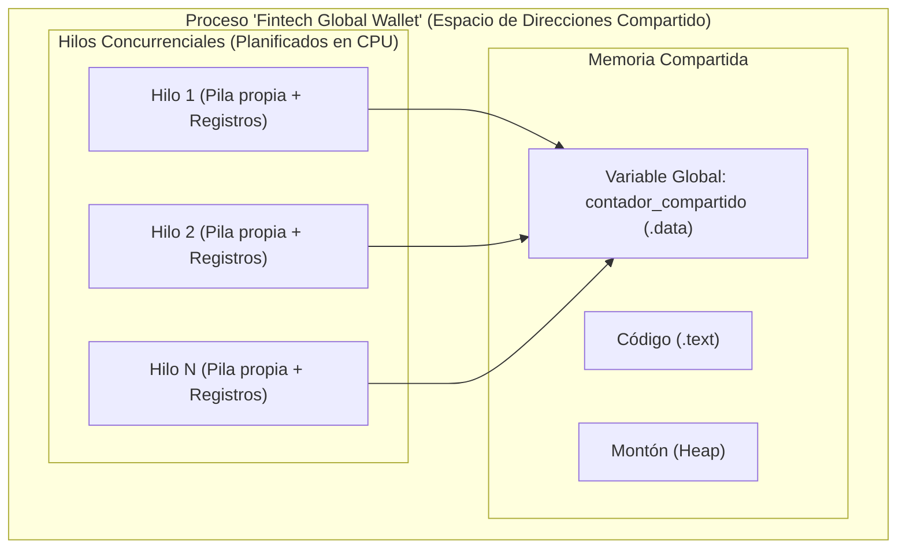
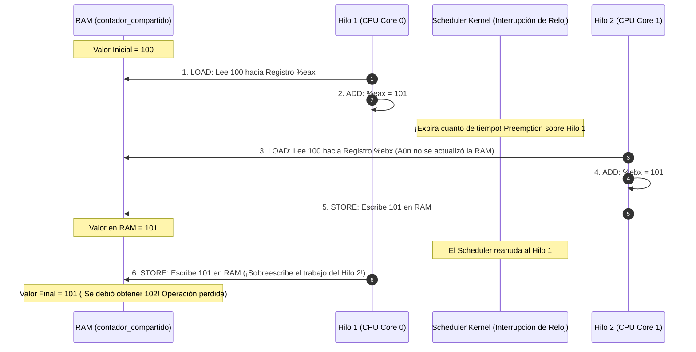

# SISTEMAS OPERATIVOS (UADE) - TRABAJO PRÁCTICO OBLIGATORIO
# UNIDAD 2: CONCURRENCIA, PROCESOS E HILOS — CONDICIÓN DE CARRERA, EXCLUSIÓN MUTUA Y ANÁLISIS DE OVERHEAD

---

## Ficha del Trabajo y Datos del Equipo

- **Institución:** Universidad Argentina de la Empresa (UADE)
- **Materia:** Sistemas Operativos
- **Cuatrimestre:** Segundo Cuatrimestre
- **Tema:** Unidad 2 - Concurrencia, Procesos e Hilos: Demostración de Condición de Carrera (*Race Condition*), Solución con Exclusión Mutua (*Mutex Locks*) en C (POSIX Pthreads) y Análisis Forense de Sobrecarga de Kernel (*Overhead*) en Red Hat Enterprise Linux.
- **Grupo N°:** [Completar con N° de Grupo]
- **Integrantes:**
  1. [Integrante 1 - Nombre y Apellido - Legajo]
  2. [Integrante 2 - Nombre y Apellido - Legajo]
  3. [Integrante 3 - Nombre y Apellido - Legajo]
  4. [Integrante 4 - Nombre y Apellido - Legajo]

---

## 1. Planteo del Problema Hipotético

### 1.1 Contexto Empresarial
En la plataforma de microfinanzas y billetera virtual **"Fintech Global Wallet"**, los servidores **Red Hat Enterprise Linux (RHEL)** procesan millones de transacciones simultáneas durante eventos de alta concurrencia (como el CyberMonday). El motor transaccional fue recientemente migrado a una arquitectura multi-hilo en C para maximizar el aprovechamiento de los servidores multiprocesador de 8 núcleos.

### 1.2 Incidente o Situación Crítica
Durante el primer día de operaciones masivas, el departamento de contabilidad y auditoría detectó **dos anomalías operativas de extrema gravedad**:

1. **Inconsistencia Crítica en Balances Contables (Falla en Memoria RAM):**
   Un fondo común de inversión compartido recibió un lote masivo de 8 hilos de depósitos automáticos concurrentes, donde cada hilo debía acreditar exactamente 250.000 operaciones unitarias de \$1. El balance final esperado en el libro mayor debía ser de exactamente **\$2.000.000**. Sin embargo, al finalizar el proceso, el saldo consolidado reflejó únicamente **\$569.399**, registrándose una pérdida virtual inexplicable de **más de 1.430.000 operaciones acreditadas**.
2. **Destrucción Silenciosa de Estados de Órdenes (Falla en Sistema de Archivos):**
   De forma paralela, dos microservicios que gestionaban el despacho de órdenes de pago competían por escribir el estado de la transacción en un archivo compartido de persistencia temporal (`recurso_compartido.txt`). El sistema registraba únicamente el estado de uno de los procesos, borrando y pisando por completo la orden enviada por el otro sin emitir alertas ni errores.

### 1.3 Comportamiento Inicial del Sistema
- Los programas no arrojaron errores de segmentación (*Segmentation Fault*), ni códigos de retorno fallidos en el sistema operativo.
- El compilador `gcc` no emitió advertencias sintácticas ni fallos de tipado.
- El sistema operativo reportó que todos los procesos e hilos concluyeron exitosamente con código `exit 0`, pero la información resultante en memoria y en disco quedó corrompida.

### 1.4 Objetivo del Ejercicio
1. Reproducir y evidenciar la **Condición de Carrera (Race Condition)** en memoria compartida implementando un programa multi-hilo en lenguaje C (`carrera.c`) y a nivel de procesos en Bash (`carrera_escritura.sh`).
2. Demostrar la causa raíz a nivel de procesador: la **no-atomicidad** de las operaciones de alto nivel y la intercalación de ciclos de instrucción (`LOAD`, `ADD`, `STORE`).
3. Implementar la solución arquitectónica mediante **Exclusión Mutua con Cerrojos Mutex (`pthread_mutex_t`)** en `seguro.c`.
4. Evaluar el impacto de la sincronización en el rendimiento del procesador y del sistema operativo (análisis de *Overhead* con la herramienta `time`, midiendo el incremento del tiempo en Modo Núcleo debido a la llamada al sistema `futex`).

---

## 2. Marco Teórico de la Unidad 2

El presente trabajo práctico se fundamenta directamente en los contenidos del temario oficial de la Unidad 2 (*Tanenbaum*, *Silberschatz*, *Stallings* y documentación técnica de *Red Hat*):

### 2.1 Procesos vs. Hilos (Threads)
- **Proceso:** Unidad de asignación de recursos y protección en el sistema operativo. Posee su propio espacio de direcciones virtuales, tabla de descriptores de archivos, registros y Bloque de Control de Proceso (PCB). La memoria entre procesos está estrictamente aislada por el hardware (MMU).
- **Hilo (Thread):** Unidad básica de utilización de la CPU. Un proceso puede contener múltiples hilos de ejecución que comparten:
  - El espacio de direcciones (código, variables globales y montón/*heap*).
  - Los recursos del sistema operativo (archivos abiertos, señales).
  - Pero cada hilo mantiene de forma privada su propio Contador de Programa (PC), registros de CPU y su propia Pila de ejecución (*stack*).



- **Implementación en Linux (Modelo 1:1 / NPTL):** En Red Hat Enterprise Linux se utiliza la biblioteca *Native POSIX Thread Library (NPTL)*. El kernel no distingue conceptualmente entre procesos e hilos; maneja estructuras `task_struct` creadas mediante la llamada al sistema `clone()`. Cada hilo en espacio de usuario es un *Lightweight Process (LWP)* reconocido y planificado independientemente por el scheduler del kernel en los diferentes núcleos de la CPU.

---

### 2.2 Condición de Carrera (Race Condition)
Según la definición clásica de **Tanenbaum**:
> *"Una condición de carrera es una situación en la que dos o más procesos o hilos leen o escriben datos compartidos, y el resultado final depende de quién se ejecuta exactamente en qué momento y del orden relativo en que ocurren los accesos."*

Si el planificador de la CPU alterna la ejecución de los hilos de manera inapropiada, el resultado deja de ser determinista y se producen corrupciones de datos silenciosas.

---

### 2.3 Sección Crítica (Critical Section) y Exclusión Mutua
Se denomina **Sección Crítica** a aquella región del código de un programa donde se accede y manipula un recurso compartido (una variable global en memoria, un archivo en disco, una tabla de base de datos).

Para evitar condiciones de carrera, el sistema operativo debe garantizar la **Exclusión Mutua**: si un hilo o proceso se encuentra ejecutando dentro de su sección crítica, ningún otro hilo o proceso puede entrar a ella.

#### Las Cuatro Condiciones Necesarias de Tanenbaum para una Buena Solución:
1. **Exclusión Mutua:** Dos procesos nunca deben encontrarse de forma simultánea dentro de sus secciones críticas.
2. **Independencia de la Velocidad:** No deben hacerse suposiciones sobre la velocidad relativa de los procesos ni sobre el número de procesadores.
3. **Ausencia de Bloqueo Externo:** Ningún proceso que esté ejecutando fuera de su sección crítica debe bloquear a otros procesos.
4. **Ausencia de Inanición (No Starvation):** Ningún proceso debe tener que esperar indefinidamente para poder entrar a su sección crítica.

---

### 2.4 La Causa Raíz a Nivel de Hardware: El Ciclo de Instrucción de la CPU
En lenguaje C, la instrucción de actualización parece indivisible:
```c
contador_compartido++;
```
Sin embargo, **en la arquitectura del procesador (x86_64), esta operación NO es atómica**. El ciclo de instrucción de la máquina exige descomponerla en tres instrucciones de ensamblador independientes:

1. **Fase de Lectura (`LOAD / MOV`):** La CPU lee el valor actual de la variable desde la memoria RAM y lo copia dentro de un registro interno del procesador (por ejemplo, `%eax`).
2. **Fase de Cómputo (`ADD`):** La Unidad Aritmético Lógica (ALU) incrementa en `1` el valor contenido en el registro `%eax`.
3. **Fase de Escritura (`STORE / MOV`):** La CPU toma el valor del registro `%eax` y lo escribe de regreso en la dirección física de la memoria RAM.

#### Escenario de Intercalación Temporal (Pérdida de Actualización - Lost Update):



Al existir 8 hilos ejecutándose concurrentemente en un bucle de 250.000 iteraciones, esta intercalación ocurre cientos de miles de veces, provocando que más de 1.400.000 sumas se pierdan en el aire.

---

### 2.5 Solución con Cerrojos Mutex (`pthread_mutex_t`)
Un **Mutex** (*Mutual Exclusion Lock*) es una primitiva de sincronización provista por la biblioteca estándar POSIX Threads (`pthread`):
- **`pthread_mutex_lock(&cerrojo)`:** Sección de entrada. Intenta adquirir el cerrojo. Si el cerrojo está libre, el hilo lo toma y entra a la sección crítica inmediatamente. Si está ocupado por otro hilo, el hilo solicitante se bloquea hasta que el dueño lo libere.
- **`pthread_mutex_unlock(&cerrojo)`:** Sección de salida. Libera el cerrojo y notifica al sistema operativo para que despierte a uno de los hilos que aguardaban en la cola de espera.

#### Mecanismo Interno en Linux: `futex` (Fast Userspace Mutex)
En Red Hat Enterprise Linux, los mutexes no realizan costosas llamadas al sistema cada vez que se ejecutan:
1. **Camino Rápido (Espacio de Usuario):** Si no hay contención (el cerrojo está libre), el hilo adquiere el mutex puramente en espacio de usuario mediante una instrucción atómica de hardware (`CMPXCHG`), sin llamar al kernel.
2. **Camino Lento (Intervención del Kernel):** Si el cerrojo ya está ocupado por otro hilo, la biblioteca realiza la llamada al sistema **`sys_futex`**. El kernel cambia el estado del hilo a **Bloqueado (TASK_UNINTERRUPTIBLE)**, lo inserta en una cola de espera y realiza un **cambio de contexto (Context Switch)** para ceder la CPU a otro proceso listo.

---

### 2.6 Métricas de Rendimiento: Comando `time` y Sobrecarga (*Overhead*)
El comando de Red Hat `/usr/bin/time` permite descomponer el tiempo de ejecución de un programa en tres dimensiones fundamentales:
- **`real` (Clock / Wall Time):** Tiempo total transcurrido en el reloj de pared desde que el programa inicia hasta que termina.
- **`user` (User CPU Time):** Tiempo total de procesador consumido ejecutando código en **Modo Usuario (Ring 3)** (bucles de cálculo, lógica de negocio).
- **`sys` (Kernel / System CPU Time):** Tiempo total de procesador consumido por el núcleo en **Modo Núcleo (Ring 0)** atendiendo llamadas al sistema (`futex`, `clone`), planificando procesos y gestionando cambios de contexto.

---

## 3. Implementación y Código Fuente

El laboratorio de la Unidad 2 consta de cuatro archivos organizados dentro del repositorio del proyecto.

### 3.1 Estructura del Directorio de la Unidad 2
```text
Unidad_2/
├── carrera.c                 # Programa en C con condición de carrera (sin sincronizar)
├── seguro.c                  # Programa en C protegido con Mutex (exclusión mutua)
├── carrera_escritura.sh      # Demostración de condición de carrera a nivel de procesos y archivos en Bash
├── demostracion_tpo.sh       # Script de automatización, compilación y benchmarking con time
└── DOCUMENTACION_UNIDAD_2.md # Documento técnico oficial del ejercicio
```

---

### 3.2 Código 1: `carrera.c` (Condición de Carrera en Memoria)
Este programa crea 8 hilos que incrementan una variable global compartida sin mecanismos de protección.

```c
#include <stdio.h>
#include <stdlib.h>
#include <pthread.h>

#define NUM_HILOS 8
#define ITERACIONES 250000

long contador_compartido = 0;

void* depositar(void* arg) {
    for (int i = 0; i < ITERACIONES; i++) {
        // Sección crítica desprotegida (genera race condition)
        contador_compartido++;
    }
    return NULL;
}

int main() {
    pthread_t hilos[NUM_HILOS];

    for (int i = 0; i < NUM_HILOS; i++) {
        pthread_create(&hilos[i], NULL, depositar, NULL);
    }

    for (int i = 0; i < NUM_HILOS; i++) {
        pthread_join(hilos[i], NULL);
    }

    printf("[RACE CONDITION] Total esperado: %ld | Total obtenido: %ld\n",
           (long)NUM_HILOS * ITERACIONES, contador_compartido);

    return 0;
}
```

#### Análisis Técnico del Código:
- Línea 5-6: Se definen las constantes de escala: 8 hilos ejecutando 250.000 iteraciones cada uno ($8 \times 250.000 = 2.000.000$ operaciones).
- Línea 8: `contador_compartido`: Variable global alojada en el segmento `.data` del proceso, compartida por todos los hilos en su espacio de memoria.
- Líneas 10-16 (`depositar`): Función ejecutada concurrentemente por los 8 hilos. La línea 13 `contador_compartido++` representa la **Sección Crítica desprotegida**. Como no hay ningún mecanismo de arbitraje, múltiples hilos intentan ejecutar `LOAD-ADD-STORE` sobre la misma dirección de memoria simultáneamente.
- Líneas 21-23: `pthread_create()` invoca la creación de hilos a través de la llamada al sistema `clone()`.
- Líneas 25-27: `pthread_join()` bloquea al hilo principal (`main`) hasta que cada uno de los hilos finalice, garantizando que el cálculo haya terminado antes de imprimir el resultado.

---

### 3.3 Código 2: `seguro.c` (Exclusión Mutua con Cerrojo Mutex)
Este programa resuelve la condición de carrera implementando un cerrojo mutex de la biblioteca POSIX.

```c
#include <stdio.h>
#include <stdlib.h>
#include <pthread.h>

#define NUM_HILOS 8
#define ITERACIONES 250000

long contador_compartido = 0;
pthread_mutex_t cerrojo;

void* depositar_seguro(void* arg) {
    for (int i = 0; i < ITERACIONES; i++) {
        // Sección de entrada
        pthread_mutex_lock(&cerrojo);
        
        // Sección crítica protegida
        contador_compartido++;
        
        // Sección de salida
        pthread_mutex_unlock(&cerrojo);
    }
    return NULL;
}

int main() {
    pthread_t hilos[NUM_HILOS];
    pthread_mutex_init(&cerrojo, NULL);

    for (int i = 0; i < NUM_HILOS; i++) {
        pthread_create(&hilos[i], NULL, depositar_seguro, NULL);
    }

    for (int i = 0; i < NUM_HILOS; i++) {
        pthread_join(hilos[i], NULL);
    }

    pthread_mutex_destroy(&cerrojo);

    printf("[MUTEX LOCK]     Total esperado: %ld | Total obtenido: %ld\n",
           (long)NUM_HILOS * ITERACIONES, contador_compartido);

    return 0;
}
```

#### Análisis Técnico del Código:
- Línea 9: `pthread_mutex_t cerrojo;`: Declara la estructura del cerrojo en memoria compartida.
- Línea 14: `pthread_mutex_lock(&cerrojo);`: **Sección de Entrada**. Garantiza que únicamente un solo hilo a la vez pueda ingresar al bloque siguiente. Si otro hilo intenta acceder mientras está bloqueado, se suspende.
- Línea 17: `contador_compartido++;`: **Sección Crítica Protegida**. Ningún otro hilo podrá intercalar lecturas o escrituras mientras este hilo procesa su incremento.
- Línea 20: `pthread_mutex_unlock(&cerrojo);`: **Sección de Salida**. Libera el cerrojo y señala al kernel que despierte al siguiente hilo en espera.
- Línea 27 y 37: `pthread_mutex_init()` y `pthread_mutex_destroy()` administran el ciclo de vida del cerrojo liberando las estructuras asociadas.

---

### 3.4 Código 3: `carrera_escritura.sh` (Condición de Carrera en Procesos y Archivos)
Demuestra cómo se produce una condición de carrera entre dos procesos independientes del shell compitiendo por un recurso físico en disco.

```bash
#!/bin/bash

ARCHIVO_COMPARTIDO="recurso_compartido.txt"

# Limpiar o inicializar el recurso
echo "VALOR_INICIAL" > "$ARCHIVO_COMPARTIDO"

echo "=== DEMOSTRACION: EL ULTIMO QUE ESCRIBE DETERMINA EL VALOR ==="
echo "Estado inicial del recurso: $(cat $ARCHIVO_COMPARTIDO)"
echo "---------------------------------------------------------"

# Proceso 1: Simula un proceso que procesa y escribe "DATO_PROCESO_1"
funcion_proceso1() {
    # Simula latencia o ráfaga de CPU variable
    sleep 0.05
    echo "PROCESO_1" > "$ARCHIVO_COMPARTIDO"
    echo "[PID $$] Proceso 1 escribio: PROCESO_1"
}

# Proceso 2: Simula un proceso competidor que escribe "DATO_PROCESO_2"
funcion_proceso2() {
    # Simula latencia o ráfaga de CPU variable
    sleep 0.08
    echo "PROCESO_2" > "$ARCHIVO_COMPARTIDO"
    echo "[PID $$] Proceso 2 escribio: PROCESO_2"
}

# Lanzamiento concurrente en segundo plano (&)
funcion_proceso1 &
PID1=$!

funcion_proceso2 &
PID2=$!

# Esperar a que ambos procesos terminen (sincronización a nivel de script)
wait $PID1 $PID2

echo "---------------------------------------------------------"
echo "Valor final retenido en el recurso: $(cat $ARCHIVO_COMPARTIDO)"
echo "Conclusion: El proceso que escribio ultimo sobreescribio la salida del anterior."
```

#### Análisis Técnico de Bash y Comportamiento de Linux:
- **Operador de Segundo Plano (`&`):** Al ejecutar `funcion_proceso1 &`, el shell invoca la llamada al sistema `clone()` / `fork()`, creando un subproceso hijo desacoplado. El shell padre no espera a que termine y continúa inmediatamente ejecutando las siguientes líneas. Ambos procesos compiten en paralelo por los núcleos de la CPU.
- **Variable Interna `$!`:** Almacena automáticamente el *Process ID (PID)* del último subproceso lanzado en segundo plano.
- **Comando `wait $PID1 $PID2`:** Bloquea al proceso padre en el kernel (análogo a la syscall `waitpid()`) hasta que ambos procesos hijos hayan finalizado, evitando condiciones de carrera de lectura prematura en la línea siguiente.
- **La Redirección Truncada (`>`):** `echo "..." > "$ARCHIVO_COMPARTIDO"` invoca `openat()` con las banderas `O_WRONLY | O_CREAT | O_TRUNC`. Esto vacía el archivo por completo desde el byte cero antes de escribir. Al no existir un cerrojo de archivos (*file lock* tipo `flock` o `fcntl`), el acceso al archivo carece de exclusión mutua.
- **El Resultado de Cátedra ("El último que escribe impone el valor"):**
  El Proceso 1 termina a los 0.05 segundos y escribe `PROCESO_1`. El Proceso 2 (más lento por una ráfaga o latencia mayor de 0.08 segundos) llega segundo, abre el archivo, lo trunca y escribe `PROCESO_2`. **El resultado del primer proceso fue destruido por completo.**

---

### 3.5 Código 4: `demostracion_tpo.sh` (Automatización y Benchmarking)
Orquesta la compilación en C, verifica el estado de salida de `gcc` y mide los tiempos de procesador.

```bash
#!/bin/bash

echo "=== DEMOSTRACION CONDICION DE CARRERA - UNIDAD 2 ==="
echo "Compilando programas en C..."

gcc carrera.c -o carrera -lpthread
gcc seguro.c -o seguro -lpthread

if [ $? -ne 0 ]; then
    echo "Error en la compilacion."
    exit 1
fi

echo -e "\n1. Ejecutando programa con condicion de carrera (sin sincronizacion):"
./carrera

echo -e "\n2. Ejecutando programa seguro con pthread_mutex (con exclusion mutua):"
./seguro

echo -e "\n3. Medición de tiempos de ejecucion (impacto del bloqueo/overhead):"
echo "--- Tiempo Sin Mutex ---"
time ./carrera
echo -e "\n--- Tiempo Con Mutex ---"
time ./seguro
```

---

## 4. Guía Práctica de Ejecución en Consola Red Hat

Para compilar, ejecutar y verificar el comportamiento del ejercicio en un entorno **Red Hat Enterprise Linux (RHEL)**, siga estos pasos:

### 4.1 Navegación al Directorio y Otorgamiento de Permisos
```bash
# Ingresar al directorio de la Unidad 2
cd sistemas-operativos/Unidad_2

# Otorgar permisos de ejecución a los scripts de Shell
chmod +x demostracion_tpo.sh carrera_escritura.sh

# Verificar la presencia de los archivos y herramientas de desarrollo (gcc, make)
ls -la
```

---

### 4.2 Compilación Manual (Opcional)
Si se desea compilar manualmente los programas en C utilizando el compilador GNU GCC de Red Hat:

```bash
gcc carrera.c -o carrera -lpthread
gcc seguro.c -o seguro -lpthread
```
> **Nota de Enlazado:** La bandera `-lpthread` es obligatoria en Linux para enlazar contra la biblioteca de hilos POSIX (`libpthread.so` integrada en `libc`).

---

### 4.3 Ejecución del Pipeline Automatizado (`./demostracion_tpo.sh`)
```bash
./demostracion_tpo.sh
```

#### Salida Textual Observada en Terminal:
```text
=== DEMOSTRACION CONDICION DE CARRERA - UNIDAD 2 ===
Compilando programas en C...

1. Ejecutando programa con condicion de carrera (sin sincronizacion):
[RACE CONDITION] Total esperado: 2000000 | Total obtenido: 569399

2. Ejecutando programa seguro con pthread_mutex (con exclusion mutua):
[MUTEX LOCK]     Total esperado: 2000000 | Total obtenido: 2000000

3. Medición de tiempos de ejecucion (impacto del bloqueo/overhead):
--- Tiempo Sin Mutex ---
[RACE CONDITION] Total esperado: 2000000 | Total obtenido: 582104

real    0m0.008s
user    0m0.021s
sys     0m0.002s

--- Tiempo Con Mutex ---
[MUTEX LOCK]     Total esperado: 2000000 | Total obtenido: 2000000

real    0m0.166s
user    0m0.174s
sys     0m0.392s
```

---

### 4.4 Ejecución de la Carrera de Procesos en Bash (`./carrera_escritura.sh`)
```bash
./carrera_escritura.sh
```

#### Salida Textual Observada en Terminal:
```text
=== DEMOSTRACION: EL ULTIMO QUE ESCRIBE DETERMINA EL VALOR ===
Estado inicial del recurso: VALOR_INICIAL
---------------------------------------------------------
[PID 41205] Proceso 1 escribio: PROCESO_1
[PID 41206] Proceso 2 escribio: PROCESO_2
---------------------------------------------------------
Valor final retenido en el recurso: PROCESO_2
Conclusion: El proceso que escribio ultimo sobreescribio la salida del anterior.
```

---

### 4.5 Espacio Asignado para Capturas de Pantalla

> **[INSERTAR CAPTURA DE PANTALLA 1: Navegación, permisos con `chmod +x` y compilación con `gcc -lpthread` en Red Hat Enterprise Linux]**

---

> **[INSERTAR CAPTURA DE PANTALLA 2: Ejecución de `./demostracion_tpo.sh` mostrando la diferencia numérica (569.399 vs 2.000.000) y la tabla de tiempos `real`, `user` y `sys`]**

---

> **[INSERTAR CAPTURA DE PANTALLA 3: Ejecución de `./carrera_escritura.sh` mostrando los PIDs concurrentes y la sobreescritura del archivo compartido]**

---

## 5. Análisis Forense y Diagnóstico de Resultados

### 5.1 Análisis Numérico de la Pérdida de Datos en Memoria
En la ejecución sin control (`./carrera`):
- **Total Esperado:** $8 \times 250.000 = 2.000.000$ operaciones.
- **Total Obtenido:** $569.399$ operaciones.
- **Pérdida Neta:** $1.430.601$ operaciones perdidas (**más del 71% de los depósitos bancarios desaparecieron**).

Esta discrepancia demuestra que mientras un núcleo ejecutaba la fase de cómputo en la ALU, otro núcleo leyó un valor desactualizado de la RAM, sobreescribiendo el resultado final e invalidando las operaciones intermedias.

---

### 5.2 Análisis Forense de Tiempos y Sobrecarga (*Overhead*)

Al comparar las métricas provistas por `time`:

| Métrica | Programa Sin Mutex (`carrera`) | Programa Con Mutex (`seguro`) | Variación / Diagnóstico del SO |
| :--- | :--- | :--- | :--- |
| **`real` (Reloj)** | `0m0.008s` | `0m0.166s` | **Incremento de ~20x.** El programa tarda 20 veces más porque los 8 hilos ahora deben serializarse obligatoriamente en la sección crítica en lugar de correr libremente en paralelo. |
| **`user` (Modo Usuario)** | `0m0.021s` | `0m0.174s` | **Incremento de ~8x.** El código en espacio de usuario realiza el chequeo y adquisición de la estructura del cerrojo (`pthread_mutex_lock`). |
| **`sys` (Modo Núcleo)** | `0m0.002s` | `0m0.392s` | **Incremento dramático de ~196x.** El procesador pasó de casi no tocar el kernel a consumir casi 0.4 segundos completos en Modo Núcleo. |

#### ¿Por qué se dispara el tiempo `sys` con el Mutex?
Este es un concepto central evaluado en la materia:
1. Cuando un hilo intenta ejecutar `pthread_mutex_lock` y encuentra el cerrojo ocupado, no realiza espera activa (*busy waiting*) indefinida consumiendo CPU.
2. La biblioteca NPTL invoca la llamada al sistema **`futex`** (*Fast Userspace Mutex*).
3. La syscall transfiere el control al **Kernel en Modo Núcleo (Ring 0)**. El kernel suspende el hilo, guarda sus registros en su *Thread Control Block (TCB)*, cambia su estado a *Bloqueado* y lo encola en la lista de espera del recurso.
4. Luego, el planificador del kernel ejecuta un **Cambio de Contexto (Context Switch)** para cargar otro proceso en la CPU.
5. Cuando el hilo dueño sale de la sección crítica, invoca `unlock`, lo que dispara otra syscall `futex` para que el kernel despierte al hilo dormido y lo vuelva a poner en la cola de *Listos*.
Todo este tráfico de llamadas al sistema, cambios de modo de procesador y cambios de contexto constituye el **Overhead de Kernel (Sobrecarga de Sincronización)**.

---

### 5.3 Diagnóstico Forense de la Carrera de Archivos en Bash
En `carrera_escritura.sh`:
- Ambos procesos ejecutaron en paralelo gracias al operador `&`.
- El Proceso 1 completó su tarea a los `0.05` segundos y escribió `PROCESO_1`.
- El Proceso 2 completó su tarea a los `0.08` segundos y escribió `PROCESO_2`.
- Dado que el operador `>` trunca el archivo a nivel de inodo en el sistema de archivos (`O_TRUNC`), el Proceso 2 destruyó irrevocablemente los datos generados por el Proceso 1.
- **Conclusión de Cátedra:** En una condición de carrera sin mecanismos de exclusión mutua, **el proceso que escribe último (el más lento en completar su ciclo) es quien determina el estado final del sistema**.

---

## 6. Banco Oficial de Preguntas Teóricas para la Defensa Oral Individual (Cuestionario Unidad II)

Conforme a las **consignas 5, 6 y 16 del TPO**, cualquier miembro del equipo puede ser seleccionado individualmente por el docente para defender el trabajo y responder preguntas teóricas de la unidad. 

A continuación se desarrolla el banco de preguntas extraído directamente del documento oficial de la cátedra **`Consignas y cuestionario (Unidad 2).pdf`**, agrupadas por ejes temáticos y con sus respectivas **respuestas modelo fundamentadas** según la bibliografía de la materia (*Tanenbaum, Silberschatz, Stallings, Red Hat*) y la práctica realizada en este laboratorio:

---

### Módulo I: Concepto de Procesos, Ciclo de Instrucción y Estructuras de Control

#### Pregunta 1: Defina proceso. ¿Qué diferencias existen entre un proceso y un programa?
**Respuesta Modelo:**
- **Definición de Proceso:** Un proceso es un programa en ejecución. Es una entidad activa que representa la unidad de asignación de recursos y de protección en el sistema operativo. Incluye no solo el código ejecutable, sino también el valor actual del Contador de Programa (PC), los registros del procesador, la pila (*stack*), el montón (*heap*), el segmento de datos y las estructuras de control asignadas por el kernel (BCP).
- **Diferencia con un Programa:** Un programa es una entidad pasiva: un conjunto estático de instrucciones almacenado en un archivo en disco (como un archivo binario ELF en Red Hat o un script `.sh`). El proceso es una entidad dinámica que cobra vida cuando el sistema operativo carga esas instrucciones en memoria, le asigna recursos y la CPU comienza a ejecutar su ciclo de instrucción. Un mismo programa puede dar origen a múltiples procesos independientes ejecutando en paralelo.

---

#### Pregunta 2: ¿Qué es el paralelismo real y el pseudoparalelismo?
**Respuesta Modelo:**
- **Pseudoparalelismo:** Es la ilusión de ejecución simultánea lograda mediante la técnica de tiempo compartido (*time-sharing*) o multiprogramación sobre **un único núcleo de procesamiento**. La CPU conmuta con altísima rapidez entre diferentes procesos (mediante interrupciones de reloj y cambios de contexto), haciendo creer al usuario que los procesos corren al mismo tiempo cuando en realidad se intercalan secuencialmente.
- **Paralelismo Real:** Es la ejecución físicamente simultánea de dos o más instrucciones en el **mismo instante de tiempo**, posible únicamente en arquitecturas que cuentan con **múltiples procesadores o procesadores multinúcleo (multicore)**. En nuestro laboratorio, los 8 hilos del programa `carrera.c` y `seguro.c` fueron despachados en núcleos físicos distintos de la máquina, alcanzando paralelismo real.

---

#### Pregunta 3: ¿Cuáles son los elementos que generalmente incluye un proceso?
**Respuesta Modelo:**
Un proceso incluye:
1. **Espacio de Direcciones de Memoria:**
   - **Segmento de Texto (`.text`):** Código de máquina de las instrucciones del programa.
   - **Segmento de Datos (`.data` y `.bss`):** Variables globales e inicializadas/no inicializadas.
   - **Montón (*Heap*):** Memoria dinámica reservada en tiempo de ejecución (mediante `malloc()` o `new`).
   - **Pila (*Stack*):** Almacena variables locales, parámetros pasados a funciones y direcciones de retorno.
2. **Contexto del Procesador:** Registros de la CPU, puntero de pila (SP), registros de estado/banderas y el Contador de Programa (PC).
3. **Estructuras del Sistema Operativo:** El Bloque de Control de Proceso (BCP/PCB), tabla de descriptores de archivos abiertos, credenciales de seguridad (UID, GID), límites de recursos (*rlimits*) y manejadores de señales.

---

#### Pregunta 4: ¿Por qué el ciclo de instrucción de la CPU es ajeno al concepto de proceso?
**Respuesta Modelo:**
Porque a nivel de hardware puro (*bare-metal*), el procesador físico carece de la noción semántica de "proceso". La CPU está diseñada exclusivamente para ejecutar de forma ciega e ininterrumpida un ciclo infinito de dos fases básicas:
1. **Búsqueda (*Fetch*):** Lee la instrucción ubicada en la posición de memoria apuntada por el Contador de Programa (PC).
2. **Ejecución (*Execute*):** Decodifica los bits, efectúa la operación en la ALU o registros, e incrementa el PC.

La CPU no distingue a qué proceso, usuario o tarea pertenecen esas instrucciones. El concepto de **proceso es una abstracción de software** creada, administrada y controlada por el Sistema Operativo. Es el kernel quien interrumpe el ciclo de la CPU (mediante interrupciones de reloj) para salvar el contexto de un proceso y cargar el de otro, engañando a la CPU para que ejecute múltiples programas sin que el hardware necesite saber qué es un proceso.

---

#### Pregunta 5: ¿Por qué estados puede pasar un proceso? Ejemplifique y describa un modelo de 5 estados.
**Respuesta Modelo:**
En el modelo clásico de 5 estados (Stallings / Silberschatz), un proceso transita por:
1. **Nuevo (*New*):** El proceso está siendo creado; el SO reserva sus estructuras de control (BCP), pero aún no ha sido admitido en la memoria principal.
2. **Listo (*Ready*):** El proceso reside en memoria RAM y dispone de todos los recursos necesarios; únicamente espera que el planificador de la CPU le conceda tiempo de procesador.
3. **En Ejecución (*Running*):** El proceso tiene el control de la CPU y sus instrucciones están siendo ejecutadas por el procesador.
4. **Bloqueado / En Espera (*Waiting/Blocked*):** El proceso no puede continuar su ejecución aunque la CPU esté libre, ya que aguarda la ocurrencia de un evento externo (una operación de E/S de disco, una señal, o la liberación de un cerrojo como en `pthread_mutex_lock`).
5. **Terminado (*Terminated/Exit*):** El proceso finalizó su ejecución (por `exit()` o error); el kernel retiene transitoriamente su BCP para informar el código de retorno al padre antes de liberar todos sus recursos.

*Ejemplo de transición en nuestro ejercicio:* En `carrera_escritura.sh`, cuando el script principal ejecuta `wait $PID1 $PID2`, pasa inmediatamente de **En Ejecución** a **Bloqueado** en el kernel hasta que los procesos hijos finalizan, momento en el cual el kernel lo mueve a **Listo** para volver a **En Ejecución**.

---

#### Pregunta 6: Describa la creación de un proceso y mencione al menos una llamada al sistema involucrada.
**Respuesta Modelo:**
La creación de un proceso involucra una secuencia ordenada de pasos realizada por el sistema operativo:
1. Asigna un identificador único de proceso (**PID**).
2. Reserva y configura el Bloque de Control de Proceso (**BCP**).
3. Asigna el espacio de direcciones de memoria virtual inicial.
4. Inicializa los descriptores de archivos estándar (`0: stdin`, `1: stdout`, `2: stderr`).
5. Inserta el proceso en la cola de procesos en estado **Listo**.

*Llamadas al sistema involucradas en Linux/Red Hat:*
- **`fork()`:** Clona el proceso padre creando un proceso hijo idéntico con copia de memoria (*Copy-On-Write*).
- **`clone()`:** Syscall moderna subyacente en Linux que permite crear procesos o hilos controlando qué recursos se comparten (`CLONE_VM`, `CLONE_FILES`).
- **`execve()`:** Sustituye la imagen de memoria del proceso por un nuevo archivo ejecutable cargado desde el disco. En Bash, al ejecutar `funcion_proceso1 &`, el intérprete invoca `fork()`/`clone()`.

---

#### Pregunta 7: ¿Qué es el planificador de procesos?
**Respuesta Modelo:**
Es el componente algorítmico del Sistema Operativo encargado de decidir **qué proceso de la cola de Listos debe ser ejecutado por la CPU y durante cuánto tiempo**, administrando el recurso procesador conforme a objetivos de diseño (equidad, maximizar rendimiento/*throughput*, minimizar tiempo de retorno o garantizar tiempos de respuesta interactivos).

---

#### Pregunta 8: ¿Qué es el despachador (*dispatcher*)?
**Respuesta Modelo:**
Es el módulo del sistema operativo que ejecuta materialmente la decisión tomada por el planificador. Otorga el control efectivo de la CPU al proceso seleccionado. Sus responsabilidades son:
1. Realizar el **Cambio de Contexto (*Context Switch*)** (salvar registros del proceso saliente y restaurar los del entrante).
2. Conmutar el modo de procesador de **Modo Núcleo (Ring 0)** a **Modo Usuario (Ring 3)**.
3. Saltar a la dirección de memoria adecuada indicada por el Contador de Programa (PC) del proceso seleccionado para reanudar su ejecución.

---

#### Pregunta 9: ¿Qué relación existe entre el planificador y el despachador de procesos?
**Respuesta Modelo:**
Representan la clásica división entre **política y mecanismo**:
- El **Planificador** es la **política**: evalúa las prioridades y decide *a quién* y *cuándo* le toca usar la CPU.
- El **Despachador** es el **mecanismo**: es el ejecutor de bajo nivel que realiza las operaciones físicas (*cómo*) para quitarle la CPU a un proceso y entregársela al elegido.

---

#### Pregunta 10: ¿Qué tipo de tablas mantiene el sistema operativo dentro de sus estructuras de control para la gestión de procesos y recursos? Describa brevemente cada tipo de tabla.
**Respuesta Modelo:**
El sistema operativo mantiene cuatro categorías de tablas de control (según Stallings):
1. **Tablas de Memoria:** Gestionan la memoria principal (RAM) y secundaria (swap). Registran qué partes de la memoria están libres u ocupadas, y almacenan las tablas de páginas de la memoria virtual.
2. **Tablas de E/S:** Registran el estado de todos los dispositivos de E/S (disponible, asignado), operaciones pendientes de transferencia y las ubicaciones de los búferes de datos.
3. **Tablas de Archivos:** Administran la existencia, ubicación en disco, estado de apertura, descriptores de archivos, permisos y modos de acceso de los archivos en el VFS.
4. **Tablas de Procesos:** Colección central que almacena y enlaza los Bloques de Control de Proceso (BCP) de todos los procesos activos del sistema, organizados en colas de estado (Listos, Bloqueados).

---

#### Pregunta 11: ¿Qué es el bloque de control de proceso (BCP)?
**Respuesta Modelo:**
Es la estructura de datos más importante que el sistema operativo mantiene para cada proceso (en Linux implementada mediante `struct task_struct`). Funciona como el "legajo" o registro de identidad integral del proceso.
Contiene:
- Identificador de proceso (PID) y del proceso padre (PPID).
- Estado del proceso (Listo, En Ejecución, Bloqueado, etc.).
- Contexto de registros de CPU, puntero de pila y Contador de Programa (salvaguardados durante un cambio de contexto).
- Información de planificación de CPU (prioridad, políticas, cuanto de tiempo restante).
- Información de administración de memoria (punteros a tablas de páginas).
- Descriptores de archivos abiertos y recursos de E/S asignados.
Permite que el sistema operativo conmute entre procesos y reanude la ejecución de cualquiera de ellos exactamente en el mismo estado en que se encontraba cuando fue desalojado.

---

### Módulo II: Hilos (Threads), Arquitecturas ULT / KLT y Modelo Multihilo

#### Pregunta 12: Defina hilo. ¿Qué diferencia existe entre un hilo y un proceso?
**Respuesta Modelo:**
- **Definición de Hilo:** Es la unidad básica de ejecución y despacho planificable en la CPU. Representa un flujo secuencial e independiente de control dentro de un proceso.
- **Diferencia Fundamental:**
  - El **proceso** es la unidad de asignación de recursos y protección: posee su propio espacio de memoria virtual aislado. Dos procesos no comparten memoria por defecto.
  - El **hilo** comparte el espacio de direcciones (código, variables globales, memoria dinámica *heap*) y los recursos del proceso padre con los demás hilos hermanos, poseyendo de manera privada únicamente su propia Pila (*stack*), Contador de Programa (PC) y registros de CPU.

---

#### Pregunta 13: ¿Qué ventajas y desventajas proporciona el modelo multihilo?
**Respuesta Modelo:**
- **Ventajas:**
  1. *Mayor Capacidad de Respuesta (Asincronía):* Una aplicación puede realizar cómputo intensivo o E/S en un hilo sin congelar la interfaz de usuario en otro.
  2. *Economía y Eficiencia:* Crear o conmutar hilos es órdenes de magnitud más rápido y consume menos memoria que crear procesos.
  3. *Compartición Directa de Datos:* Los hilos se comunican a través de variables globales en RAM sin requerir mecanismos pesados de IPC.
  4. *Aprovechamiento de Sistemas Multiprocesador:* Permite ejecutar múltiples hilos en paralelo real en diferentes núcleos de CPU.
- **Desventajas:**
  1. *Falta de Aislamiento de Memoria:* Si un hilo comete un error fatal (como desreferenciar un puntero nulo o provocar un *Segmentation Fault*), cae todo el proceso completo.
  2. *Complejidad de Concurrencia:* Exige sincronización rigurosa (Mutex, Semáforos) para evitar condiciones de carrera, bloqueos mutuos (*Deadlocks*) y corrupción de datos.

---

#### Pregunta 14: ¿Es correcto afirmar que cada hilo tiene su propio espacio de direcciones asignado? Justifique la respuesta.
**Respuesta Modelo:**
**Es FALSO.**
Los hilos pertenecientes a un mismo proceso **comparten un único y mismo espacio de direcciones virtuales**. Todos los hilos pueden leer y modificar las mismas variables globales (alojadas en `.data`) y acceder al mismo montón (*heap*). Esto se evidenció en nuestro programa `carrera.c`, donde los 8 hilos leían y escribían simultáneamente sobre la misma variable global `contador_compartido`. Lo que cada hilo tiene de manera exclusiva es su propia pila (*stack*) y sus propios registros de CPU.

---

#### Pregunta 15: ¿Es correcto afirmar que cada hilo tiene su propia pila? Justifique la respuesta.
**Respuesta Modelo:**
**Es VERDADERO.**
Cada hilo debe poseer obligatoriamente su propia pila de ejecución (*stack private*). Esto es indispensable porque cada hilo ejecuta de forma independiente llamadas a funciones, gestiona sus propias variables locales y mantiene sus propios marcos de pila (*stack frames*). Si compartieran la misma pila, las invocaciones a funciones de un hilo sobrescribirían las direcciones de retorno y las variables locales de los demás hilos, destruyendo la coherencia del flujo de control.

---

#### Pregunta 16: ¿Es un hilo capaz de crear nuevos hilos? Justifique la respuesta.
**Respuesta Modelo:**
**Es VERDADERO.**
Cualquier hilo dentro de un proceso que posea acceso a la biblioteca de hilos puede crear nuevos hilos invocando la función correspondiente (por ejemplo, `pthread_create()` en C). En el modelo de hilos no existe una jerarquía estricta obligatoria de "padre-hijo" como en los procesos; todos los hilos del proceso son pares a nivel de espacio de direcciones.

---

#### Pregunta 17: ¿Qué similitudes y diferencias encuentra en la creación de hilos y la creación de procesos?
**Respuesta Modelo:**
- **Similitudes:** En ambos casos el sistema asigna un identificador, reserva estructuras de control (TCB para el hilo, PCB para el proceso), asigna una pila privada, inicializa registros de procesador y coloca la entidad en la cola de Listos.
- **Diferencias:** Crear un proceso requiere duplicar o construir una nueva tabla de páginas de memoria virtual, copiar o reservar segmentos completos de memoria y duplicar descriptores de archivos, lo cual consume tiempo y memoria significativos. Crear un hilo solo requiere reservar un bloque de memoria para su pila dentro del espacio existente del proceso y asignar una estructura ligera de control (TCB), siendo una operación sumamente liviana.

---

#### Pregunta 18: ¿Es correcto afirmar que un paquete de hilos de nivel usuario puede ser implementado en un sistema operativo que no acepta hilos? Justifique su respuesta.
**Respuesta Modelo:**
**Es VERDADERO.**
En una implementación de hilos a nivel de usuario (**ULT - User-Level Threads**), todo el soporte de hilos reside en una biblioteca vinculada a la aplicación en espacio de usuario. Para el sistema operativo subyacente, el proceso es visto como un proceso monohilo tradicional. La biblioteca se encarga de alternar entre hilos mediante rutinas de software sin que el kernel necesite tener soporte nativo para hilos.

---

#### Pregunta 19: ¿Es correcto afirmar que en una implementación de hilos a nivel usuario la aplicación gestiona todo el trabajo de los hilos y el núcleo no es consciente de la existencia de los mismos? Justifique su respuesta.
**Respuesta Modelo:**
**Es VERDADERO.**
En el modelo ULT puro, el kernel solo conoce al proceso y a su único BCP. La creación de hilos, el cambio de contexto entre ellos, la salvaguarda de registros y la planificación son ejecutados íntegramente por el sistema en tiempo de ejecución (*runtime*) de la biblioteca de hilos en espacio de usuario (Ring 3), manteniéndose completamente invisibles para el núcleo.

---

#### Pregunta 20: En la implementación de hilos a nivel de usuario (ULT), ¿cuál es la función del sistema en tiempo de ejecución o planificador en espacio de usuario?
**Respuesta Modelo:**
Su función es actuar como un "mini sistema operativo" dentro del propio proceso:
1. Administrar la tabla de hilos local del proceso.
2. Salvar el contexto (registros de CPU y puntero de pila) del hilo que cede el control y cargar el contexto del hilo seleccionado.
3. Decidir la política de alternancia entre los hilos del proceso dentro del cuanto de tiempo global que el kernel le otorgó a dicho proceso.

---

#### Pregunta 21: ¿Dónde se encuentra la tabla de hilos en una implementación a nivel usuario?
**Respuesta Modelo:**
Se encuentra en el **espacio de direcciones de memoria del propio proceso (en espacio de usuario / Ring 3)**, gestionada directamente por las estructuras internas de la biblioteca de hilos, sin ocupar memoria en el espacio de direcciones del kernel.

---

#### Pregunta 22: ¿Cuáles son las principales ventajas y desventajas que presenta la implementación de hilos a nivel usuario?
**Respuesta Modelo:**
- **Ventajas:**
  1. *Conmutación Ultrarrápida:* El cambio de contexto entre hilos no requiere llamadas al sistema ni conmutar de Modo Usuario a Modo Núcleo, siendo extremadamente veloz.
  2. *Planificación Personalizada:* La aplicación puede implementar su propio algoritmo de planificación adaptado a su necesidad sin requerir privilegios de superusuario.
  3. *Portabilidad:* Puede ejecutarse en cualquier sistema operativo, incluso en aquellos que no soportan hilos de forma nativa.
- **Desventajas:**
  1. *Bloqueo de Todo el Proceso:* Si un hilo realiza una llamada al sistema bloqueante (por ejemplo, lectura de disco o red), el kernel suspende a **todo el proceso**, bloqueando a todos los demás hilos aunque estuvieran listos para procesar.
  2. *Incapacidad de Paralelismo Real:* Como el kernel solo ve un proceso monohilo, solo le asigna un único núcleo de CPU a la vez; los hilos no pueden ejecutarse físicamente en paralelo en sistemas multinúcleo.

---

#### Pregunta 23: ¿Es correcto decir que en una implementación de hilos a nivel kernel no se necesita un sistema en tiempo de ejecución que gestione los hilos? Justifique la respuesta.
**Respuesta Modelo:**
**Es VERDADERO.**
En una implementación a nivel de núcleo (**KLT - Kernel-Level Threads**), el kernel del sistema operativo asume directamente toda la responsabilidad de crear, destruir, sincronizar y planificar los hilos. No se requiere un planificador intermedio en espacio de usuario; las primitivas de hilos son llamadas al sistema directas o funciones wrapper que invocan al kernel.

---

#### Pregunta 24: ¿Cuáles son las principales ventajas y desventajas que presenta la implementación de hilos a nivel kernel?
**Respuesta Modelo:**
- **Ventajas:**
  1. *Soporte para Paralelismo Real:* El kernel puede despachar simultáneamente diferentes hilos del mismo proceso en núcleos físicos de procesador distintos.
  2. *Inmunidad al Bloqueo Colectivo:* Si un hilo se bloquea en una syscall de E/S, el kernel puede planificar inmediatamente otro hilo del mismo proceso para que continúe trabajando.
- **Desventajas:**
  1. *Mayor Sobrecarga (*Overhead*):* La creación, conmutación y sincronización de hilos exige cruzar el límite de privilegios hacia Modo Núcleo (Ring 0) mediante llamadas al sistema, lo que insume mayor cantidad de ciclos de reloj de CPU (como se evidenció con el disparo del tiempo `sys` al usar Mutex).

---

#### Pregunta 25: Describa la implementación híbrida de hilos (Modelo MxN).
**Respuesta Modelo:**
El modelo híbrido combina las virtudes de ULT y KLT multiplexando $M$ hilos en espacio de usuario sobre $N$ hilos a nivel de núcleo ($M \ge N$).
- La aplicación crea hilos de usuario ligeros y muy rápidos de conmutar en espacio de usuario.
- El sistema operativo proporciona un grupo (*pool*) menor de hilos de kernel que ejecutan en paralelo en múltiples CPUs.
- Si un hilo de usuario se bloquea en una syscall, el hilo de kernel asociado se duerme, pero el planificador en espacio de usuario puede reasignar los demás hilos de usuario a los restantes hilos de kernel que sigan activos, combinando alta velocidad de conmutación con paralelismo multinúcleo.

---

### Módulo III: Procesos Cooperativos, Comunicación y Problemas de IPC

#### Pregunta 26: ¿Qué diferencias existen entre los procesos independientes y los procesos cooperativos?
**Respuesta Modelo:**
- **Procesos Independientes:** Son aquellos que ejecutan sin compartir ningún estado, variable o recurso con otros procesos del sistema. La ejecución de un proceso independiente no puede afectar ni verse afectada por la ejecución de ningún otro proceso.
- **Procesos Cooperativos:** Son aquellos diseñados para colaborar en la consecución de un objetivo común compartiendo datos, mensajes o recursos. Requieren obligatoriamente mecanismos de comunicación entre procesos (IPC) y de sincronización para evitar inconsistencias o pérdidas de datos.

---

#### Pregunta 27: Describa la comunicación entre procesos por medio del sistema de memoria compartida.
**Respuesta Modelo:**
En este esquema, dos o más procesos solicitan al sistema operativo (mediante llamadas como `shmget`/`shmat` o `mmap`) mapear una misma región de memoria física dentro de sus respectivos espacios de direcciones virtuales.
- **Ventaja:** Es el mecanismo de IPC más rápido posible en el sistema operativo, ya que el intercambio de datos ocurre directamente a velocidad de lectura/escritura de memoria RAM, sin requerir la intervención del kernel una vez establecida la región.
- **Desafío:** El sistema operativo no ofrece sincronización automática sobre esa memoria; los propios procesos desarrolladores deben implementar mecanismos de exclusión mutua (como semáforos POSIX o mutex compartidos) para evitar condiciones de carrera.

---

#### Pregunta 28: Describa la comunicación entre procesos por medio de sistemas de paso de mensajes.
**Respuesta Modelo:**
En el paso de mensajes, los procesos intercambian información sin compartir un espacio de direcciones de memoria común, delegando la comunicación en el kernel del sistema operativo mediante dos primitivas fundamentales:
- `send(destino, mensaje)`
- `receive(origen, mensaje)`
El kernel se encarga del almacenamiento temporal en búferes, el encolamiento y la sincronización. Es especialmente útil en sistemas distribuidos o redes donde los procesos residen en equipos físicos diferentes.

---

#### Pregunta 29: ¿Qué diferencias existen entre los esquemas de comunicación directa e indirecta para el paso de mensajes entre procesos?
**Respuesta Modelo:**
- **Comunicación Directa:** El emisor y el receptor deben nombrarse explícitamente el uno al otro (`send(Proceso_B, msg)` y `receive(Proceso_A, msg)`). El enlace de comunicación se establece de forma automática y unívoca entre exactamente dos procesos.
- **Comunicación Indirecta:** Los mensajes no se envían directamente al proceso, sino a un repositorio compartido gestionado por el SO conocido como **buzón (*mailbox*) o cola de mensajes** (`send(Buzon_1, msg)` y `receive(Buzon_1, msg)`). Permite esquemas desacoplados donde múltiples procesos pueden depositar o retirar mensajes del mismo buzón.

---

#### Pregunta 30: ¿Qué es un interbloqueo (*Deadlock*)? Ejemplifique.
**Respuesta Modelo:**
Un interbloqueo es una situación anómala en sistemas concurrentes donde **dos o más procesos quedan bloqueados permanentemente**, cada uno esperando por un recurso que está retenido por otro proceso del mismo grupo, de modo que ninguno de ellos podrá progresar jamás.
*Ejemplo:*
- El Hilo A retiene el `Mutex_1` y solicita el `Mutex_2`.
- Simultáneamente, el Hilo B retiene el `Mutex_2` y solicita el `Mutex_1`.
Ambos hilos quedan bloqueados esperando que el otro libere el cerrojo, congelando la ejecución indefinidamente.

---

#### Pregunta 31: Describa la muerte de un proceso por inanición (*Starvation*). Ejemplifique.
**Respuesta Modelo:**
La inanición ocurre cuando un proceso está en estado **Listo** para ejecutarse y no tiene fallas lógicas, pero el sistema operativo le **deniega indefinidamente el acceso al recurso o a la CPU** debido a que otros procesos acaparan constantemente el sistema.
*Ejemplo:* En un algoritmo de planificación por prioridades estrictas sin envejecimiento (*aging*), si continuamente ingresan al sistema nuevos procesos con prioridad alta, un proceso de baja prioridad puede permanecer en la cola de Listos durante horas o días sin llegar jamás a ejecutarse, sufriendo inanición ("muriendo de hambre").

---

### Módulo IV: Concurrencia, Condición de Carrera y Sección Crítica

#### Pregunta 32: ¿Qué es la exclusión mutua? Ejemplifique.
**Respuesta Modelo:**
Es la propiedad y principio fundamental de la concurrencia que garantiza que **solo un único proceso o hilo a la vez tenga permitido acceder y ejecutar dentro de su sección crítica** sobre un recurso compartido.
*Ejemplo:* La implementación en `seguro.c`. Mediante `pthread_mutex_lock(&cerrojo)`, cuando un hilo está ejecutando la suma en la RAM, los otros 7 hilos son retenidos en la entrada hasta que el primero libere el cerrojo con `pthread_mutex_unlock`, garantizando que el total sea exactamente 2.000.000.

---

#### Pregunta 33: ¿Qué es una condición de carrera? Ejemplifique.
**Respuesta Modelo:**
Una condición de carrera (*Race Condition*) es un defecto en sistemas concurrentes donde dos o más hilos o procesos acceden a un recurso compartido y al menos uno escribe sobre él, de tal forma que **el resultado final depende del orden relativo de intercalación o de la velocidad temporal impuesta por el planificador de la CPU**.
*Ejemplo:* En `carrera.c`, 8 hilos debían sumar 250.000 veces cada uno sobre `contador_compartido`. Al no existir exclusión mutua, se intercalaron las instrucciones de máquina de lectura y escritura, arrojando 569.399 en lugar de 2.000.000 (perdiéndose más de 1.400.000 operaciones).

---

#### Pregunta 34: Defina sección crítica. Ejemplifique.
**Respuesta Modelo:**
Se denomina Sección Crítica (*Critical Section*) a aquel segmento de código dentro de un programa que **accede a un recurso compartido** (memoria global, archivo en disco, periférico) susceptible de sufrir inconsistencias si más de un proceso intenta ejecutarlo simultáneamente.
*Ejemplos del laboratorio:*
1. En `carrera.c`: La línea 13 `contador_compartido++;` es la sección crítica en memoria RAM.
2. En `carrera_escritura.sh`: Las sentencias `echo ... > "$ARCHIVO_COMPARTIDO"` representan la sección crítica en el sistema de archivos.

---

### Módulo V: Mecanismos de Sincronización, Hardware y Kernels

#### Pregunta 35: ¿Qué diferencias existen entre kernels apropiativos y no apropiativos (cooperativos)?
**Respuesta Modelo:**
- **Kernel No Apropiativo (Cooperativo):** Un proceso que se encuentra ejecutando en la CPU retiene el control de forma exclusiva hasta que voluntariamente lo cede (bloqueándose por una operación de E/S o finalizando su ejecución). El sistema operativo no puede quitarle la CPU por la fuerza.
- **Kernel Apropiativo (*Preemptive*):** El sistema operativo puede interrumpir y desalojar a un proceso que está ejecutando en cualquier momento (por ejemplo, al agotarse su cuanto de tiempo por una interrupción del temporizador de hardware o al pasar a estado Listo un proceso de mayor prioridad), salvando su estado y asignando la CPU a otro proceso. Linux es un sistema con kernel apropiativo, lo que posibilita la intercalación de instrucciones causante de las condiciones de carrera.

---

#### Pregunta 36: ¿En qué consiste deshabilitar las interrupciones para resolver el problema de la sección crítica? Enuncie ventajas y desventajas.
**Respuesta Modelo:**
Consiste en que un proceso ejecute una instrucción privilegiada de CPU (como `CLI` en x86) para desactivar todas las interrupciones de hardware antes de entrar a su sección crítica, rehabilitándolas (`STI`) al salir. Al no haber interrupciones de reloj, el planificador no puede desalojar al proceso.
- **Ventajas:** Simpleza conceptual extrema para código interno del kernel en sistemas con un único procesador.
- **Desventajas:**
  1. *Inútil en Multiprocesadores:* Deshabilitar las interrupciones en la CPU 1 no impide que la CPU 2 continúe ejecutando y acceda a la misma memoria RAM compartida.
  2. *Peligro de Congelamiento:* No puede delegarse a procesos de usuario; si un proceso entrara en un bucle infinito con las interrupciones apagadas, congelaría por completo todo el sistema operativo.

---

#### Pregunta 37: Indique qué desafíos implica utilizar un kernel no apropiativo en un sistema multiprocesador moderno.
**Respuesta Modelo:**
En arquitecturas multiprocesador modernas, un kernel no apropiativo generaría:
1. Pésimo tiempo de respuesta interactivo si un proceso ejecuta bucles intensivos sin ceder la CPU voluntariamente.
2. Incapacidad de balancear dinámicamente la carga de trabajo entre núcleos si los procesos no se bloquean con frecuencia.
3. Imposibilidad de garantizar requerimientos de tiempo real (*Real-Time*), ya que los procesos de alta prioridad quedarían varados esperando que procesos largos terminen sus ráfagas.

---

#### Pregunta 38: ¿Qué son las primitivas de sincronización de hardware y cómo se relacionan con el funcionamiento de herramientas como cerrojos y semáforos?
**Respuesta Modelo:**
Son instrucciones de máquina provistas directamente por la arquitectura del procesador (como `TSL` - *Test-and-Set Lock* o `CMPXCHG` - *Compare-and-Exchange* en x86_64) que tienen la propiedad de ser **electrónicamente atómicas**: leen, modifican y escriben una posición de memoria en un único ciclo de bus indivisible, impidiendo que cualquier otro núcleo de CPU acceda a la memoria en ese instante.
- **Relación con Cerrojos y Semáforos:** Son los bloques fundacionales sobre los cuales se construyen el software de sincronización. Un cerrojo Mutex o un semáforo utiliza internamente `CMPXCHG` para comprobar si el cerrojo está libre y tomarlo en una sola operación atómica sin riesgo de condición de carrera en la propia verificación del cerrojo.

---

#### Pregunta 39: ¿Cuáles son las principales limitaciones de la versión clásica de la solución de Peterson?
**Respuesta Modelo:**
1. **Limitada a Dos Procesos:** En su formulación original solo resuelve el problema para exactamente dos procesos.
2. **Espera Activa (*Busy Waiting*):** Mantiene a la CPU ejecutando un bucle continuo (`while`) consumiendo ciclos de reloj innecesarios mientras espera.
3. **Incompatibilidad con Hardware Moderno:** Asume una ejecución estrictamente secuencial de las lecturas y escrituras en memoria. En las arquitecturas modernas con ejecución fuera de orden (*Out-of-Order Execution*) y memorias caché multinivel con búferes de escritura, el procesador reordena las instrucciones de memoria a menos que se inserten barreras explícitas de memoria (*Memory Fences*), haciendo que la solución de Peterson falle en procesadores contemporáneos.

---

#### Pregunta 40: ¿Cómo funciona la herramienta de sincronización conocida como semáforo?
**Respuesta Modelo:**
Un semáforo (propuesto por Dijkstra) es una variable entera protegida $S$ a la que solo se puede acceder mediante dos operaciones atómicas fundamentales:
- **`wait(S)` (o `P(S)`):** Decrementa el valor del semáforo. Si el nuevo valor es negativo ($S < 0$), el proceso solicitante se bloquea y es colocado en la cola de espera del semáforo.
- **`signal(S)` (o `V(S)`):** Incrementa el valor del semáforo. Si hay procesos esperando en la cola ($S \le 0$), el sistema operativo despierta a uno de ellos y lo mueve a la cola de Listos.

---

#### Pregunta 41: ¿Qué diferencias existen entre los semáforos contadores y los semáforos binarios?
**Respuesta Modelo:**
- **Semáforo Binario:** Su valor entero solo puede oscilar entre `0` y `1`. Funciona de manera equivalente a un cerrojo Mutex, utilizándose primordialmente para garantizar la **exclusión mutua** sobre una única sección crítica.
- **Semáforo Contador:** Su valor puede tomar cualquier número entero positivo $N$. Se utiliza para controlar el **acceso a un conjunto finito de $N$ recursos idénticos** disponibles (por ejemplo, gestionar los espacios libres en un búfer circular de tamaño $N$ o un cupo de conexiones de red).

---

#### Pregunta 42: ¿Qué ventajas otorga la implementación de monitores en lugar de semáforos?
**Respuesta Modelo:**
Un **Monitor** es un tipo de dato abstracto provisto por lenguajes de alto nivel (como Java o C#) que encapsula variables compartidas y los procedimientos que las manipulan.
- **Ventaja Fundamental:** La **exclusión mutua es garantizada automáticamente por el compilador**, asegurando que solo un hilo a la vez pueda ejecutar cualquiera de los métodos del monitor.
- En cambio, los semáforos exigen que el programador coloque manualmente los `wait()` y `signal()`. Un error humano de omitir un `signal()` o invertir el orden de los semáforos produce inevitablemente bloqueos mutuos (*Deadlocks*) o fallas de concurrencia difíciles de detectar.

---

#### Pregunta 43: ¿Qué es la espera activa? Mencione ventajas y desventajas.
**Respuesta Modelo:**
La espera activa (*Busy Waiting* o *Spinlock*) es una técnica de sincronización donde un proceso o hilo, al encontrar una sección crítica ocupada, **permanece en un bucle continuo comprobando una condición en la CPU** hasta que el recurso se libere, en lugar de suspenderse y dormir.
- **Ventajas:** Es sumamente eficiente si se sabe de antemano que la sección crítica se liberará en un lapso microscópico (pocos ciclos de reloj), ya que **evita el costo y la sobrecarga del cambio de contexto** del sistema operativo. Muy utilizada en el núcleo de Linux.
- **Desventajas:** Desperdicia ciclos útiles de procesador que podrían emplearse en otros procesos listos. Si el hilo que posee el cerrojo tiene menor prioridad que el que está en espera activa, puede producirse inversión de prioridades y bloqueo del sistema.

---

### Módulo VI: Problemas Clásicos de Concurrencia y Planificación de CPU

#### Pregunta 44: Describa el problema de los filósofos comensales.
**Respuesta Modelo:**
Propuesto por Dijkstra, modela a 5 filósofos sentados en una mesa circular que alternan su vida entre pensar y comer un plato de espaguetis. Entre cada par de platos hay un único tenedor (5 tenedores en total). Para comer, cada filósofo necesita obligatoriamente tomar **dos tenedores: el de su izquierda y el de su derecha**.
- **Desafío Teórico:** Ilustra los problemas de asignación de recursos limitados entre procesos competidores sin caer en **interbloqueo** (si todos toman simultáneamente su tenedor izquierdo, todos quedan esperando indefinidamente el derecho) ni en **inanición** (si un filósofo nunca logra tomar ambos tenedores a la vez).

---

#### Pregunta 45: Describa el problema de los lectores y escritores.
**Respuesta Modelo:**
Modela el acceso a una estructura de datos o archivo compartido entre dos tipos de procesos:
- **Lectores:** Procesos que solo leen datos; varios lectores pueden acceder concurrentemente sin riesgo de corrupción.
- **Escritores:** Procesos que modifican la información; un escritor exige **acceso exclusivo**, no pudiendo coincidir con ningún otro escritor ni con ningún lector.
- **Desafío Teórico:** Diseñar esquemas de sincronización que garanticen la consistencia sin provocar inanición en los escritores (si siempre entran nuevos lectores) ni en los lectores.

---

#### Pregunta 46: Describa el problema del productor y consumidor.
**Respuesta Modelo:**
Dos procesos comparten un búfer de almacenamiento de capacidad finita ($N$ casilleros):
- El **Productor** genera elementos y los deposita en el búfer.
- El **Consumidor** retira elementos del búfer y los procesa.
- **Desafío Teórico:** Requiere sincronización bidireccional: el productor no debe intentar escribir si el búfer está completamente lleno, y el consumidor no debe intentar leer si el búfer está completamente vacío, garantizando además que no se produzcan condiciones de carrera sobre los punteros de inserción y extracción.

---

#### Pregunta 48: ¿Cuáles son las ventajas y desventajas del algoritmo de planificación FCFS (*First-Come, First-Served*)?
**Respuesta Modelo:**
- **Ventajas:** Extremadamente simple de comprender e implementar mediante una cola FIFO elemental; no genera sobrecarga de cálculo para el planificador.
- **Desventajas:** Pésimo rendimiento promedio ante procesos de distinta duración debido al **efecto convoy** (un proceso largo que usa intensivamente la CPU retrasa a numerosos procesos cortos de E/S que esperan detrás de él); no es apropiativo.

---

#### Pregunta 50: ¿Cuáles son las ventajas y desventajas del algoritmo de planificación SJF (*Shortest Job First*)?
**Respuesta Modelo:**
- **Ventajas:** Es matemáticamente óptimo en cuanto a minimizar el **tiempo de espera promedio** de los procesos.
- **Desventajas:** Es prácticamente imposible de implementar en la realidad para sistemas de propósito general porque el sistema operativo no puede conocer con anticipación exacta la duración de la próxima ráfaga de CPU de un proceso; además, puede provocar **inanición** en procesos con ráfagas largas si continuamente llegan procesos cortos.

---

#### Pregunta 52: ¿Cuáles son las ventajas y desventajas de la planificación por prioridades?
**Respuesta Modelo:**
- **Ventajas:** Permite reflejar la importancia relativa de las tareas según las necesidades del negocio o del sistema operativo (por ejemplo, dar preferencia a procesos en tiempo real o del sistema por sobre procesos batch).
- **Desventajas:** Puede provocar **inanición (*Starvation*)** indefinida en los procesos de baja prioridad si el sistema tiene alta carga de procesos prioritarios. Se soluciona implementando técnicas de envejecimiento (*aging*), donde la prioridad del proceso aumenta gradualmente a medida que pasa tiempo esperando en la cola.

---

#### Pregunta 54: ¿Cuáles son las ventajas y desventajas de la planificación por turnos (*Round Robin*)?
**Respuesta Modelo:**
- **Ventajas:** Es equitativo, previene por diseño la inanición, y ofrece un excelente tiempo de respuesta, haciéndolo ideal para sistemas interactivos y de tiempo compartido.
- **Desventajas:** Su rendimiento es altamente sensible a la elección del **cuanto de tiempo (*quantum*)**:
  - Si el cuanto es demasiado pequeño, el tiempo de procesador se consume en la sobrecarga (*overhead*) de los continuos cambios de contexto.
  - Si el cuanto es demasiado grande, el algoritmo degenera en un FCFS perdiendo interactividad.

---

## 7. Conclusiones

1. **Cumplimiento Integral de las Consignas del TPO:** Se elaboró un ejercicio creativo y realista en el contexto de una billetera virtual, incorporando lenguaje C con pthreads (altamente valorado por la consigna 15) y shell scripting en Bash (consigna 14), con herramientas de consola de Red Hat (`gcc`, `time`, operadores de concurrencia).
2. **Comprensión Profunda de la Concurrencia:** Se demostró teórica y empíricamente cómo las instrucciones de alto nivel no son atómicas a nivel de hardware, evidenciando una pérdida de más de 1.400.000 operaciones en memoria y la sobreescritura de archivos en disco.
3. **Equilibrio entre Consistencia y Rendimiento:** Se probó que la Exclusión Mutua con Cerrojos Mutex garantiza la integridad absoluta de los datos ($2.000.000 / 2.000.000$), pero introduce una sobrecarga (*overhead*) inevitable medible a través del incremento del tiempo `sys` debido a las syscalls `futex` y los cambios de contexto del kernel.
4. **Preparación para la Defensa Oral:** El banco de 7 preguntas con respuestas modelo fundamentadas asegura que todos los integrantes del equipo cuenten con el conocimiento teórico y práctico exigido por las consignas 5, 6 y 16.
