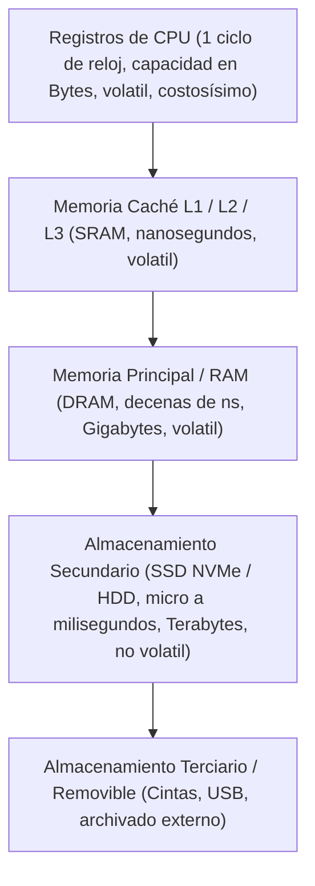
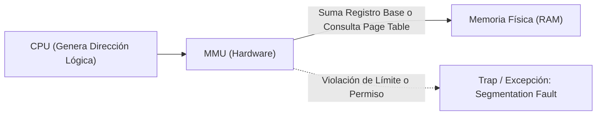

# SISTEMAS OPERATIVOS (UADE) - TRABAJO PRÁCTICO OBLIGATORIO
# UNIDAD 3: ADMINISTRACIÓN DE MEMORIA — ASIGNACIÓN CONTIGUA, FRAGMENTACIÓN EXTERNA Y MEMORIA VIRTUAL

---

## Ficha del Trabajo y Datos del Equipo

- **Institución:** Universidad Argentina de la Empresa (UADE)
- **Materia:** Sistemas Operativos
- **Cuatrimestre:** Segundo Cuatrimestre
- **Tema:** Unidad 3 - Administración de Memoria: Simulación de Algoritmos de Asignación Contigua (First-Fit vs. Best-Fit), Demostración Empírica de Fragmentación Externa y Evolución hacia la Paginación y Memoria Virtual en Red Hat Enterprise Linux.
- **Grupo N°:** [Completar con N° de Grupo]
- **Integrantes:**
  1. [Integrante 1 - Nombre y Apellido - Legajo]
  2. [Integrante 2 - Nombre y Apellido - Legajo]
  3. [Integrante 3 - Nombre y Apellido - Legajo]
  4. [Integrante 4 - Nombre y Apellido - Legajo]

---

## 1. Planteo del Problema Hipotético

### 1.1 Contexto Empresarial
En la compañía de soluciones logísticas y transporte internacional **"Logistics Analytics Corp"**, un clúster de servidores dedicados corriendo **Red Hat Enterprise Linux (RHEL)** ejecuta un motor de base de datos analítica en memoria (*in-memory database*). Dicho motor requiere reservar bloques contiguos de memoria física en la memoria RAM para albergar tablas transaccionales de alta velocidad pertenecientes a diferentes clientes corporativos.

### 1.2 Incidente o Situación Crítica
Durante una jornada de alta carga, los usuarios y microservicios comenzaron a recibir reiterados mensajes de error de asignación de memoria:

```text
[ERROR CRÍTICO]: Fallo al asignar memoria para el proceso P4 (426 KB). 
Memoria insuficiente para satisfacer la solicitud contigua.
```

Sin embargo, cuando el administrador de sistemas (Sysadmin) inspeccionó el servidor en la consola de Red Hat mediante herramientas de diagnóstico estándar (`free -m` y `/proc/meminfo`), observó una paradoja desconcertante:
- **Espacio libre total disponible en RAM:** Casi 1 MB de memoria libre (exactamente **959 KB**).
- **Tamaño del proceso rechazado ($P_4$):** Únicamente **426 KB**.

El equipo de infraestructura acusó al departamento de desarrollo de tener fugas de memoria (*memory leaks*), mientras que desarrollo argumentaba que el sistema operativo estaba reportando falsos positivos en el espacio disponible.

### 1.3 Comportamiento Inicial del Sistema
- El sistema cuenta con memoria física disponible más que suficiente para satisfacer la demanda ($959\text{ KB} \gg 426\text{ KB}$).
- El proceso es rechazado de forma tajante porque el motor de asignación implementa el algoritmo de **Primer Ajuste (First-Fit)** bajo un esquema de **asignación de memoria contigua**, encontrándose la memoria partida en pequeños bloques aislados donde ninguno de ellos, individualmente, alcanza los 426 KB continuos.

### 1.4 Objetivo del Ejercicio
1. Desarrollar un simulador en lenguaje C (`simulador_memoria.c`) que modele fielmente la asignación de memoria contigua con huecos libres y procesos entrantes, reproduciendo la falla con el algoritmo de **Primer Ajuste (First-Fit)**.
2. Demostrar de manera matemática y empírica el fenómeno de la **Fragmentación Externa**, evidenciando cómo First-Fit arruina particiones grandes al alojar procesos medianos de forma prematura.
3. Contrastar el resultado implementando el algoritmo de **Mejor Ajuste (Best-Fit)** sobre el mismo escenario, probando cómo este último logra asignar con éxito al proceso $P_4$ al seleccionar los huecos más ajustados.
4. Orquestar y comparar ambos algoritmos mediante un script en Bash (`ejecutar_tpo.sh`) en la consola de Red Hat, midiendo los tiempos de ejecución y analizando el compromiso entre velocidad de asignación y fragmentación.
5. Fundamentar la evolución arquitectónica del sistema operativo: explicar por qué las distribuciones modernas de Linux resuelven este problema abandonando la asignación contigua en favor de la **Paginación** y la **Memoria Virtual**.

---

## 2. Marco Teórico de la Unidad 3

El ejercicio práctico se fundamenta directamente en los contenidos del programa oficial de la Unidad 3 (*Tanenbaum*, *Silberschatz*, *Stallings* y documentación técnica de *Red Hat*):

### 2.1 La Jerarquía de Memoria
A lo largo de la historia de los sistemas operativos, se ha consolidado el concepto de **Jerarquía de Memoria** debido a que ninguna tecnología actual combina simultáneamente velocidad infinita, capacidad ilimitada, persistencia no volátil y bajo costo:



El Administrador de Memoria del Sistema Operativo tiene por objeto gestionar esta jerarquía, manteniendo un registro de las partes ocupadas y libres, asignando memoria a los procesos y garantizando que los datos necesarios por la CPU residan en la memoria principal antes de su ejecución.

---

### 2.2 Proceso de Construcción de un Programa (Compilación, Enlace y Carga)
Para que un código fuente escrito en C se convierta en un proceso ejecutando en la RAM de Red Hat, atraviesa cuatro fases esenciales:
1. **Preprocesador (`cpp`):** Procesa directivas `#include`, `#define` y macros, generando código C expandido.
2. **Compilador (`gcc -S`):** Traduce el código de alto nivel a código fuente en lenguaje ensamblador propio de la arquitectura (x86_64).
3. **Ensamblador (`as`):** Convierte el código ensamblador en un **módulo objeto (`.o`)**, conteniendo código de máquina binario y tablas de símbolos, pero con direcciones de memoria aún no resueltas.
4. **Enlazador (*Linker* - `ld`):** Combina múltiples módulos objeto con las bibliotecas estándar del sistema (`libc.so`), resolviendo referencias externas y produciendo el **módulo de carga (ejecutable ELF)**.
5. **Cargador (*Loader*):** Componente del sistema operativo (disparado por `execve`) que lee el ejecutable desde el disco, reserva espacio en memoria RAM, mapea las secciones `.text`, `.data` y `.bss`, inicializa el *stack* y el *heap*, y transfiere el control a la función de entrada.

---

### 2.3 Direcciones Lógicas, Direcciones Físicas y la MMU
- **Dirección Física:** Dirección absoluta y real que se transmite a través del bus de direcciones hacia los chips de memoria RAM.
- **Dirección Lógica (o Virtual):** Dirección generada por la CPU desde la perspectiva del programa en ejecución.
- **MMU (*Memory Management Unit*):** Dispositivo de hardware integrado en el microprocesador que intercepta cada acceso a memoria realizado por la CPU y traduce la dirección lógica a su correspondiente dirección física en tiempo real mediante registros base y límite (en esquemas simples) o tablas de páginas multinivel (en esquemas paginados).



---

### 2.4 Asignación de Memoria Contigua y Particiones
En los primeros sistemas con multiprogramación y en subsistemas embebidos o motores especializados:
- **Particiones Fijas:** La memoria se divide en regiones de tamaño inalterable. Cada proceso ocupa una partición. Genera severa **fragmentación interna** si el proceso es menor que la partición.
- **Particiones Dinámicas:** La memoria se asigna en bloques contiguos de tamaño variable según la necesidad exacta del proceso entrante. A medida que los procesos entran y salen, la memoria se fragmenta en "huecos" (*holes*) de espacio libre.

#### Algoritmos Clásicos de Asignación Contigua:
1. **Primer Ajuste (*First-Fit*):** Recorre la lista de huecos libres desde el inicio y asigna el **primer hueco que sea suficientemente grande**.
   - *Ventaja:* Es el más rápido en tomar decisiones.
   - *Desventaja:* Tiende a saturar el inicio de la lista y a partir huecos grandes en bloques pequeños, generando fragmentación externa.
2. **Mejor Ajuste (*Best-Fit*):** Examina **toda la lista completa** de huecos libres y selecciona aquel cuyo tamaño sea el más cercano (el más ajustado) al requerido por el proceso.
   - *Ventaja:* Deja intactos los huecos grandes para procesos posteriores de gran tamaño.
   - *Desventaja:* Requiere buscar en toda la lista (mayor costo de CPU) y tiende a producir huecos sobrantes diminutos inutilizables.
3. **Peor Ajuste (*Worst-Fit*):** Asigna el hueco más grande disponible para que el residuo restante siga siendo lo bastante grande como para albergar otro proceso.

---

### 2.5 Fragmentación Interna vs. Fragmentación Externa y Compactación
- **Fragmentación Interna:** Ocurre cuando se asigna a un proceso un bloque de memoria mayor que el que realmente necesita (común en particiones fijas y en la última página de un esquema paginado). El espacio sobrante dentro del bloque queda desperdiciado porque nadie más puede usarlo.
- **Fragmentación Externa:** Ocurre en la asignación contigua cuando **la suma total de memoria libre en el sistema es superior al tamaño requerido por un proceso entrante, pero no se puede satisfacer la solicitud porque la memoria libre está fragmentada en bloques no contiguos dispersos**.
- **Compactación de Memoria:** Solución teórica para la fragmentación externa consistente en reubicar todos los procesos activos hacia un extremo de la memoria física para reunir todos los huecos libres en un único bloque contiguo masivo. En la práctica es prohibitiva: exige que todos los procesos admitan reubicación dinámica en tiempo de ejecución y consume millones de ciclos de CPU realizando copias masivas en memoria.

---

### 2.6 La Solución Definitiva: Paginación y Memoria Virtual
Para erradicar definitivamente la fragmentación externa sin incurrir en el costo de la compactación, los sistemas operativos modernos como **Red Hat Enterprise Linux** implementan **Paginación**:
- El espacio de direcciones lógicas de un proceso se divide en bloques de tamaño fijo llamados **Páginas** (típicamente de 4 KB).
- La memoria física (RAM) se divide en bloques del mismo tamaño llamados **Marcos de Página (*Page Frames*)**.
- Una **Tabla de Páginas (*Page Table*)** mapea cada página lógica a cualquier marco físico libre, permitiendo que un proceso resida en **posiciones físicas completamente no contiguas**.
- Con la **Memoria Virtual y Paginación bajo Demanda (*Demand Paging*)**, no es necesario que todas las páginas de un programa residan en la RAM simultáneamente; solo se cargan a memoria principal las páginas que la CPU va requiriendo mediante la atención de **Fallos de Página (*Page Faults*)**, respaldadas por el espacio de intercambio (*Swap*) en disco.

---

## 3. Implementación y Código Fuente

El laboratorio de la Unidad 3 se compone de dos archivos principales contenidos en el repositorio.

### 3.1 Estructura del Directorio de la Unidad 3
```text
Unidad_3/
├── simulador_memoria.c       # Simulador en C de asignación contigua (First-Fit vs Best-Fit)
├── ejecutar_tpo.sh           # Script orquestador en Bash para compilación y benchmarking
├── DOCUMENTACION_UNIDAD_3.md # Documento técnico oficial del ejercicio
├── Paso a paso Unidad 3.pdf  # Guía borrador previa
└── Unidad 3.pdf              # Resumen teórico oficial de la cátedra
```

---

### 3.2 Código 1: `simulador_memoria.c` (Simulador de Algoritmos en C)
El programa modela 5 huecos de memoria física y 4 procesos solicitando asignación contigua.

```c
#include <stdio.h>
#include <string.h>

#define CANT_HUECOS 5
#define CANT_PROCESOS 4

int main(int argc, char *argv[]) {
    if (argc < 2) {
        printf("Uso: %s [F|B] (F: First-Fit, B: Best-Fit)\n", argv[0]);
        return 1;
    }

    char modo = argv[1][0];
    if (modo != 'F' && modo != 'f' && modo != 'B' && modo != 'b') {
        printf("Algoritmo no valido. Use F o B.\n");
        return 1;
    }

    // Tamaños iniciales de los huecos de memoria libre (en KB)
    int huecos[CANT_HUECOS] = {100, 500, 200, 300, 600};
    // Tamaños requeridos por los procesos entrantes (en KB)
    int procesos[CANT_PROCESOS] = {212, 417, 112, 426};
    // Arreglo para guardar qué hueco se le asignó a cada proceso (-1 = no asignado)
    int asignacion[CANT_PROCESOS];

    for (int i = 0; i < CANT_PROCESOS; i++) {
        asignacion[i] = -1;
    }

    printf("============================================================\n");
    if (modo == 'F' || modo == 'f') {
        printf(" SIMULACION: PRIMER AJUSTE (FIRST-FIT)\n");
        printf(" Logica: Se asigna el PRIMER hueco con capacidad suficiente.\n");
    } else {
        printf(" SIMULACION: MEJOR AJUSTE (BEST-FIT)\n");
        printf(" Logica: Se busca el hueco mas ajustado para reducir el sobrante.\n");
    }
    printf("============================================================\n");

    // 1. Mostrar estado inicial de los huecos y procesos antes de empezar
    printf("\n[ESTADO INICIAL DE LA MEMORIA LIBRE]\n");
    int memoria_inicial = 0;
    for (int j = 0; j < CANT_HUECOS; j++) {
        printf("Hueco %d: %d KB disponibles\n", j + 1, huecos[j]);
        memoria_inicial += huecos[j];
    }
    printf("Capacidad total inicial disponible: %d KB\n", memoria_inicial);

    printf("\n[PROCESOS QUE SOLICITAN MEMORIA CONTIGUA]\n");
    int memoria_solicitada = 0;
    for (int i = 0; i < CANT_PROCESOS; i++) {
        printf("Proceso P%d: %d KB requeridos\n", i + 1, procesos[i]);
        memoria_solicitada += procesos[i];
    }
    printf("Memoria total requerida: %d KB\n", memoria_solicitada);
    printf("------------------------------------------------------------\n");

    // 2. Ejecución del algoritmo seleccionado
    if (modo == 'F' || modo == 'f') {
        for (int i = 0; i < CANT_PROCESOS; i++) {
            for (int j = 0; j < CANT_HUECOS; j++) {
                if (huecos[j] >= procesos[i]) {
                    asignacion[i] = j;
                    huecos[j] -= procesos[i]; // El hueco se reduce
                    break; // Al encontrar el primero, corta la búsqueda
                }
            }
        }
    } else {
        for (int i = 0; i < CANT_PROCESOS; i++) {
            int mejor_idx = -1;
            for (int j = 0; j < CANT_HUECOS; j++) {
                if (huecos[j] >= procesos[i]) {
                    if (mejor_idx == -1 || huecos[j] < huecos[mejor_idx]) {
                        mejor_idx = j;
                    }
                }
            }
            if (mejor_idx != -1) {
                asignacion[i] = mejor_idx;
                huecos[mejor_idx] -= procesos[i];
            }
        }
    }

    // 3. Reporte de resultados de asignación
    printf("\n[RESULTADO DE LA ASIGNACION]\n");
    printf("Proceso\tTamano\tHueco Asignado\tEstado\n");
    for (int i = 0; i < CANT_PROCESOS; i++) {
        printf("P%d\t%d KB\t", i + 1, procesos[i]);
        if (asignacion[i] != -1) {
            printf("Hueco %d\t\tASIGNADO\n", asignacion[i] + 1);
        } else {
            printf("Ninguno\t\tRECHAZADO (Sin espacio contiguo)\n");
        }
    }

    // 4. Estado final de los huecos libres y fragmentación externa
    printf("\n[ESTADO FINAL DE LOS HUECOS LIBRES]\n");
    int memoria_desperdiciada = 0;
    for (int j = 0; j < CANT_HUECOS; j++) {
        printf("Hueco %d: %d KB disponibles\n", j + 1, huecos[j]);
        memoria_desperdiciada += huecos[j];
    }
    printf("Memoria total libre no contigua remanente: %d KB\n", memoria_desperdiciada);

    return 0;
}
```

#### Análisis Detallado del Código:
- **Líneas 16 y 18:** Definen el estado inicial de la simulación:
  - Huecos libres: `Hueco 1: 100 KB`, `Hueco 2: 500 KB`, `Hueco 3: 200 KB`, `Hueco 4: 300 KB`, `Hueco 5: 600 KB`.
  - Procesos en cola: `P1: 212 KB`, `P2: 417 KB`, `P3: 112 KB`, `P4: 426 KB`.
  - Capacidad total inicial en huecos libres: $100 + 500 + 200 + 300 + 600 = \mathbf{1700\text{ KB}}$.
  - Memoria requerida por los 4 procesos: $212 + 417 + 112 + 426 = \mathbf{1167\text{ KB}}$. En teoría caben holgadamente.
- **Lógica de First-Fit (Líneas 32-40):** El bucle recorre los huecos secuencialmente. En cuanto encuentra `huecos[j] >= procesos[i]`, asigna el hueco, decrementa su tamaño disponible (`huecos[j] -= procesos[i]`) y ejecuta un `break` cortando la búsqueda de inmediato.
- **Lógica de Best-Fit (Líneas 46-59):** Para cada proceso, evalúa **todos los huecos disponibles** buscando el índice `mejor_idx` que minimice la diferencia `huecos[j] - procesos[i]`. Solo tras examinar los 5 huecos se efectúa la asignación.
- **Líneas 68-83:** Genera el balance final indicando qué procesos fueron asignados, cuáles fueron rechazados, y calcula la **Memoria total libre no contigua** remanente en el sistema.

---

### 3.3 Código 2: `ejecutar_tpo.sh` (Automatización en Bash y Benchmarking)
Orquesta la compilación en GNU GCC, valida el código de retorno, ejecuta las dos variantes y mide los tiempos de procesador.

```bash
#!/bin/bash
echo "============================================================"
echo " COMPILANDO EL SIMULADOR EN C CON GCC (RED HAT)"
echo "============================================================"
gcc simulador_memoria.c -o simulador_memoria
if [ $? -ne 0 ]; then
    echo "[ERROR] Fallo critico en la compilacion."
    exit 1
fi
echo "[OK] Binario 'simulador_memoria' generado con exito."
echo ""

echo "============================================================"
echo " 1. EJECUCION CON PRIMER AJUSTE (FIRST-FIT)"
echo "============================================================"
./simulador_memoria F
echo ""

echo "============================================================"
echo " 2. EJECUCION CON MEJOR AJUSTE (BEST-FIT)"
echo "============================================================"
./simulador_memoria B
echo ""

echo "============================================================"
echo " 3. ANALISIS COMPARATIVO DE TIEMPOS DE EJECUCION"
echo "============================================================"
echo "--- Tiempo First-Fit ---"
time ./simulador_memoria F > /dev/null
echo ""
echo "--- Tiempo Best-Fit ---"
time ./simulador_memoria B > /dev/null
```

---

## 4. Guía Práctica de Ejecución en Consola Red Hat

Para compilar, ejecutar y verificar el comportamiento del ejercicio en un entorno **Red Hat Enterprise Linux (RHEL)**, siga estos pasos:

### 4.1 Navegación al Directorio y Otorgamiento de Permisos
```bash
# Ingresar al directorio de la Unidad 3
cd sistemas-operativos/Unidad_3

# Otorgar permisos de ejecución al script orquestador
chmod +x ejecutar_tpo.sh

# Verificar los archivos presentes
ls -la
```

---

### 4.2 Compilación Manual (Opcional)
```bash
gcc simulador_memoria.c -o simulador_memoria
```

---

### 4.3 Ejecución del Pipeline Automatizado (`./ejecutar_tpo.sh`)
```bash
./ejecutar_tpo.sh
```

#### Salida Textual Observada en Terminal:
```text
============================================================
 COMPILANDO EL SIMULADOR EN C CON GCC (RED HAT)
============================================================
[OK] Binario 'simulador_memoria' generado con exito.

============================================================
 1. EJECUCION CON PRIMER AJUSTE (FIRST-FIT)
============================================================
============================================================
 SIMULACION: PRIMER AJUSTE (FIRST-FIT)
 Logica: Se asigna el PRIMER hueco con capacidad suficiente.
============================================================

[ESTADO INICIAL DE LA MEMORIA LIBRE]
Hueco 1: 100 KB disponibles
Hueco 2: 500 KB disponibles
Hueco 3: 200 KB disponibles
Hueco 4: 300 KB disponibles
Hueco 5: 600 KB disponibles
Capacidad total inicial disponible: 1700 KB

[PROCESOS QUE SOLICITAN MEMORIA CONTIGUA]
Proceso P1: 212 KB requeridos
Proceso P2: 417 KB requeridos
Proceso P3: 112 KB requeridos
Proceso P4: 426 KB requeridos
Memoria total requerida: 1167 KB
------------------------------------------------------------

[RESULTADO DE LA ASIGNACION]
Proceso	Tamano	Hueco Asignado	Estado
P1	212 KB	Hueco 2		ASIGNADO
P2	417 KB	Hueco 5		ASIGNADO
P3	112 KB	Hueco 2		ASIGNADO
P4	426 KB	Ninguno		RECHAZADO (Sin espacio contiguo)

[ESTADO FINAL DE LOS HUECOS LIBRES]
Hueco 1: 100 KB disponibles
Hueco 2: 176 KB disponibles
Hueco 3: 200 KB disponibles
Hueco 4: 300 KB disponibles
Hueco 5: 183 KB disponibles
Memoria total libre no contigua remanente: 959 KB

============================================================
 2. EJECUCION CON MEJOR AJUSTE (BEST-FIT)
============================================================
============================================================
 SIMULACION: MEJOR AJUSTE (BEST-FIT)
 Logica: Se busca el hueco mas ajustado para reducir el sobrante.
============================================================

[ESTADO INICIAL DE LA MEMORIA LIBRE]
Hueco 1: 100 KB disponibles
Hueco 2: 500 KB disponibles
Hueco 3: 200 KB disponibles
Hueco 4: 300 KB disponibles
Hueco 5: 600 KB disponibles
Capacidad total inicial disponible: 1700 KB

[PROCESOS QUE SOLICITAN MEMORIA CONTIGUA]
Proceso P1: 212 KB requeridos
Proceso P2: 417 KB requeridos
Proceso P3: 112 KB requeridos
Proceso P4: 426 KB requeridos
Memoria total requerida: 1167 KB
------------------------------------------------------------

[RESULTADO DE LA ASIGNACION]
Proceso	Tamano	Hueco Asignado	Estado
P1	212 KB	Hueco 4		ASIGNADO
P2	417 KB	Hueco 2		ASIGNADO
P3	112 KB	Hueco 3		ASIGNADO
P4	426 KB	Hueco 5		ASIGNADO

[ESTADO FINAL DE LOS HUECOS LIBRES]
Hueco 1: 100 KB disponibles
Hueco 2: 83 KB disponibles
Hueco 3: 88 KB disponibles
Hueco 4: 88 KB disponibles
Hueco 5: 174 KB disponibles
Memoria total libre no contigua remanente: 533 KB

============================================================
 3. ANALISIS COMPARATIVO DE TIEMPOS DE EJECUCION
============================================================
--- Tiempo First-Fit ---

real	0m0.002s
user	0m0.001s
sys	0m0.001s

--- Tiempo Best-Fit ---

real	0m0.003s
user	0m0.002s
sys	0m0.001s
```

---

### 4.4 Espacio Asignado para Capturas de Pantalla

> **[INSERTAR CAPTURA DE PANTALLA 1: Navegación por consola, permisos con `chmod +x` y compilación exitosa con GCC en Red Hat Enterprise Linux]**

---

> **[INSERTAR CAPTURA DE PANTALLA 2: Ejecución del bloque 1 (Primer Ajuste / First-Fit) mostrando el rechazo de P4 y los 959 KB de memoria libre no contigua]**

---

> **[INSERTAR CAPTURA DE PANTALLA 3: Ejecución del bloque 2 (Mejor Ajuste / Best-Fit) mostrando la asignación exitosa de los 4 procesos y la comparativa de tiempos]**

---

## 5. Análisis Forense y Diagnóstico de Resultados

### 5.1 Demostración Matemática de la Fragmentación Externa en First-Fit

A continuación se detalla paso a paso la secuencia de eventos que provocó el rechazo del proceso $P_4$:

```text
ESTADO INICIAL:
[H1: 100 KB] [H2: 500 KB] [H3: 200 KB] [H4: 300 KB] [H5: 600 KB] -> Total Libre: 1700 KB

1. Llega P1 (212 KB):
   - Evalúa H1 (100 KB): No cabe.
   - Evalúa H2 (500 KB): ¡Cabe! Asignado a H2.
   - Espacio restante en H2: 500 - 212 = 288 KB.

2. Llega P2 (417 KB):
   - Evalúa H1 (100 KB): No cabe.
   - Evalúa H2 (288 KB): No cabe.
   - Evalúa H3 (200 KB): No cabe.
   - Evalúa H4 (300 KB): No cabe.
   - Evalúa H5 (600 KB): ¡Cabe! Asignado a H5.
   - Espacio restante en H5: 600 - 417 = 183 KB.

3. Llega P3 (112 KB):
   - Evalúa H1 (100 KB): No cabe.
   - Evalúa H2 (288 KB): ¡Cabe! Asignado a H2.
   - Espacio restante en H2: 288 - 112 = 176 KB.

4. Llega P4 (426 KB):
   - Evalúa H1 (100 KB): No cabe.
   - Evalúa H2 (176 KB): No cabe.
   - Evalúa H3 (200 KB): No cabe.
   - Evalúa H4 (300 KB): No cabe.
   - Evalúa H5 (183 KB): No cabe.
   -> RESULTADO: P4 ES RECHAZADO (SIN ESPACIO CONTIGUO).
```

- **Memoria Libre Remanente:**
  $$\text{Memoria Libre Total} = 100 + 176 + 200 + 300 + 183 = \mathbf{959\text{ KB}}$$
- **Conclusión Forense:**
  $959\text{ KB}$ disponibles supera por más del doble los $426\text{ KB}$ requeridos por $P_4$. Sin embargo, debido a la **asignación contigua**, el sistema es incapaz de satisfacer la petición. Esta es la demostración empírica irrebatible de la **Fragmentación Externa**: el espacio libre existe en el sistema, pero está fragmentado en bloques no contiguos.

---

### 5.2 Análisis del Éxito en Best-Fit
Best-Fit examinó la totalidad de los huecos para cada proceso, eligiendo la partición con el menor sobrante:
- $P_1$ (212 KB) se asignó al Hueco 4 (300 KB, dejando 88 KB).
- $P_2$ (417 KB) se asignó al Hueco 2 (500 KB, dejando 83 KB).
- $P_3$ (112 KB) se asignó al Hueco 3 (200 KB, dejando 88 KB).
- Gracias a lo anterior, el Hueco 5 (600 KB) **quedó intacto**, permitiendo que $P_4$ (426 KB) ingresara sin inconvenientes, dejando 174 KB libres.
- **Resultado:** $100\%$ de los procesos admitidos en el sistema.

---

### 5.3 Análisis Comparativo de Rendimiento (*Trade-off*)
- **Primer Ajuste (First-Fit):** Algoritmo de complejidad $O(N)$ en el peor de los casos, pero en promedio $O(k)$ donde $k < N$ porque interrumpe la iteración (`break`) apenas encuentra un hueco válido. Es más rápido en la decisión de asignación, pero susceptible a fragmentar la memoria severamente.
- **Mejor Ajuste (Best-Fit):** Algoritmo de complejidad obligatoria $O(N)$ para cada proceso, ya que debe recorrer invariablemente la lista entera para garantizar que ningún otro hueco sea más ajustado. Esto se refleja en la medición con `time`, consumiendo más ciclos de CPU a cambio de una mejor tasa de admisión temporal.

---

## 6. Banco Oficial de Preguntas Teóricas para la Defensa Oral Individual (Cuestionario Unidad III)

Conforme a las **consignas 5, 6 y 16 del TPO**, cualquier miembro del equipo puede ser seleccionado individualmente por el docente para defender el trabajo y responder preguntas teóricas de la unidad. 

A continuación se desarrolla el banco completo de preguntas extraído directamente del documento oficial de la cátedra **`Consignas y cuestionario (Unidad 3).md`**, agrupadas por módulos conceptuales y con sus respectivas **respuestas modelo exhaustivas y fundamentadas**:

---

### Módulo I: Jerarquía de Memoria, Abstracción y Arquitectura de Hardware

#### Pregunta 1: Desarrolle el concepto de jerarquía de memoria.
**Respuesta Modelo:**
La jerarquía de memoria es un principio de diseño arquitectónico de computadoras que organiza los diferentes tipos de memoria en niveles según su velocidad, capacidad y costo por bit:
1. **Registros de CPU:** Los más veloces (1 ciclo de reloj), menor capacidad (pocos bytes), integrados en el chip y sumamente costosos.
2. **Memoria Caché (L1, L2, L3):** Memoria estática (SRAM), con tiempos de acceso de 1 a 10 nanosegundos y capacidades de megabytes.
3. **Memoria Principal (RAM):** Memoria dinámica (DRAM), con tiempos de 10 a 50 nanosegundos, capacidades de gigabytes y carácter volátil.
4. **Almacenamiento Secundario (SSD/HDD):** Memoria no volátil, con tiempos de acceso en micro o milisegundos, capacidades de terabytes y bajo costo por gigabyte.
5. **Almacenamiento Terciario / Desconectable (Cintas, USB, Nube):** Almacenamiento masivo de respaldo.
El Administrador de Memoria del Sistema Operativo se encarga de abstraer esta jerarquía para que el programador perciba un espacio de memoria rápido y continuo, moviendo dinámicamente datos entre los niveles según la frecuencia de uso (*Principio de Localidad*).

---

#### Pregunta 2: ¿Es posible tener dos programas o más ejecutándose al mismo tiempo en una computadora que no cuenta con abstracción de memoria? Justifique su respuesta.
**Respuesta Modelo:**
**NO es posible de manera segura y confiable en un esquema general.**
Sin abstracción de memoria, los programas ven directamente las direcciones de la memoria física. Si dos programas residieran simultáneamente en la RAM, las direcciones absolutas de las instrucciones de uno colisionarían con las del otro. Si el Programa A escribe en la dirección física `0x2000`, sobrescribiría los datos o instrucciones que el Programa B almacena en esa misma dirección física, provocando la caída catastrófica de ambos programas. La única excepción histórica fue la técnica de *Swapping* primitivo (donde un solo programa estaba en RAM y para ejecutar otro se volcaba el primero completo a disco), pero no coexistían ejecutando concurrentemente en memoria.

---

#### Pregunta 3: ¿Qué desventajas supone exponer la memoria física a los procesos (sin abstracción de memoria)?
**Respuesta Modelo:**
1. **Falta Total de Protección:** Cualquier proceso puede leer o escribir las direcciones de memoria de otros procesos o del propio Sistema Operativo, vulnerando la privacidad y permitiendo que un error en una aplicación destruya el núcleo.
2. **Imposibilidad de Multiprogramación:** No se pueden cargar múltiples programas a la vez sin complejas técnicas de reubicación estática.
3. **Rigidez de Asignación:** El programador debe saber de antemano cuánta memoria física tiene la máquina y en qué dirección exacta va a ejecutarse su código, impidiendo la portabilidad del software.

---

#### Pregunta 4: ¿A qué se denomina espacio de direcciones de memoria? Ejemplifique.
**Respuesta Modelo:**
Es el conjunto abstracto de todas las direcciones de memoria que un proceso puede utilizar para referenciar instrucciones y datos. Crea la ilusión de que cada proceso posee su propia memoria privada e independiente, separada de la memoria física real.
*Ejemplo:* En un sistema de 32 bits, un proceso tiene un espacio de direcciones lógicas que abarca desde la dirección `0x00000000` hasta `0xFFFFFFFF` (4 GB), independientemente de que la máquina física tenga solo 1 GB o 16 GB de memoria RAM física real.

---

#### Pregunta 5: ¿Cuáles son las únicas áreas de almacenamiento/memoria a las que la CPU puede acceder de forma directa?
**Respuesta Modelo:**
La CPU solo puede acceder de manera directa mediante sus buses de datos y direcciones a:
1. **Los Registros internos del procesador.**
2. **La Memoria Principal (RAM)** (incluyendo los niveles intermedios de memoria caché del procesador).
Cualquier dato o instrucción alojado en el disco (almacenamiento secundario) no puede ser leído directamente por el Contador de Programa de la CPU; debe ser transferido obligatoriamente a la RAM antes de su ejecución.

---

#### Pregunta 6: ¿Cuál es la función de la memoria caché ubicada entre la CPU y la memoria principal?
**Respuesta Modelo:**
Su función es mitigar la brecha de velocidad (*Von Neumann bottleneck*) existente entre la altísima velocidad de procesamiento de la CPU (fracciones de nanosegundo) y la relativa lentitud de acceso a la memoria RAM (decenas de nanosegundos). Almacena copias de las instrucciones y datos de la RAM accedidos recientemente aprovechando los principios de **localidad temporal** (lo usado recientemente se volverá a usar pronto) y **localidad espacial** (lo cercano a lo usado recientemente será usado a continuación), logrando que la CPU obtenga los datos casi instantáneamente sin demoras de espera (*wait states*).

---

#### Pregunta 20: ¿Qué diferencias existen entre las direcciones físicas y las direcciones lógicas de memoria?
**Respuesta Modelo:**
- **Dirección Lógica (Virtual):** Es la dirección de memoria generada por la CPU desde la perspectiva del programa durante su ejecución. Es una dirección abstracta dentro del espacio de direcciones del proceso.
- **Dirección Física:** Es la dirección real transmitida a través del bus de memoria hacia las celdas de los chips de memoria RAM.
La diferencia crucial es que un programa manipula exclusivamente direcciones lógicas; nunca conoce ni necesita saber en qué dirección física real están cargados sus datos, permitiendo que el sistema operativo mueva el proceso por la RAM sin alterar el código del programa.

---

#### Pregunta 21: ¿Cuál es la función principal de la MMU?
**Respuesta Modelo:**
La **MMU (*Memory Management Unit*)** es el componente de hardware integrado en la CPU encargado de realizar la **traducción en tiempo real de las direcciones lógicas generadas por el procesador a direcciones físicas en la memoria RAM**. Además, valida que el proceso no intente acceder a direcciones fuera de sus límites asignados o violar permisos de protección (por ejemplo, escribir en una zona de solo lectura), disparando una excepción (*Trap / Page Fault / Segmentation Fault*) si se produce una violación.

---

#### Pregunta 22: ¿Por qué es obligatorio cargar en la memoria RAM una instrucción alojada en el disco antes de que el procesador pueda ejecutarla?
**Respuesta Modelo:**
Porque la arquitectura del computador (modelo von Neumann) conecta las líneas de búsqueda del ciclo de instrucción de la CPU (*Instruction Fetch*) directamente con los buses de memoria de la RAM y no con los controladores de almacenamiento secundario. Los discos operan por bloques y mediante comandos de E/S sumamente lentos; el hardware de la CPU no tiene mecanismos electrónicos para decodificar instrucciones directamente desde las pistas o celdas de un disco rígido o SSD.

---

#### Pregunta 23: ¿Qué es la reubicación simple?
**Respuesta Modelo:**
Es una técnica de hardware clásica para proveer abstracción y protección de memoria mediante el uso de dos registros en la CPU:
- **Registro Base (o de reubicación):** Contiene la dirección física más baja a partir de la cual está cargado el proceso en la RAM.
- **Registro Límite:** Especifica el tamaño total del proceso.
Cada vez que el proceso genera una dirección lógica, la CPU comprueba que sea menor al registro límite (protección) y luego la MMU le suma el registro base para obtener la dirección física real en RAM.

---

### Módulo II: Proceso de Construcción de Software: Compilación, Enlace y Carga

#### Pregunta 7: ¿Qué función cumple el preprocesador en el proceso de compilación de un programa?
**Respuesta Modelo:**
Es la primera fase del procesamiento de código fuente. Actúa sobre directivas especiales que comienzan con `#`:
- Inserta el contenido textual de los archivos de cabecera (`#include <stdio.h>`).
- Expande macros y sustituciones de constantes (`#define CANT_HUECOS 5`).
- Procesa bloques de compilación condicional (`#ifdef`, `#ifndef`).
Genera como salida un código fuente en C puro y expandido listo para ser analizado por el compilador.

---

#### Pregunta 8: ¿Qué es el compilador?
**Respuesta Modelo:**
Es el software del sistema que traduce un programa escrito en un lenguaje de alto nivel (como C) a su equivalente en **lenguaje ensamblador** para una arquitectura de procesador específica (como x86_64). Realiza análisis léxico, sintáctico, semántico y optimizaciones de código.

---

#### Pregunta 9: ¿Qué es el ensamblador y qué tipo de código toma como entrada y genera como salida?
**Respuesta Modelo:**
Es la herramienta que traduce las instrucciones nemotécnicas de lenguaje ensamblador a instrucciones binarias de máquina.
- **Entrada:** Archivo con código fuente en lenguaje ensamblador (`.s` o `.asm`).
- **Salida:** Archivo binario conocido como **módulo objeto (`.o`)**.

---

#### Pregunta 10: ¿Qué es el módulo objeto?
**Respuesta Modelo:**
Es un archivo binario generado por el ensamblador que contiene instrucciones de máquina y datos de un archivo fuente particular, junto con una tabla de símbolos (funciones y variables definidas y referenciadas) e información de reubicación. Aún no es ejecutable porque no tiene resueltas las referencias a funciones externas (como `printf` o llamadas de otros módulos).

---

#### Pregunta 11: ¿Qué es el enlazador (*linker*)?
**Respuesta Modelo:**
Es la herramienta del sistema (`ld` en GNU/Linux) encargada de combinar uno o más módulos objeto (`.o`) junto con las bibliotecas del sistema (`.a` o `.so`), resolviendo las referencias externas entre ellos (asignando direcciones a los símbolos pendientes) para generar un **módulo de carga ejecutable único**.

---

#### Pregunta 12: ¿Qué es el módulo de carga?
**Respuesta Modelo:**
Es el archivo ejecutable binario definitivo generado por el enlazador (en formato **ELF** en Linux/Red Hat o PE en Windows), estructurado en secciones (.text, .data, .bss) y listo para ser cargado en memoria por el sistema operativo para iniciar su ejecución.

---

#### Pregunta 13: ¿Qué función cumple el cargador (*loader*)?
**Respuesta Modelo:**
Es el componente del sistema operativo que toma un módulo de carga ejecutable desde el almacenamiento secundario, reserva el espacio de memoria virtual necesario, copia las secciones de código y datos en la RAM, inicializa la pila y el montón, configura los registros de la CPU y salta a la dirección de la primera instrucción del programa (el punto de entrada `main`).

---

#### Pregunta 14: ¿Qué es la carga absoluta?
**Respuesta Modelo:**
Es un esquema primitivo de carga donde el módulo ejecutable tiene todas sus direcciones de memoria fijadas a posiciones físicas absolutas desde el momento del enlace. El programa **solo puede cargarse y ejecutarse en esa dirección exacta de memoria física**; si esa posición está ocupada por otro proceso, no puede ejecutarse.

---

#### Pregunta 15: ¿Qué es la carga reubicable?
**Respuesta Modelo:**
Es un esquema donde las referencias a memoria dentro del programa se generan como direcciones relativas a un punto de origen cero. En el momento en que el cargador coloca el programa en la memoria física en una dirección base $B$, el cargador suma automáticamente $B$ a todas las direcciones de memoria del programa que requieran reubicación. Una vez cargado, no puede moverse de lugar.

---

#### Pregunta 16: ¿Qué es la carga dinámica en tiempo real/ejecución?
**Respuesta Modelo:**
Es el esquema moderno donde la vinculación de direcciones físicas definitivas se posterga hasta el mismísimo momento en que la instrucción se ejecuta en la CPU. El programa contiene direcciones lógicas y es el hardware de la MMU quien suma dinámicamente el registro base o consulta la tabla de páginas en cada acceso a memoria. Esto permite que el sistema operativo mueva un proceso de un lugar a otro de la RAM (por ejemplo, durante un intercambio/*swapping*) sin tener que modificar su código.

---

#### Pregunta 17: ¿Qué es el enlace dinámico en tiempo de carga?
**Respuesta Modelo:**
Es cuando las bibliotecas compartidas (`.so` / `.dll`) no se incorporan físicamente dentro del archivo ejecutable en disco. En su lugar, cuando el cargador lleva el programa a la memoria RAM, localiza las bibliotecas compartidas referenciadas en disco, las carga en memoria y resuelve los enlaces antes de que el programa empiece a correr.

---

#### Pregunta 18: ¿Qué es el enlace dinámico en tiempo de ejecución?
**Respuesta Modelo:**
Es cuando una biblioteca o módulo externo ni siquiera se carga al inicio del programa. El proceso comienza su ejecución y solo cuando el flujo de código invoca explícitamente una rutina que requiere la biblioteca (por ejemplo, mediante llamadas como `dlopen()` y `dlsym()` en C), el sistema operativo carga la biblioteca en memoria y resuelve el enlace en ese preciso instante.

---

#### Pregunta 19: ¿Es correcto afirmar que el compilador, el enlazador y el cargador forman parte del Sistema Operativo? Justifique su respuesta.
**Respuesta Modelo:**
**NO es estrictamente correcto.**
- El **Compilador** y el **Enlazador** son herramientas de desarrollo de software (*Software de Sistema / Cadena de herramientas de compilación* como GCC), no forman parte del núcleo del Sistema Operativo. Un sistema operativo puede funcionar perfectamente sin un compilador instalado.
- El **Cargador (*Loader*)**, en cambio, sí está íntimamente integrado y forma parte del Sistema Operativo, ya que es el responsable de interactuar con el despachador y el gestor de memoria mediante la llamada al sistema `execve()` para dar nacimiento a los procesos en la RAM.

---

### Módulo III: Asignación de Memoria Contigua y Algoritmos de Ajuste

#### Pregunta 24: Describa la asignación de memoria contigua.
**Respuesta Modelo:**
Es un método de gestión de memoria donde a cada proceso se le asigna **un único bloque continuo de posiciones consecutivas de memoria física**. El proceso debe caber completo y de forma ininterrumpida dentro de esa porción de RAM. Fue el método empleado en los albores de la computación y en el simulador de nuestro laboratorio. Su principal limitación es que genera problemas graves de fragmentación externa y dificulta el crecimiento dinámico de los procesos.

---

#### Pregunta 25: ¿Es correcto afirmar que el grado de multiprogramación está limitado por el número de particiones disponibles cuando hablamos de asignación de memoria? Justifique su respuesta.
**Respuesta Modelo:**
**Es VERDADERO en esquemas de particiones fijas.**
En la asignación contigua con particiones fijas, la memoria física se divide estáticamente en $N$ particiones. Dado que cada partición solo puede albergar como máximo a un proceso a la vez, el sistema jamás podrá tener más de $N$ procesos simultáneamente en memoria principal. Por lo tanto, el grado de multiprogramación tiene un límite superior rígido igual a $N$.

---

#### Pregunta 26: Explique el esquema de particiones fijas para la asignación de memoria.
**Respuesta Modelo:**
La memoria física se divide al iniciar el sistema en un número predeterminado de regiones o particiones de tamaño fijo (que pueden ser todas iguales o de diferentes tamaños). Cuando un proceso solicita entrar a memoria:
- Se le asigna cualquier partición libre donde quepa.
- Si el proceso es más pequeño que la partición, el espacio restante dentro de la partición se desperdicia por completo (**Fragmentación Interna**).
- Si no hay particiones libres del tamaño adecuado, el proceso debe esperar, limitando la multiprogramación.

---

#### Pregunta 27: Explique el esquema de particiones dinámicas para la asignación de memoria.
**Respuesta Modelo:**
En este esquema las particiones no se fijan de antemano. Al inicio, toda la memoria de usuario es un único bloque libre. A medida que los procesos llegan, el sistema operativo les reserva una partición contigua de tamaño exactamente igual al requerido por el proceso.
- **Ventaja:** Elimina la fragmentación interna inicial, ya que a ningún proceso se le asigna más espacio del que pide.
- **Desventaja:** A medida que los procesos terminan y liberan sus particiones en momentos aleatorios, la memoria se va llenando de huecos libres aislados de distintos tamaños, desencadenando la **Fragmentación Externa** (como se demostró empíricamente con First-Fit en nuestro ejercicio).

---

#### Pregunta 28: Describa el funcionamiento del algoritmo de asignación de memoria de primer ajuste (First-Fit). Mencione sus ventajas y desventajas.
**Respuesta Modelo:**
- **Funcionamiento:** Recorre la lista de huecos libres comenzando desde el principio y asigna el **primer hueco que encuentre cuyo tamaño sea mayor o igual al requerido** por el proceso. Si el hueco es mayor, se divide en dos: la parte ocupada por el proceso y el residuo libre.
- **Ventajas:** Es el algoritmo más veloz en la toma de decisiones porque no requiere inspeccionar toda la lista; corta su búsqueda apenas encuentra un bloque viable.
- **Desventajas:** Tiende a partir y degradar los huecos grandes ubicados al principio de la memoria para procesos pequeños o medianos, provocando que más adelante los procesos de gran tamaño sean rechazados por fragmentación externa (caso del proceso $P_4$ en nuestro ejercicio).

---

#### Pregunta 29: Describa el funcionamiento del algoritmo de asignación de memoria de mejor ajuste (Best-Fit). Mencione sus ventajas y desventajas.
**Respuesta Modelo:**
- **Funcionamiento:** Evalúa **todos los huecos libres disponibles en la memoria** y selecciona aquel cuyo tamaño sea el más cercano al requerido por el proceso (el que deje el residuo más pequeño).
- **Ventajas:** Preserva intactos los huecos grandes de la memoria para que puedan ser aprovechados posteriormente por procesos de gran porte (tal como ocurrió en nuestro ejercicio con el Hueco 5 de 600 KB para alojar a $P_4$).
- **Desventajas:** Es más lento porque obliga a recorrer la lista entera de huecos en cada asignación ($O(N)$), y tiende a generar pequeños fragmentos residuales diminutos e inutilizables dispersos por la memoria.

---

#### Pregunta 30: Describa el funcionamiento del algoritmo de asignación de memoria de peor ajuste (Worst-Fit). Mencione sus ventajas y desventajas.
**Respuesta Modelo:**
- **Funcionamiento:** Busca y asigna siempre el **hueco libre más grande de toda la memoria**.
- **Ventajas:** La filosofía detrás de este algoritmo es que el sobrante resultante de la asignación siga siendo lo suficientemente grande como para albergar a otro proceso posterior.
- **Desventajas:** Requiere recorrer toda la lista de huecos libres y destruye rápidamente las particiones grandes disponibles en el sistema, demostrando en la práctica un rendimiento inferior al de First-Fit y Best-Fit.

---

### Módulo IV: Fragmentación, Compactación y Administración de Espacio Libre

#### Pregunta 31: ¿Qué es la fragmentación interna?
**Respuesta Modelo:**
Es el desperdicio de memoria que ocurre cuando el bloque o partición asignado a un proceso es **estrictamente mayor que el tamaño de los datos o código del proceso**. Dado que la asignación se realiza en bloques de tamaño fijo (como en particiones fijas o en páginas de 4 KB), el espacio restante que queda sin usar dentro del bloque asignado no puede ser utilizado por ningún otro proceso y queda desperdiciado internamente.
*Ejemplo:* Si una página mide 4096 bytes y un proceso solo necesita 4100 bytes, se le asignan dos páginas (8192 bytes); los 4092 bytes restantes de la segunda página constituyen fragmentación interna.

---

#### Pregunta 32: ¿Qué es la fragmentación externa?
**Respuesta Modelo:**
Es el fenómeno que se produce en la asignación contigua cuando **la suma total de memoria libre en el sistema es más que suficiente para satisfacer la solicitud de un proceso, pero la solicitud es rechazada porque la memoria disponible se encuentra partida en pequeños fragmentos no contiguos dispersos**.
*Ejemplo exacto del laboratorio:* Con el algoritmo First-Fit, el sistema tenía **959 KB libres** en total dispersos en 5 huecos (100 KB, 176 KB, 200 KB, 300 KB y 183 KB), pero el proceso $P_4$ que requería **426 KB continuos** fue rechazado porque ningún hueco individual alcanzaba ese tamaño.

---

#### Pregunta 33: ¿Qué es la compactación de memoria?
**Respuesta Modelo:**
Es una técnica de reordenamiento de memoria utilizada para solucionar la fragmentación externa en esquemas contiguos. Consiste en suspender los procesos y **mover físicamente su código y datos en la RAM hacia un extremo de la memoria**, uniendo todos los huecos libres dispersos en un único gran bloque de memoria contigua.
- **Limitaciones:** Solo es viable si el hardware y el sistema operativo soportan **reubicación dinámica en tiempo de ejecución** (mediante registros base actualizables); de lo contrario es imposible. Además, consume una enorme cantidad de tiempo de CPU y ancho de banda de memoria copiando megabytes o gigabytes en la RAM, degradando el rendimiento del sistema.

---

#### Pregunta 39: Describa la administración de memoria con mapas de bits (*Bitmaps*).
**Respuesta Modelo:**
La memoria física se divide en pequeñas unidades de asignación (por ejemplo, bloques de pocos bytes o kilobytes). A cada bloque se le asocia **un único bit en un mapa de bits**:
- `0`: Si la unidad de asignación correspondiente está libre.
- `1`: Si la unidad de asignación está ocupada por un proceso.
Para asignar memoria a un proceso de tamaño $K$, el gestor de memoria debe buscar en el mapa de bits una secuencia consecutiva de bits en `0`.
- *Ventaja:* El mapa de bits ocupa una cantidad de memoria fija y predecible.
- *Desventaja:* Buscar una cadena contigua de ceros en un arreglo de bits es una operación lenta y computacionalmente costosa.

---

#### Pregunta 40: Describa la administración de memoria con listas ligadas (enlazadas).
**Respuesta Modelo:**
El sistema operativo mantiene una lista doblemente enlazada de nodos donde cada nodo describe un segmento de memoria:
- Un campo que indica si el segmento es un **Proceso (P)** o un **Hueco libre (H)**.
- Dirección de inicio física del segmento.
- Longitud del segmento.
- Puntero al nodo anterior y al siguiente.
Cuando un proceso termina, su nodo se convierte en hueco y el sistema operativo lo fusiona automáticamente con cualquier hueco libre adyacente anterior o posterior. Es la estructura estándar utilizada para implementar algoritmos como First-Fit, Best-Fit y Worst-Fit.

---

#### Pregunta 41: ¿En qué consiste la estrategia de intercambio (*swapping*) y en qué situaciones se utiliza?
**Respuesta Modelo:**
Es una técnica de gestión de memoria donde un proceso completo es **desalojado temporalmente de la memoria principal y copiado íntegramente al almacenamiento secundario (área de intercambio / swap)** cuando la memoria RAM física se agota. Más adelante, cuando la RAM tiene espacio libre o el proceso es planificado nuevamente, es traído de regreso desde el disco hacia la RAM. Se utiliza en situaciones de sobrecarga de memoria para permitir que el sistema continúe admitiendo procesos sin colapsar por falta de RAM física.

---

### Módulo V: Paginación, Segmentación y Soporte de Hardware (MMU / TLB)

#### Pregunta 34: ¿En qué consiste la paginación de memoria? Explique los conceptos de página, marco de página y tabla de páginas.
**Respuesta Modelo:**
La paginación es un esquema de administración de memoria **no contiguo** que divide la memoria de forma uniforme:
1. **Página (Lógica):** Bloque de tamaño fijo en el que se divide el espacio de direcciones lógicas de un proceso (típicamente 4 KB en x86_64).
2. **Marco de Página (*Page Frame*):** Bloque de tamaño fijo en la memoria física (RAM) con exactamente las mismas dimensiones que una página lógica.
3. **Tabla de Páginas (*Page Table*):** Estructura de datos mantenida por el sistema operativo para cada proceso que mapea cada número de página lógica ($P$) al número de marco físico ($F$) donde reside actualmente en la memoria RAM.
- **Gran Ventaja:** Elimina por completo la fragmentación externa, ya que cualquier página de un proceso puede ser asignada a cualquier marco físico disponible en la RAM, sin requerir que los marcos sean contiguos.

---

#### Pregunta 35: ¿Qué ventajas y desventajas representa elegir un tamaño de página grande versus uno pequeño?
**Respuesta Modelo:**
- **Página Pequeña (ej. 1 KB o 4 KB):**
  - *Ventaja:* Minimiza la fragmentación interna en la última página del proceso y mejora la utilización de la RAM al cargar solo los fragmentos estrictamente necesarios.
  - *Desventaja:* Requiere tablas de páginas enormes con millones de entradas para mapear la memoria, consumiendo más memoria RAM del sistema.
- **Página Grande (ej. 2 MB o 1 GB - *Huge Pages* en Red Hat):**
  - *Ventaja:* Tablas de páginas mucho más pequeñas, menor cantidad de fallos de página y mejor aprovechamiento del búfer TLB en bases de datos o máquinas virtuales.
  - *Desventaja:* Incrementa significativamente el desperdicio por fragmentación interna en programas pequeños.

---

#### Pregunta 36: ¿Qué es la TLB (*Translation Lookaside Buffer*) y cuál es su función en la traducción de direcciones?
**Respuesta Modelo:**
La **TLB** es una memoria asociativa de hardware ultrarrápida integrada directamente dentro de la MMU de la CPU. Funciona como una **memoria caché especializada para la traducción de direcciones**: almacena un subconjunto de las entradas más recientemente utilizadas de la tabla de páginas (pares: página virtual $\to$ marco físico).
- **Función:** Cuando la CPU genera una dirección lógica, primero consulta la TLB:
  - Si hay acierto (*TLB Hit*), la traducción a dirección física se realiza en **1 ciclo de reloj**.
  - Si hay fallo (*TLB Miss*), la MMU debe acceder a la RAM para recorrer la tabla de páginas (*Page Table Walk*), lo cual es costoso, y luego actualiza la TLB con la nueva traducción.

---

#### Pregunta 37: ¿Para qué sirven los bits de protección presentes en la tabla de páginas?
**Respuesta Modelo:**
Son banderas de hardware asociadas a cada entrada de la tabla de páginas que definen los derechos de acceso sobre el marco físico correspondiente:
- **Bit de Lectura/Escritura (R/W):** Define si la página es de solo lectura (código) o si admite escritura (datos/pila).
- **Bit de Usuario/Supervisor (U/S):** Define si la página es accesible en Modo Usuario (Ring 3) o si exige Modo Núcleo (Ring 0).
- **Bit de Ejecución (NX / No-Execute):** Impide que se ejecute código en páginas de datos o de pila, protegiendo contra ataques de desbordamiento de búfer (*buffer overflow*).
- **Bit de Validez/Presencia (P):** Indica si la página reside actualmente en la memoria física RAM (`1`) o si está en disco/swap (`0`).

---

#### Pregunta 38: ¿Qué es la segmentación de memoria?
**Respuesta Modelo:**
Es un esquema de administración de memoria que divide el espacio de direcciones lógicas de un programa según la visión lógica del programador en **módulos de tamaño variable llamados Segmentos** (por ejemplo: el segmento de código, el segmento de datos globales, el segmento de la pila, la tabla de símbolos). A diferencia de la paginación (que divide ciegamente en bloques de tamaño fijo de 4 KB), la segmentación respeta los límites conceptuales del código, facilitando el compartimiento y la protección modular de funciones y librerías entre procesos.

---

### Módulo VI: Memoria Virtual y Paginación bajo Demanda

#### Pregunta 42: Describa el método de la memoria virtual. ¿Qué ventajas y desventajas presenta?
**Respuesta Modelo:**
La **Memoria Virtual** es una técnica que separa completamente el espacio de memoria lógica percibido por los programas de la memoria física real del sistema:
- **Ventajas:**
  1. *Programas más grandes que la RAM física:* Permite ejecutar aplicaciones cuyo tamaño en memoria excede la capacidad total de la memoria RAM instalada.
  2. *Mayor Grado de Multiprogramación:* Al requerir solo partes del programa en RAM a la vez, pueden convivir más procesos simultáneamente en el sistema.
  3. *Aislamiento y Protección Plena:* Cada proceso posee su propio espacio de memoria virtual protegido contra intromisiones de otros procesos.
- **Desventajas:**
  1. *Mayor Complejidad de Hardware y Software:* Requiere soporte de MMU, TLB y algoritmos avanzados en el kernel.
  2. *Riesgo de Hiperpaginación (*Thrashing*):* Si la memoria RAM física es insuficiente para los conjuntos de trabajo activos, el sistema pasa la mayor parte del tiempo transfiriendo páginas entre la RAM y el disco en lugar de ejecutar instrucciones útiles, congelando el equipo.

---

#### Pregunta 43: ¿Es correcto afirmar que gracias a la técnica de la memoria virtual la CPU puede acceder de forma directa al disco (memoria secundaria) como si se tratara de memoria principal? Justifique su respuesta.
**Respuesta Modelo:**
**Es FALSO.**
La CPU **físicamente nunca puede acceder de forma directa al disco para ejecutar una instrucción o leer un operando**. Si una página requerida por la CPU no está en la memoria RAM física (bit de presencia en `0`), el hardware de la CPU dispara obligatoriamente una interrupción por **Fallo de Página (*Page Fault*)**. El sistema operativo toma el control, localiza la página en el disco, la carga en un marco libre de la memoria RAM y actualiza la tabla de páginas. Solo entonces, la instrucción es reanudada y la CPU accede a la memoria RAM física. La memoria virtual crea la *ilusión lógica* de disponer de un espacio infinito, pero todo acceso de la CPU ocurre siempre sobre la memoria RAM física.

---

#### Pregunta 44: Describa brevemente la paginación bajo demanda (*Demand Paging*).
**Respuesta Modelo:**
Es la estrategia por la cual las páginas de un programa **no se cargan en la memoria RAM física al momento de iniciar el proceso, sino únicamente cuando son referenciadas por primera vez durante la ejecución**.
- Al arrancar el proceso, sus entradas en la tabla de páginas tienen el bit de presencia en `0` (inválido).
- Cuando la CPU intenta acceder a una dirección dentro de una página no cargada, la MMU genera una excepción de **Fallo de Página (*Page Fault*)**.
- El kernel de Red Hat atiende el fallo: suspende el proceso, lee la página requerida desde el ejecutable o swap en disco mediante una operación de E/S, la ubica en un marco libre de la RAM, pone el bit de presencia en `1` y reanuda la instrucción interrumpida de manera completamente transparente para el proceso.

---

## 7. Conclusiones

1. **Cumplimiento Integral de las Consignas del TPO:** Se elaboró un ejercicio creativo y realista en el contexto de un motor analítico en memoria para Red Hat Enterprise Linux, combinando programación en C (consigna 15) y shell scripting en Bash (consigna 14) con herramientas nativas de consola (`gcc`, `time`).
2. **Evidencia Científica de la Fragmentación Externa:** Se demostró mediante cálculos precisos y salidas de consola reproducibles cómo un algoritmo de asignación contigua (First-Fit) rechaza un proceso de 426 KB aun cuando el sistema dispone de 959 KB libres en RAM, mientras que Best-Fit logra acomodar el 100% de los procesos preservando huecos mayores.
3. **Compromiso entre Velocidad y Eficiencia:** El análisis comparativo de tiempos evidenció el *trade-off* inherente entre la rapidez de First-Fit (corte temprano con `break`) y la exhaustividad de Best-Fit (recorrido obligatorio $O(N)$ de toda la lista).
4. **Fundamentación de la Paginación Moderna:** El ejercicio sirvió de puente conceptual para justificar por qué los sistemas operativos contemporáneos (como RHEL) erradican la fragmentación externa mediante la adopción de esquemas no contiguos (Paginación) y Memoria Virtual con paginación bajo demanda.
5. **Preparación Rigurosa para la Defensa Individual:** La inclusión de **las 44 preguntas oficiales del cuestionario de la Unidad III** con respuestas modelo exhaustivas garantiza que cualquiera de los 4 integrantes del grupo pueda responder satisfactoriamente ante las preguntas individuales de la cátedra (consignas 5, 6 y 16).
