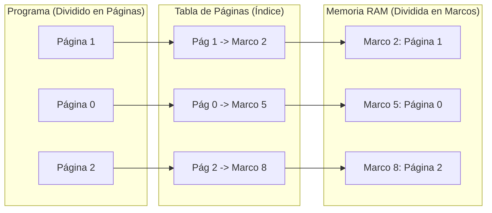

# SISTEMAS OPERATIVOS (UADE) — GUÍA DE ESTUDIO Y CUESTIONARIO RESUELTO
# UNIDAD 3: ADMINISTRACIÓN DE MEMORIA

> 📖 **Guía Pedagógica Explicada Desde Cero**  
> Este documento contiene las **44 preguntas oficiales** de la Unidad 3 resueltas de manera clara, simple y didáctica, pensadas para que cualquier estudiante pueda entender los conceptos sin necesidad de conocimientos previos avanzados, pero incorporando los términos técnicos formales exigidos por la cátedra para el segundo parcial y la defensa oral.

---

## Índice Temático
- [Módulo I: Jerarquía de Memoria, Abstracción y Hardware Básico](#módulo-i-jerarquía-de-memoria-abstracción-y-hardware-básico) (Preguntas 1 a 6, 20 a 23)
- [Módulo II: Proceso de Construcción: Compilación, Enlace y Carga](#módulo-ii-proceso-de-construcción-compilación-enlace-y-carga) (Preguntas 7 a 19)
- [Módulo III: Asignación de Memoria Contigua y Algoritmos de Ajuste](#módulo-iii-asignación-de-memoria-contigua-y-algoritmos-de-ajuste) (Preguntas 24 a 30)
- [Módulo IV: Fragmentación, Compactación y Gestión de Espacio Libre](#módulo-iv-fragmentación-compactación-y-gestión-de-espacio-libre) (Preguntas 31 a 33, 39 a 41)
- [Módulo V: Paginación, Segmentación y Soporte de Hardware (MMU / TLB)](#módulo-v-paginación-segmentación-y-soporte-de-hardware-mmu--tlb) (Preguntas 34 a 38)
- [Módulo VI: Memoria Virtual y Paginación bajo Demanda](#módulo-vi-memoria-virtual-y-paginación-bajo-demanda) (Preguntas 42 a 44)

---

## Módulo I: Jerarquía de Memoria, Abstracción y Hardware Básico

### Pregunta 1: Desarrolle el concepto de jerarquía de memoria.

> 💡 **En palabras simples (Para entenderlo de cero):**  
> Pensá en cómo guardás cosas en tu vida cotidiana. Lo que usás a cada segundo lo tenés en la mano o en el bolsillo (Registros de la CPU). Lo que usás seguido lo dejás arriba de tu escritorio de trabajo (Memoria Caché). Lo que usás durante el día lo tenés en el armario de tu habitación (Memoria RAM). Y lo que guardás para el futuro lo mandás al baúl o depósito del sótano (Disco rígido o SSD).  
> A medida que bajás de nivel: la memoria se vuelve **más grande, más barata y más lenta**.

**Explicación y Concepto de Cátedra:**  
La jerarquía de memoria es la solución de ingeniería al dilema fundamental del hardware: no existe una memoria que sea infinitamente rápida, infinitamente grande, no volátil y barata al mismo tiempo.  
Por eso, los sistemas operativos organizan la memoria en una pirámide de niveles:
1. **Registros de CPU:** Viven dentro del procesador. Tardan 1 ciclo de reloj (fracciones de nanosegundo). Miden apenas unos pocos bytes y son volátiles.
2. **Caché (L1, L2, L3):** Construida con tecnología SRAM. Tarda de 1 a 10 nanosegundos, con capacidades de megabytes.
3. **Memoria Principal (RAM):** Construida con DRAM. Tarda decenas de nanosegundos, tiene capacidades de gigabytes y es volátil (se borra al apagar la PC).
4. **Almacenamiento Secundario (SSD / HDD):** No volátil (los datos persisten), con capacidades de terabytes, pero es miles de veces más lenta (milisegundos en HDD, microsegundos en SSD).
5. **Almacenamiento Terciario / Removible:** Cintas, pendrives o la nube.

El Administrador de Memoria del Sistema Operativo se encarga de mover la información entre estos niveles para que el procesador sienta que tiene una memoria gigante a la velocidad de la más rápida.

---

### Pregunta 2: ¿Es posible tener dos programas o más ejecutándose al mismo tiempo en una computadora que no cuenta con abstracción de memoria? Justifique su respuesta.

> 💡 **En palabras simples (Para entenderlo de cero):**  
> **NO, no es posible de forma segura.**  
> Imaginate que dos personas intentan escribir un ensayo en la mismísima hoja de papel al mismo tiempo: lo que escribe una persona le va a tapar y borrar las palabras a la otra.

**Explicación y Concepto de Cátedra:**  
**NO es posible de manera confiable.**  
Sin abstracción de memoria, cada programa ve directamente la **memoria física real** (las celdas electrónicas directas desde la dirección 0 hasta el final).  
Si el Programa 1 decide guardar un dato en la posición física `2000`, y el Programa 2 también decide guardar algo en la posición `2000`, el segundo sobreescribirá al primero sin advertencia. Ambos programas fallarían inmediatamente al corromperse sus variables.  
*(Nota histórica: La única forma en que las primeras computadoras corrían más de un programa era deteniendo uno, copiándolo entero a una cinta magnética o disco, y cargando el otro, pero nunca coexistían al mismo tiempo en la RAM).*

---

### Pregunta 3: ¿Qué desventajas supone exponer la memoria física a los procesos (sin abstracción de memoria)?

> 💡 **En palabras simples (Para entenderlo de cero):**  
> Es como vivir en un hotel donde ninguna habitación tiene puerta ni cerradura: cualquiera puede entrar a tu pieza, mirar tus cosas privadas o tirarte la ropa a la basura.

**Explicación y Concepto de Cátedra:**  
Exponer la memoria física directamente a los procesos trae tres desventajas críticas:
1. **Cero Protección y Seguridad:** Un programa de usuario (o un virus) puede escribir directamente sobre la zona de memoria del Kernel del Sistema Operativo o de otros programas, congelando toda la computadora o robando contraseñas.
2. **Imposibilidad de Multiprogramación Moderna:** No se pueden cargar varios programas a la vez porque sus direcciones se pisarían entre sí.
3. **Dificultad de Programación y Falta de Portabilidad:** El programador tendría que saber de antemano cuánta RAM física tiene la computadora donde va a correr el programa y en qué número exacto de celda física va a ubicarse.

---

### Pregunta 4: ¿A qué se denomina espacio de direcciones de memoria? Ejemplifique.

> 💡 **En palabras simples (Para entenderlo de cero):**  
> Es como el sistema de departamentos en los edificios. En la Calle A hay un edificio con un "Departamento 3B", y en la Calle B hay otro edificio con su propio "Departamento 3B". Aunque ambos tienen el mismo número de departamento, son lugares totalmente distintos en la ciudad.

**Explicación y Concepto de Cátedra:**  
El espacio de direcciones es el **conjunto abstracto de direcciones de memoria que un proceso puede utilizar para referenciar sus instrucciones y datos**.  
El Sistema Operativo le da a cada proceso su propio espacio de direcciones privado e independiente, haciéndole creer que tiene la memoria entera para él solo, comenzando desde la dirección 0 hasta un máximo.  
*Ejemplo:* En un sistema operativo de 32 bits, cada proceso cree que tiene un espacio de direcciones de 4 GB (desde `0x00000000` hasta `0xFFFFFFFF`), independientemente de que la computadora real solo tenga 2 GB de memoria física.

---

### Pregunta 5: ¿Cuáles son las únicas áreas de almacenamiento/memoria a las que la CPU puede acceder de forma directa?

> 💡 **En palabras simples (Para entenderlo de cero):**  
> El procesador solo puede "hablar directamente" con lo que tiene adentro de su chip o conectado a sus cables directos de alta velocidad: sus **Registros** y la **Memoria RAM** (pasando por la memoria Caché).  
> A un disco rígido o SSD **nunca** puede acceder directamente para ejecutar una instrucción.

**Explicación y Concepto de Cátedra:**  
Las únicas áreas accesibles directamente por el ciclo de instrucción de la CPU son:
1. **Los Registros internos del procesador.**
2. **La Memoria Principal (RAM)** (a través de la memoria caché del procesador).  
Cualquier archivo o programa que esté en el disco debe ser transferido obligatoriamente por el sistema operativo hacia la memoria RAM antes de que la CPU pueda ejecutar sus instrucciones.

---

### Pregunta 6: ¿Cuál es la función de la memoria cache ubicada entre la CPU y la memoria principal?

> 💡 **En palabras simples (Para entenderlo de cero):**  
> La CPU es como un cocinero hiperrápido y la RAM es el supermercado que queda a dos cuadras. Si el cocinero tuviera que ir al supermercado por cada pizca de sal, tardaría horas. La memoria Caché es como la mesada de la cocina: el cocinero tiene a mano los ingredientes que más usa para no tener que salir a cada rato.

**Explicación y Concepto de Cátedra:**  
Su función es **reducir la brecha de velocidad entre la CPU y la memoria RAM**.  
La CPU procesa a velocidades de GHz (fracciones de nanosegundo), mientras que la RAM responde en decenas de nanosegundos (mucho más lenta). La memoria Caché guarda una copia de las instrucciones y datos que el procesador está usando con mayor frecuencia basándose en dos principios:
- **Localidad Temporal:** Si usaste un dato recién, es muy probable que lo vuelvas a usar pronto.
- **Localidad Espacial:** Si usaste un dato en una celda, es muy probable que uses los datos vecinos que están al lado.

---

### Pregunta 20: ¿Qué diferencias existen entre las direcciones físicas y las direcciones lógicas de memoria?

> 💡 **En palabras simples (Para entenderlo de cero):**  
> La **dirección lógica** es el número de asiento en tu entrada de cine ("Fila 3, Asiento 5"). La **dirección física** son las coordenadas GPS exactas del planeta Tierra donde está ubicado ese asiento. Vos en tu cabeza manejás el asiento, no las coordenadas del GPS.

**Explicación y Concepto de Cátedra:**  
- **Dirección Lógica (o Virtual):** Es la dirección generada por la CPU desde la perspectiva del programa. El programa cree que sus datos empiezan en la dirección 0 y crecen en orden.
- **Dirección Física:** Es la dirección real que viaja por el bus de la placa madre y señala la celda electrónica de silicio en los chips de la memoria RAM.  
El programa solo conoce y manipula direcciones lógicas; nunca sabe en qué parte física real de la RAM está guardado.

---

### Pregunta 21: ¿Cuál es la función principal de la MMU?

> 💡 **En palabras simples (Para entenderlo de cero):**  
> Es el "traductor en tiempo real". Es un chip que está adentro del procesador y que, cada vez que el programa dice "quiero leer mi casilla 10", la MMU se fija en sus tablas y dice "la casilla 10 de este programa en realidad está en la casilla 5000 de la RAM real".

**Explicación y Concepto de Cátedra:**  
La **MMU (*Memory Management Unit* o Unidad de Manejo de Memoria)** es un dispositivo de hardware integrado en la CPU cuya función principal es:
1. **Traducir al instante las direcciones lógicas en direcciones físicas** en cada acceso a memoria.
2. **Verificar la protección:** Si el programa intenta acceder a una dirección fuera de su límite o escribir en una zona de solo lectura, la MMU frena la operación y dispara una excepción de hardware al sistema operativo (*Segmentation Fault* o Fallo de Página).

---

### Pregunta 22: ¿Por qué es obligatorio cargar en la memoria RAM una instrucción alojada en el disco antes de que el procesador pueda ejecutarla?

> 💡 **En palabras simples (Para entenderlo de cero):**  
> Porque la CPU no tiene "cables" para leer bytes directamente del disco. La CPU está conectada físicamente por buses de alta velocidad a las ranuras de la RAM. El disco es un dispositivo de almacenamiento que se comunica por comandos lentos de entrada/salida.

**Explicación y Concepto de Cátedra:**  
Porque según el modelo de arquitectura de von Neumann, el circuito de búsqueda de instrucciones de la CPU (*Instruction Fetch*) está conectado exclusivamente a los buses de memoria principal. El procesador necesita decodificar instrucciones a la velocidad de la electrónica de la RAM; los discos duros y SSDs se gestionan a través de controladores de E/S por bloques, haciendo físicamente imposible que la CPU ejecute código directamente desde ellos.

---

### Pregunta 23: ¿Qué es la reubicación simple?

> 💡 **En palabras simples (Para entenderlo de cero):**  
> Es la forma más básica de mover un programa en la memoria usando dos datos: una **Base** (dónde arranca) y un **Límite** (cuánto mide). Si tu programa arranca en la base 1000 y mide 500, si pide leer su posición 20, la CPU suma $1000 + 20 = 1020$. Y si pide la 600, la CPU se da cuenta de que se pasó del límite y lo frena.

**Explicación y Concepto de Cátedra:**  
Es un mecanismo de hardware clásico para proveer reubicación dinámica y protección mediante dos registros especiales en la CPU:
- **Registro Base (o de Reubicación):** Almacena la dirección física más baja a partir de la cual se cargó el proceso en la RAM.
- **Registro Límite:** Almacena el tamaño del proceso.  
Cada dirección lógica generada por el programa se compara contra el registro límite; si es válida, la MMU le suma el registro base para obtener la dirección física en la RAM.

---

## Módulo II: Proceso de Construcción: Compilación, Enlace y Carga

---

### Pregunta 7: ¿Qué función cumple el preprocesador en el proceso de compilación de un programa?

> 💡 **En palabras simples (Para entenderlo de cero):**  
> Es como el corrector de texto que pasa antes de que empiece la traducción en serio. Busca todas las líneas que empiezan con un numeral `#`, reemplaza palabras (`#define`) y copia y pega archivos enteros (`#include`).

**Explicación y Concepto de Cátedra:**  
Es la primera fase de la cadena de compilación. No genera código de máquina; realiza transformaciones de texto sobre el código fuente en C:
- Expande macros y sustituye constantes definidas con `#define`.
- Incluye el contenido de archivos de cabecera (`#include <stdio.h>`).
- Descarta comentarios y procesa directivas condicionales (`#ifdef`, `#ifndef`).

---

### Pregunta 8: ¿Qué es el compilador?

> 💡 **En palabras simples (Para entenderlo de cero):**  
> Es el traductor principal. Toma el texto escrito en lenguaje C (que los humanos entendemos) y lo traduce a instrucciones en lenguaje ensamblador específicas para ese procesador.

**Explicación y Concepto de Cátedra:**  
Es el software del sistema encargado de traducir un programa escrito en lenguaje de alto nivel a lenguaje ensamblador para una arquitectura específica (por ejemplo, x86_64). Verifica la sintaxis, valida los tipos de datos y optimiza las instrucciones.

---

### Pregunta 9: ¿Qué es el ensamblador y qué tipo de código toma como entrada y genera como salida?

> 💡 **En palabras simples (Para entenderlo de cero):**  
> Es el que convierte las palabras de ensamblador (como `MOV`, `ADD`) en puros ceros y unos que entiende el chip.  
> - **Entrada:** Código en lenguaje ensamblador (`.s`).  
> - **Salida:** Archivo binario u objeto (`.o`).

**Explicación y Concepto de Cátedra:**  
Es la herramienta que traduce las instrucciones nemotécnicas de lenguaje ensamblador a lenguaje de máquina binario.  
- **Toma como entrada:** Archivos de código fuente ensamblador (`.s` o `.asm`).  
- **Genera como salida:** Un archivo binario denominado **módulo objeto (`.o`)**, que contiene instrucciones binarias pero aún sin resolver direcciones definitivas.

---

### Pregunta 10: ¿Qué es el módulo objeto?

> 💡 **En palabras simples (Para entenderlo de cero):**  
> Es un archivo intermedio de ceros y unos (`.o`). Ya está traducido a código de máquina, pero todavía no puede correr como programa porque no sabe dónde están las funciones externas que usó (por ejemplo, `printf`).

**Explicación y Concepto de Cátedra:**  
Es un archivo binario generado por el ensamblador que contiene código de máquina, datos del programa y una **tabla de símbolos** (donde figuran las funciones que define y las funciones externas que necesita). Todavía no es ejecutable porque sus referencias a bibliotecas externas están incompletas.

---

### Pregunta 11: ¿Qué es el enlazador (linker)?

> 💡 **En palabras simples (Para entenderlo de cero):**  
> Es el que "pega todas las piezas". Junta el archivo `.o` que hiciste vos con los archivos `.o` de las bibliotecas del sistema (como la de imprimir texto en pantalla) y arma un único archivo final listo para usar.

**Explicación y Concepto de Cátedra:**  
El enlazador (*linker*, como `ld` en Linux) combina múltiples módulos objeto independientes y bibliotecas del sistema (`libc.so`). Resuelve todas las referencias cruzadas entre ellos (conecta cada llamada a una función con la dirección de memoria real donde está programada) y produce el archivo ejecutable final.

---

### Pregunta 12: ¿Qué es el módulo de carga?

> 💡 **En palabras simples (Para entenderlo de cero):**  
> Es el producto final terminado: el archivo ejecutable (un binario ELF en Red Hat o un `.exe` en Windows) que está guardado en el disco listo para que le des doble clic o lo ejecutes desde la terminal.

**Explicación y Concepto de Cátedra:**  
Es el programa binario ejecutable resultante del proceso de enlace, estructurado en secciones estándar (sección de código `.text`, sección de datos inicializados `.data`, etc.) y preparado con toda la información necesaria para que el sistema operativo pueda cargarlo en la memoria RAM.

---

### Pregunta 13: ¿Qué función cumple el cargador (loader)?

> 💡 **En palabras simples (Para entenderlo de cero):**  
> Es el "mudancero". Cuando ejecutás `./mi_programa`, el cargador va al disco, agarra el ejecutable, le busca un departamento libre en la memoria RAM, acomoda sus cosas y le avisa a la CPU: *"Empezá a ejecutar desde acá"*.

**Explicación y Concepto de Cátedra:**  
Es el componente del sistema operativo (asociado a la llamada al sistema `execve`) que toma un módulo de carga desde el disco, reserva espacio en la memoria virtual, copia las secciones de código y datos en la RAM, configura la pila (*stack*) y el montón (*heap*), inicializa los registros del procesador y salta a la primera instrucción del programa (`main`).

---

### Pregunta 14: ¿Qué es la carga absoluta?

> 💡 **En palabras simples (Para entenderlo de cero):**  
> Es el sistema antiguo más rígido: el programa está grabado a fuego para correr en una dirección fija de la RAM (por ejemplo, "en la casilla 2000"). Si la casilla 2000 está ocupada por otra cosa, el programa directamente no puede abrirse.

**Explicación y Concepto de Cátedra:**  
Es un esquema de carga primitivo donde todas las direcciones de memoria del ejecutable son fijadas como direcciones físicas absolutas desde el momento del enlace. El programa solo puede cargarse en esa ubicación física exacta; si no está disponible, el proceso no puede ejecutarse.

---

### Pregunta 15: ¿Qué es la carga reubicable?

> 💡 **En palabras simples (Para entenderlo de cero):**  
> El programa está armado con direcciones relativas (desde el 0 en adelante). Cuando el cargador lo mete a la memoria, se fija dónde lo puso (por ejemplo, en la casilla 5000) y le suma 5000 a todas sus direcciones de una sola vez. Pero ojo: una vez que lo cargó ahí, ya no lo puede mover.

**Explicación y Concepto de Cátedra:**  
Es un esquema donde el código generado tiene direcciones relativas a un punto de partida cero. En el momento en que el cargador sitúa el programa en una dirección base $B$ de la memoria física, recalcula y ajusta todas las direcciones sumándoles $B$. Una vez cargado, sus direcciones quedan fijas.

---

### Pregunta 16: ¿Qué es la carga dinámica en tiempo real/ejecución?

> 💡 **En palabras simples (Para entenderlo de cero):**  
> Es el método moderno. Las direcciones reales no se calculan de antemano; se calculan **en el mismísimo nanosegundo en que la instrucción se está ejecutando** gracias al chip de la MMU. Esto permite que el sistema operativo pueda mudar el programa a otra parte de la RAM en cualquier momento sin romper nada.

**Explicación y Concepto de Cátedra:**  
Es el mecanismo utilizado en los sistemas operativos modernos. La traducción a direcciones físicas definitivas se posterga hasta el momento en que la instrucción es ejecutada por la CPU. La MMU traduce dinámicamente cada dirección lógica sobre la marcha, permitiendo que el proceso se desplace de ubicación física durante su ciclo de vida (por ejemplo, tras un intercambio o compactación).

---

### Pregunta 17: ¿Qué es el enlace dinámico en tiempo de carga?

> 💡 **En palabras simples (Para entenderlo de cero):**  
> Las bibliotecas compartidas (los archivos `.so` en Linux o `.dll` en Windows) no están guardadas adentro de tu ejecutable. Cuando abrís el programa, el sistema operativo va al disco, busca esas bibliotecas y las carga en la RAM en ese momento antes de empezar a correr.

**Explicación y Concepto de Cátedra:**  
Es una técnica donde las rutinas de bibliotecas compartidas no se incluyen físicamente dentro del archivo ejecutable en disco. Cuando el cargador lleva el programa a la memoria RAM, localiza las bibliotecas compartidas requeridas en el sistema operativo, las carga en memoria y enlaza sus funciones antes de iniciar la ejecución del código.

---

### Pregunta 18: ¿Qué es el enlace dinámico en tiempo de ejecución?

> 💡 **En palabras simples (Para entenderlo de cero):**  
> La biblioteca ni siquiera se carga cuando abrís el programa. El programa arranca y solo cuando el usuario hace clic en una opción específica (por ejemplo, apretar el botón de "Exportar a PDF"), el programa busca la biblioteca en ese preciso instante, la carga y la usa.

**Explicación y Concepto de Cátedra:**  
Es cuando la carga y el enlace de un módulo se difieren hasta el momento exacto en que el código en ejecución lo necesita explícitamente (utilizando funciones como `dlopen()` y `dlsym()` en Linux). Permite ahorrar memoria RAM cargando componentes pesados únicamente si el usuario utiliza esa funcionalidad.

---

### Pregunta 19: ¿Es correcto afirmar que el compilador, el enlazador y el cargador forman parte del Sistema Operativo? Justifique su respuesta.

> 💡 **En palabras simples (Para entenderlo de cero):**  
> **FALSO.**  
> El compilador y el enlazador son herramientas para programadores (como el paquete GCC), no son parte del sistema operativo. Tu computadora puede funcionar y prender sin tener ningún compilador instalado. Solo el cargador (*loader*) forma parte del sistema operativo.

**Explicación y Concepto de Cátedra:**  
**Es FALSO.**  
- El **Compilador** y el **Enlazador** son herramientas de desarrollo de software (*software de aplicación o cadena de desarrollo*). No forman parte del núcleo (*kernel*) del sistema operativo.
- El **Cargador (*loader*)**, en cambio, **sí forma parte integral del sistema operativo**, ya que es el componente encargado de asignar memoria y dar vida a los procesos en el núcleo mediante llamadas al sistema como `execve()`.

---

## Módulo III: Asignación de Memoria Contigua y Algoritmos de Ajuste

### Pregunta 24: Describa la asignación de memoria contigua.

> 💡 **En palabras simples (Para entenderlo de cero):**  
> Cada programa tiene que entrar en un **único pedazo de memoria entero y de corrido en la RAM**. No podés cortar el programa en pedacitos para meterlo en distintos huecos libres.

**Explicación y Concepto de Cátedra:**  
Es un método clásico de administración donde a cada proceso se le asigna un bloque ininterrumpido de direcciones de memoria física consecutivas. El programa debe caber completo dentro de ese bloque contiguo. Su principal desventaja histórica es que genera problemas severos de **fragmentación externa**.

---

### Pregunta 25: ¿Es correcto afirmar que el grado de multiprogramación está limitado por el número de particiones disponibles cuando hablamos de asignación de memoria? Justifique su respuesta.

> 💡 **En palabras simples (Para entenderlo de cero):**  
> **VERDADERO (en particiones fijas).**  
> Si tenés 4 cocheras en un estacionamiento, solo podés guardar 4 autos a la vez. No podés meter un quinto auto hasta que alguno de los 4 se vaya.

**Explicación y Concepto de Cátedra:**  
**Es VERDADERO en esquemas de particiones fijas.**  
En la asignación de memoria con particiones fijas, la RAM se divide en una cantidad $N$ de particiones. Como cada partición solo puede alojar como máximo a un proceso a la vez, el sistema jamás podrá tener más de $N$ procesos simultáneamente en la memoria principal. Por ende, el grado de multiprogramación queda rígidamente limitado al número de particiones creadas.

---

### Pregunta 26: Explique el esquema de particiones fijas para la asignación de memoria.

> 💡 **En palabras simples (Para entenderlo de cero):**  
> La memoria se divide de entrada en casilleros de tamaño fijo que nunca cambian (por ejemplo, casilleros de 500 KB). Si llega un programa chiquito de 100 KB, ocupa todo el casillero y los 400 KB que sobran quedan desperdiciados sin que nadie más los pueda tocar (**fragmentación interna**).

**Explicación y Concepto de Cátedra:**  
La memoria se divide estáticamente al arrancar el sistema en un conjunto de regiones o particiones de tamaño inalterable.  
- Cuando llega un proceso, se busca una partición libre donde quepa.
- Si el proceso ocupa menos espacio que el tamaño de la partición, el espacio sobrante dentro de esa partición queda completamente inutilizado (**Fragmentación Interna**).
- Si no hay particiones libres de su tamaño, el proceso debe esperar afuera en una cola.

---

### Pregunta 27: Explique el esquema de particiones dinámicas para la asignación de memoria.

> 💡 **En palabras simples (Para entenderlo de cero):**  
> No hay casilleros armados de antemano. A cada programa que llega se le da un pedazo hecho a su medida exacta. El problema es que cuando los programas terminan y se van en momentos distintos, la memoria empieza a quedar como un queso gruyère: llena de huecos libres separados entre sí (**fragmentación externa**).

**Explicación y Concepto de Cátedra:**  
En este esquema las particiones se crean dinámicamente en tiempo de ejecución: cada proceso recibe exactamente la cantidad de memoria que solicita, eliminando la fragmentación interna inicial.  
Sin embargo, a medida que los procesos terminan y liberan su memoria en orden aleatorio, la RAM queda dividida en múltiples "huecos" libres dispersos. Con el tiempo, esto provoca **Fragmentación Externa**, donde hay suficiente memoria total libre pero no está junta de forma continua.

---

### Pregunta 28: Describa el funcionamiento del algoritmo de asignación de memoria de primer ajuste (First-Fit). Mencione sus ventajas y desventajas.

> 💡 **En palabras simples (Para entenderlo de cero):**  
> El proceso se mete en la **primera cochera que encuentra donde entre**, sin fijarse si sobra mucho o poco espacio.  
> - **Ventaja:** Es rapidísimo en decidir.  
> - **Desventaja:** Arruina cocheras grandes metiendo autos medianos, y después cuando llega un auto grande, no entra en ningún lado (lo que nos pasó con $P_4$ en el ejercicio).

**Explicación y Concepto de Cátedra:**  
- **Funcionamiento:** Recorre la lista de huecos libres desde el inicio y asigna el **primer hueco cuyo tamaño sea mayor o igual al requerido**. El residuo sobrante queda como un nuevo hueco libre más pequeño.
- **Ventajas:** Es el algoritmo más rápido computacionalmente porque no recorre toda la lista; interrumpe la búsqueda apenas encuentra un bloque viable.
- **Desventajas:** Tiende a saturar el inicio de la memoria con fragmentos pequeños y a dividir prematuramente los huecos grandes, dejando al sistema vulnerable a la fragmentación externa.

---

### Pregunta 29: Describa el funcionamiento del algoritmo de asignación de memoria de mejor ajuste (Best-Fit). Mencione sus ventajas y desventajas.

> 💡 **En palabras simples (Para entenderlo de cero):**  
> El proceso recorre todo el estacionamiento y elige la cochera que le quede **más justa y apretada**, para desperdiciar la menor cantidad de espacio posible.  
> - **Ventaja:** Deja libres e intactas las cocheras gigantes para cuando lleguen procesos grandes.  
> - **Desventaja:** Tiene que revisar todas las cocheras (más lento) y deja pedacitos residuales tan chiquitos que nadie los puede usar.

**Explicación y Concepto de Cátedra:**  
- **Funcionamiento:** Examina la **lista completa de huecos libres** y selecciona aquel cuyo tamaño sea el más cercano al requerido por el proceso (el que deje el residuo más chico).
- **Ventajas:** Preserva los bloques grandes de memoria libres para solicitudes de gran porte (en nuestro laboratorio permitió asignar exitosamente a $P_4$ en el Hueco 5 de 600 KB).
- **Desventajas:** Es más lento porque siempre recorre toda la lista ($O(N)$), y tiende a generar una gran cantidad de huecos libres diminutos e inutilizables dispersos.

---

### Pregunta 30: Describa el funcionamiento del algoritmo de asignación de memoria de peor ajuste (Worst-Fit). Mencione sus ventajas y desventajas.

> 💡 **En palabras simples (Para entenderlo de cero):**  
> El proceso busca siempre **el hueco más grande que haya en toda la memoria**. La teoría decía: "Si uso el hueco más grande, lo que sobra va a seguir siendo grande y servirá para otro auto". Pero en la práctica es un desastre porque destruye rápido todos los huecos grandes.

**Explicación y Concepto de Cátedra:**  
- **Funcionamiento:** Recorre toda la lista de huecos libres y asigna siempre el **hueco de mayor tamaño disponible**.
- **Ventajas:** El bloque remanente resultante de la asignación suele ser lo suficientemente grande como para poder ser utilizado por otro proceso posterior.
- **Desventajas:** Obliga a recorrer toda la lista en cada asignación y destruye sistemáticamente los huecos grandes de la memoria, mostrando en la práctica el peor rendimiento de los tres algoritmos.

---

## Módulo IV: Fragmentación, Compactación y Gestión de Espacio Libre

### Pregunta 31: ¿Qué es la fragmentación interna?

> 💡 **En palabras simples (Para entenderlo de cero):**  
> Es el espacio que sobra **adentro** de una caja que te dieron. Si te dan una caja de 100 KB para guardar un archivo de 20 KB, los 80 KB que sobran quedan encerrados adentro de tu caja y nadie más los puede usar.

**Explicación y Concepto de Cátedra:**  
Es el desperdicio de memoria que ocurre cuando el bloque o partición asignado a un proceso es de tamaño fijo y resulta **mayor que la memoria que el proceso realmente necesita**. El espacio libre sobrante queda atrapado dentro de la partición asignada y no puede ser aprovechado por ningún otro proceso del sistema. Es típica de los esquemas de particiones fijas y de la última página en sistemas paginados.

---

### Pregunta 32: ¿Qué es la fragmentación externa?

> 💡 **En palabras simples (Para entenderlo de cero):**  
> Es el espacio libre que sobra **afuera**, pero está partido en pedacitos dispersos. Tenés 959 KB libres en total en la memoria, pero llega un programa que pide 426 KB continuos y no entra porque el pedazo más grande mide 300 KB. La memoria libre existe, pero está desparramada.

**Explicación y Concepto de Cátedra:**  
Es la situación que ocurre en la asignación contigua cuando **la suma total de toda la memoria libre del sistema es suficiente para satisfacer el requerimiento de un proceso, pero la solicitud es rechazada porque no existe ningún bloque contiguo individual de tamaño suficiente**.  
*Demostración empírica del TPO:* En la simulación con First-Fit, sobraban 959 KB libres totales entre 5 huecos, pero el proceso $P_4$ (426 KB) fue rechazado por no existir espacio contiguo.

---

### Pregunta 33: ¿Qué es la compactación de memoria?

> 💡 **En palabras simples (Para entenderlo de cero):**  
> Como ordenar el placard: empujar toda la ropa que tenés guardada hacia la izquierda para que todo el espacio vacío se junte en un solo hueco grande a la derecha. El problema en la computadora es que mover gigabytes de datos en la RAM gasta un montón de procesador y tiempo.

**Explicación y Concepto de Cátedra:**  
Es una técnica para solucionar la fragmentación externa en esquemas contiguos. Consiste en reubicar y desplazar físicamente todos los procesos activos hacia un extremo de la memoria física para reunir todos los huecos libres dispersos en un único gran bloque de memoria contigua.  
- **Requisito obligatorio:** Exige que los procesos admitan **reubicación dinámica en tiempo de ejecución** mediante hardware (MMU).  
- **Desventaja:** Consume millones de ciclos de procesador copiando memoria de un lado a otro, congelando temporalmente el sistema.

---

### Pregunta 39: Describa la administración de memoria con mapas de bits.

> 💡 **En palabras simples (Para entenderlo de cero):**  
> Dividís la memoria en cuadraditos iguales y tenés una planilla llena de 0 y 1. Si el cuadradito está libre ponés un `0`; si está ocupado ponés un `1`. Para meter un programa, tenés que buscar una fila de ceros seguidos.

**Explicación y Concepto de Cátedra:**  
La memoria física se divide en unidades de asignación de tamaño fijo (por ejemplo, bloques de pocos bytes o kilobytes). A cada bloque le corresponde **un único bit en un mapa de bits**:
- `0`: Indica que el bloque está libre.
- `1`: Indica que el bloque está ocupado por un proceso.  
Para asignar memoria a un proceso de $K$ bloques, el sistema debe recorrer el mapa de bits buscando una secuencia consecutiva de $K$ bits en cero. Ocupa un tamaño de memoria fijo pero la búsqueda puede ser lenta.

---

### Pregunta 40: Describa la administración de memoria con listas ligadas (enlazadas).

> 💡 **En palabras simples (Para entenderlo de cero):**  
> Es como un tren de vagones enlazados. Cada vagón tiene una etiqueta que dice si es un Proceso (`P`) o un Hueco libre (`H`), cuánto mide y dónde arranca, y una cadena que apunta al vagón siguiente. Si un proceso termina, se convierte en vagón `H` y se fusiona con los huecos libres de al lado.

**Explicación y Concepto de Cátedra:**  
El sistema operativo mantiene una lista doblemente enlazada de nodos donde cada nodo describe un segmento contiguo de memoria:
- Un campo identificador: indica si el segmento es un **Proceso (P)** o un **Hueco libre (H)**.
- Dirección de inicio física del segmento.
- Longitud del segmento.
- Puntero al nodo anterior y al siguiente.  
Cuando un proceso finaliza, su nodo se marca como hueco y el kernel lo fusiona automáticamente con los huecos vecinos si están contiguos, evitando fragmentaciones innecesarias.

---

### Pregunta 41: ¿En qué consiste la estrategia de intercambio (swapping) y en qué situaciones se utiliza?

> 💡 **En palabras simples (Para entenderlo de cero):**  
> Cuando la memoria RAM se queda sin lugar, el sistema operativo agarra a un programa que está durmiendo o que no estás usando en ese momento, lo "guarda en el freezer" (lo copia entero al disco rígido en el área de Swap) y libera la RAM para que entre otro. Cuando volvés a hacer clic en él, lo descongela y lo trae de vuelta a la RAM.

**Explicación y Concepto de Cátedra:**  
El intercambio (*swapping*) es una técnica donde un proceso completo es desalojado de la memoria principal y copiado íntegramente a un área especial del almacenamiento secundario (espacio de intercambio o *swap*) cuando la memoria física RAM está saturada. Más tarde, cuando hay memoria disponible o el proceso es seleccionado para ejecutar, es traído de regreso desde el disco a la RAM. Se utiliza para evitar que el sistema colapse por falta de memoria RAM física ante picos de demanda.

---

## Módulo V: Paginación, Segmentación y Soporte de Hardware (MMU / TLB)

### Pregunta 34: ¿En qué consiste la paginación de memoria? Explique los conceptos de página, marco de página y tabla de páginas.

> 💡 **En palabras simples (Para entenderlo de cero):**  
> Es la solución moderna que resolvió el problema de la fragmentación externa para siempre.  
> En vez de meter el programa como un bloque entero:
> - Cortás el programa en hojas iguales de 4 KB (**Páginas**).
> - Dividís la RAM en cajones iguales de 4 KB (**Marcos de página**).
> - Y tenés un índice (**Tabla de páginas**) que anota en qué cajón de la RAM está guardada cada hoja.  
> Las hojas de tu programa pueden estar desparramadas en cualquier cajón libre de la RAM, y la computadora funciona perfecto porque no necesita que estén juntas.

**Explicación y Concepto de Cátedra:**  
La paginación es un esquema de asignación de memoria **no contiguo**:
1. **Página (Lógica):** Bloque de tamaño fijo en el que se divide el espacio de direcciones lógicas de un proceso (típicamente de 4 KB en arquitecturas x86_64).
2. **Marco de Página (*Page Frame*):** Bloque de memoria física en la RAM que tiene exactamente el mismo tamaño que una página lógica.
3. **Tabla de Páginas (*Page Table*):** Estructura de datos gestionada por el kernel para cada proceso que mapea cada página lógica al marco físico real de la RAM donde está almacenada.  
**Gran ventaja:** Elimina totalmente la fragmentación externa, ya que cualquier página puede asignarse a cualquier marco libre disponible en la RAM sin importar el orden físico.

---

### Pregunta 35: ¿Qué ventajas y desventajas representa elegir un tamaño de página grande versus uno pequeño?

> 💡 **En palabras simples (Para entenderlo de cero):**  
> - **Páginas Chicas (ej. 4 KB):** No desperdiciás espacio adentro de la última página, pero necesitás una libreta gigante (la tabla de páginas) para anotar dónde está cada pedacito.  
> - **Páginas Grandes (ej. 2 MB - Huge Pages):** La libreta es chiquita y rápida, pero si tu programa es pequeño desperdiciás mucho espacio adentro de la página.

**Explicación y Concepto de Cátedra:**  
- **Páginas Pequeñas (ej. 1 KB o 4 KB):**
  - *Ventaja:* Minimizan la fragmentación interna (el sobrante en la última página del proceso es diminuto).
  - *Desventaja:* Requieren tablas de páginas enormes con millones de entradas para mapear la memoria, consumiendo más RAM del sistema operativo.
- **Páginas Grandes (ej. 2 MB o 1 GB):**
  - *Ventaja:* Tablas de páginas mucho más pequeñas, menor cantidad de accesos a memoria y mejor aprovechamiento del búfer TLB (muy usadas en servidores Red Hat para bases de datos masivas).
  - *Desventaja:* Mayor desperdicio por fragmentación interna en programas de tamaño reducido.

---

### Pregunta 36: ¿Qué es la TLB (Translation Lookaside Buffer) y cuál es su función en la traducción de direcciones?

> 💡 **En palabras simples (Para entenderlo de cero):**  
> Es la "libreta de atajos" de la MMU. Como tener que ir a buscar a la RAM la tabla de páginas en cada instrucción es muy lento, la TLB es una pequeña memoria ultrarrápida adentro del procesador que guarda las últimas traducciones que usaste. Si la traducción está en la TLB, la resuelve al instante en 1 nanosegundo.

**Explicación y Concepto de Cátedra:**  
La **TLB (*Translation Lookaside Buffer*)** es una memoria asociativa de hardware de alta velocidad ubicada dentro de la MMU de la CPU. Funciona como una **memoria caché especializada para la traducción de direcciones virtuales a físicas**:
- Cuando la CPU genera una dirección lógica, primero consulta la TLB.
- Si la traducción está cargada (**TLB Hit / Acierto**), la dirección física se obtiene en un solo ciclo de reloj.
- Si no está (**TLB Miss / Fallo**), la MMU debe acceder a la RAM física para recorrer la tabla de páginas (*Page Table Walk*), lo cual es costoso, y luego guarda la traducción en la TLB para futuros accesos.

---

### Pregunta 37: ¿Para qué sirven los bits de protección presentes en la tabla de páginas?

> 💡 **En palabras simples (Para entenderlo de cero):**  
> Son candados de seguridad que tiene cada página de memoria:
> - Un candado dice: "esta página es solo para leer, nadie puede modificarla" (por ejemplo, el código del programa).
> - Otro dice: "esta página es privada del sistema operativo, el usuario no puede tocarla".
> - Otro dice: "acá hay datos, no se permite ejecutar código" (para que los virus no puedan correr trampas en la memoria).

**Explicación y Concepto de Cátedra:**  
Son banderas de hardware almacenadas en cada entrada de la tabla de páginas que establecen los derechos de acceso sobre el marco físico:
- **Bit R/W (Read/Write):** Define si la página es de solo lectura (`0`) o de lectura y escritura (`1`).
- **Bit U/S (User/Supervisor):** Protege las páginas del sistema operativo impidiendo que procesos en Modo Usuario (Ring 3) puedan acceder a ellas.
- **Bit NX (No-Execute):** Impide que la CPU interprete los bytes de esa página como instrucciones ejecutables, protegiendo contra ataques de desbordamiento de búfer (*buffer overflow*).
- **Bit de Validez / Presencia (P):** Indica si la página reside actualmente en la memoria RAM física (`1`) o si está en el disco/swap (`0`).

---

### Pregunta 38: ¿Qué es la segmentación de memoria?

> 💡 **En palabras simples (Para entenderlo de cero):**  
> En vez de cortar el programa en hojas de tamaño fijo de 4 KB como hace la paginación, la segmentación corta el programa respetando las partes lógicas que escribió el programador: el código por un lado, las variables globales por otro, la pila por otro y las funciones por otro. Cada parte (Segmento) mide lo que necesita medir.

**Explicación y Concepto de Cátedra:**  
Es un esquema de administración de memoria que divide el espacio de direcciones lógicas del proceso en **bloques de tamaño variable llamados Segmentos**, reflejando la visión modular del programador (segmento de código, segmento de pila, segmento de montón, segmento de bibliotecas). A diferencia de la paginación, la segmentación es visible para el compilador y facilita compartir funciones o proteger módulos enteros con diferentes permisos.

---

## Módulo VI: Memoria Virtual y Paginación bajo Demanda

### Pregunta 42: Describa el método de la memoria virtual. ¿Qué ventajas y desventajas presenta?

> 💡 **En palabras simples (Para entenderlo de cero):**  
> La Memoria Virtual es el gran truco del sistema operativo: hace que los programas crean que tienen una memoria gigantesca e infinita, cuando en realidad la RAM física es limitada. El sistema guarda la mayor parte del programa en el disco y solo sube a la RAM los pedacitos que se están usando en este segundo.

**Explicación y Concepto de Cátedra:**  
La **Memoria Virtual** es la técnica arquitectónica que separa completamente el espacio de memoria lógica percibido por los programas de la memoria física real del hardware:
- **Ventajas:**
  1. *Programas más grandes que la RAM física:* Permite ejecutar aplicaciones de 20 GB en una computadora que solo tiene 8 GB de memoria RAM física.
  2. *Mayor Grado de Multiprogramación:* Como cada proceso solo tiene en RAM las páginas que realmente necesita, pueden convivir muchos más programas abiertos al mismo tiempo.
  3. *Aislamiento y Protección Plena:* Cada proceso vive en su propio espacio virtual sin posibilidad de interferir con otros.
- **Desventajas:**
  1. *Mayor sobrecarga de hardware y software:* Requiere soporte de MMU, TLB y algoritmos en el kernel.
  2. *Riesgo de Hiperpaginación (*Thrashing*):* Si la memoria RAM es demasiado chica para los programas abiertos, la computadora pasa el 99% de su tiempo copiando páginas entre la RAM y el disco en lugar de trabajar, congelando el equipo.

---

### Pregunta 43: ¿Es correcto afirmar que gracias a la técnica de la memoria virtual la CPU puede acceder de forma directa al disco (memoria secundaria) como si se tratara de memoria principal? Justifique su respuesta.

> 💡 **En palabras simples (Para entenderlo de cero):**  
> **FALSO.**  
> La CPU **físicamente jamás puede leer una instrucción directamente desde el disco**. Si una página del programa está en el disco, la CPU se frena, el sistema operativo la copia a la RAM física, y recién ahí la CPU la puede leer. La memoria virtual te hace creer la ilusión de que está todo accesible, pero la CPU siempre lee de la RAM.

**Explicación y Concepto de Cátedra:**  
**Es FALSO.**  
La CPU físicamente **nunca puede acceder de forma directa al disco para ejecutar instrucciones o leer operandos**.  
Cuando una página requerida por la CPU no está en la memoria RAM (bit de presencia en `0`), el hardware dispara una excepción por **Fallo de Página (*Page Fault*)**. El sistema operativo toma el control, lee la página del disco mediante operaciones lentas de E/S, la deposita en un marco libre de la memoria RAM física y actualiza la tabla de páginas. Solo entonces se reanuda la instrucción y la CPU accede a la memoria RAM física.

---

### Pregunta 44: Describa brevemente la paginación bajo demanda.

> 💡 **En palabras simples (Para entenderlo de cero):**  
> La filosofía de *"no traigas nada a la memoria hasta que no te lo pidan"*.  
> Cuando abrís un juego o un programa gigante, no se cargan los 50 GB a la RAM de golpe. El programa arranca vacío y, a medida que la CPU va pidiendo una página que no está en la RAM, salta un **Fallo de Página**, el sistema operativo la va a buscar al disco, la mete a la RAM y sigue corriendo.

**Explicación y Concepto de Cátedra:**  
La **Paginación bajo Demanda (*Demand Paging*)** es la estrategia por la cual las páginas de un programa **no se cargan en la memoria RAM al inicio del proceso, sino únicamente cuando son referenciadas por primera vez durante la ejecución**:
1. Al arrancar el proceso, sus páginas están marcadas como "no presentes" en la tabla de páginas.
2. Cuando la CPU intenta acceder a una dirección cuya página no está en la RAM, la MMU dispara una interrupción por **Fallo de Página (*Page Fault*)**.
3. El kernel atiende el fallo: suspende el proceso, lee la página requerida desde el disco (archivo ejecutable o swap), la carga en un marco libre de la RAM, actualiza la tabla de páginas poniendo el bit de presencia en `1`, y reanuda la instrucción que había fallado de forma totalmente transparente para el usuario.

---

## Conclusiones para la Defensa Oral Individual

Para defender la Unidad 3 ante el docente con solvencia, recordá estos tres conceptos clave:

1. **El Problema Práctico:** La **fragmentación externa** se produce en la asignación contigua (como First-Fit) cuando hay memoria libre total de sobra (959 KB en nuestro ejercicio), pero está rota en pedazos dispersos y no permite alojar un proceso de 426 KB.
2. **La Solución Práctica:** Con **Best-Fit**, al elegir los huecos más ajustados, se preservan los huecos grandes intactos (como el de 600 KB) permitiendo que todos los procesos ingresen al sistema.
3. **La Solución Real del Sistema Operativo:** En los sistemas modernos como Red Hat Enterprise Linux, este problema se erradica por completo mediante la **Paginación** y la **Memoria Virtual**, ya que la memoria se parte en páginas de 4 KB y los programas ya no necesitan estar en bloques continuos dentro de la RAM.
