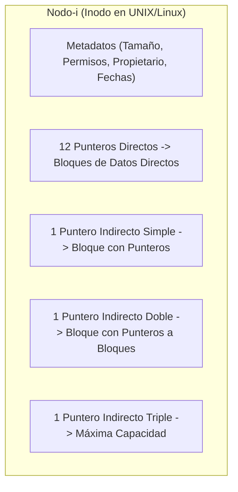

# SISTEMAS OPERATIVOS (UADE) — GUÍA DE ESTUDIO Y CUESTIONARIO RESUELTO
# UNIDAD 4: SISTEMA DE ARCHIVOS (FILE SYSTEMS)

> 📖 **Guía Pedagógica Explicada Desde Cero**  
> Este documento contiene las **25 preguntas oficiales** de la Unidad 4 resueltas de manera didáctica, clara y accesible para principiantes, manteniendo la rigurosidad conceptual de la cátedra (*Tanenbaum, Silberschatz, Stallings y Red Hat Enterprise Linux*) para preparar exámenes parciales y defensas orales.

---

## Índice Temático
- [Módulo I: Concepto de Archivo, Atributos y Operaciones del Kernel](#módulo-i-concepto-de-archivo-atributos-y-operaciones-del-kernel) (Preguntas 1 a 5, 20)
- [Módulo II: Formatos, Tipos de Archivo y Modos de Acceso](#módulo-ii-formatos-tipos-de-archivo-y-modos-de-acceso) (Preguntas 6 a 10)
- [Módulo III: Estructuras Internas de Archivo, Particiones y Volúmenes](#módulo-iii-estructuras-internas-de-archivo-particiones-y-volúmenes) (Preguntas 11 a 14)
- [Módulo IV: Esquemas de Asignación de Bloques en Disco y Nodos-i](#módulo-iv-esquemas-de-asignación-de-bloques-en-disco-y-nodos-i) (Preguntas 15 a 18)
- [Módulo V: Gestión de Espacio Libre y Directorios](#módulo-v-gestión-de-espacio-libre-y-directorios) (Preguntas 19, 21 a 23)
- [Módulo VI: Montaje y Sistemas de Archivos con Bitácora (Journaling)](#módulo-vi-montaje-y-sistemas-de-archivos-con-bitácora-journaling) (Preguntas 24 y 25)

---

## Módulo I: Concepto de Archivo, Atributos y Operaciones del Kernel

### Pregunta 1: ¿Qué es un archivo?

> 💡 **En palabras simples (Para entenderlo de cero):**  
> Un archivo es como una carpeta o libreta con nombre donde guardás información en la computadora para que no se pierda al apagarla. Es la forma que tiene el sistema operativo de esconderte la complejidad física del disco (pistas, sectores, chips de memoria) y darte algo fácil de usar: una caja con nombre donde guardás datos.

**Explicación y Concepto de Cátedra:**  
Un archivo es una **unidad lógica de almacenamiento continuo**, abstracta y persistente, definida por el Sistema Operativo sobre un dispositivo de almacenamiento secundario (HDD, SSD).  
Cumple tres propiedades fundamentales:
1. **Persistencia:** La información sobrevive a la terminación del proceso que la creó y al apagado del equipo.
2. **Abstracción:** Oculta los detalles físicos del hardware (geometría de disco, bloques, voltajes) ofreciendo una vista lógica uniforme.
3. **Compartibilidad:** Puede ser accedido por múltiples procesos y usuarios según sus permisos de seguridad.

📌 **Ejemplo en Linux:**  
Cualquier archivo de configuración, como `/etc/hostname`, almacena una secuencia persistente de bytes que identifican al servidor.

---

### Pregunta 2: Enuncie y describa brevemente los atributos más comunes de los archivos.

> 💡 **En palabras simples (Para entenderlo de cero):**  
> Son los "datos sobre el archivo" (los metadatos), como la ficha de tu DNI: cómo te llamás, cuánto medís, quién es tu dueño y cuándo naciste.

**Explicación y Concepto de Cátedra:**  
Los atributos varían según el sistema operativo, pero los más comunes son:
1. **Nombre (*Name*):** Cadena de texto legible por el usuario para identificar el archivo.
2. **Identificador (*Identifier*):** Número único interno en el sistema de archivos (en Linux es el **número de inodo**).
3. **Tipo (*Type*):** Indica si es un archivo regular, directorio, enlace o dispositivo.
4. **Ubicación (*Location*):** Puntero al dispositivo físico y a los bloques de disco donde residen los datos.
5. **Tamaño (*Size*):** Longitud actual del archivo en bytes o bloques de almacenamiento.
6. **Protección / Permisos (*Protection*):** Quién puede leer, escribir o ejecutar el archivo (bits `rwx`).
7. **Marcas de Tiempo (*Timestamps*):** Fecha y hora de creación, último acceso (`atime`) y última modificación (`mtime`).
8. **Propietario (*Owner*):** UID (User ID) y GID (Group ID) que determinan a quién pertenece.

📌 **Ejemplo en Linux:**  
El comando `stat archivo.txt` o `ls -l` expone directamente todos estos atributos en la terminal.

---

### Pregunta 3: Enuncie y describa brevemente las operaciones más comunes con archivos mencionando las llamadas al sistema asociadas.

> 💡 **En palabras simples (Para entenderlo de cero):**  
> Son los "verbos" o acciones que un programa le puede pedir al sistema operativo que haga sobre un archivo: crearlo, abrirlo, leerlo, escribirlo, moverse adentro de él o borrarlo.

**Explicación y Concepto de Cátedra:**  
Las operaciones estándar sobre archivos y sus correspondientes **Syscalls** en UNIX/Linux son:
1. **Crear (*Create*):** Asigna espacio en el directorio y reserva un inodo libre en disco.  
   $\to$ Syscall: `creat()` o `open(..., O_CREAT)`.
2. **Abrir (*Open*):** Carga los metadatos en la tabla de archivos abiertos del kernel y devuelve un descriptor de archivo (*fd*).  
   $\to$ Syscall: `open()` o `openat()`.
3. **Leer (*Read*):** Transfiere bytes desde el archivo hacia un búfer en la memoria RAM del proceso a partir de la posición del puntero.  
   $\to$ Syscall: `read()`.
4. **Escribir (*Write*):** Vuelca bytes desde la memoria RAM del proceso hacia el archivo en disco.  
   $\to$ Syscall: `write()`.
5. **Reposicionar (*Seek*):** Mueve el puntero de lectura/escritura a una posición específica sin transferir datos.  
   $\to$ Syscall: `lseek()`.
6. **Cerrar (*Close*):** Libera la entrada del descriptor en la tabla del proceso y sincroniza buffers.  
   $\to$ Syscall: `close()`.
7. **Borrar (*Delete / Unlink*):** Elimina la entrada del archivo en el directorio y libera los bloques e inodo si ya no tiene referencias activas.  
   $\to$ Syscall: `unlink()`.
8. **Truncar (*Truncate*):** Reduce el tamaño del archivo a una longitud especificada (incluso a 0) vaciando su contenido.  
   $\to$ Syscall: `truncate()` o `ftruncate()`.

---

### Pregunta 4: ¿Qué es un archivo especial de carácter?

> 💡 **En palabras simples (Para entenderlo de cero):**  
> En Linux "todo es un archivo". Un archivo especial de carácter representa a un dispositivo que manda o recibe letras de a una por vez, en fila india, sin guardar bloques fijos (como el teclado, el mouse o la pantalla).

**Explicación y Concepto de Cátedra:**  
Es un archivo de dispositivo (*Device File*) que sirve como interfaz con periféricos que transfieren datos como un **flujo continuo de caracteres/bytes individuales**, sin utilizar búferes de bloques direccionables y sin capacidad de posicionamiento aleatorio (*seek*).
- Se identifican con la letra **`c`** en los permisos de `ls -l`.

📌 **Ejemplo en Linux:**  
- `/dev/tty` (la consola/terminal del usuario).  
- `/dev/null` (el "agujero negro" que descarta todo lo que se le escribe).  
- `/dev/random` (generador de números aleatorios).

---

### Pregunta 5: ¿Qué es un archivo especial de bloque?

> 💡 **En palabras simples (Para entenderlo de cero):**  
> Es un archivo especial que representa a un dispositivo que lee y escribe la información en **paquetes o bloques de tamaño fijo** (por ejemplo, de 4 KB), y que te permite saltar a cualquier parte del dispositivo directamente (como un disco duro, un pendrive o un SSD).

**Explicación y Concepto de Cátedra:**  
Es un archivo de dispositivo que provee acceso a dispositivos de almacenamiento estructurados en **bloques independientes y directamente direccionables**. Permite transferencias masivas y operaciones de búsqueda aleatoria (`lseek`).
- Se identifican con la letra **`b`** en los permisos de `ls -l`.

📌 **Ejemplo en Linux:**  
- `/dev/sda` (el disco físico principal).  
- `/dev/sda1` o `/dev/nvme0n1p1` (las particiones de almacenamiento del disco).

---

### Pregunta 20: ¿Qué son las cuotas de disco?

> 💡 **En palabras simples (Para entenderlo de cero):**  
> Es como el límite de datos de tu plan de celular, pero en el disco de la computadora: el administrador le dice a cada usuario cuántos megabytes o cuántos archivos tiene permitido guardar como máximo para que nadie acapare todo el disco del servidor.

**Explicación y Concepto de Cátedra:**  
Las cuotas de disco son un mecanismo de control y administración del Sistema Operativo que limita el consumo de almacenamiento secundario por usuario o por grupo.  
Controla dos parámetros:
1. **Cuota de Bloques (*Block Quota*):** Límite máximo de espacio en bytes o kilobytes que el usuario puede ocupar.
2. **Cuota de Inodos (*Inode Quota*):** Límite máximo en la cantidad de archivos y directorios que el usuario puede crear (evita que un usuario agote la tabla de inodos creando millones de archivos vacíos).
- **Límite Blando (*Soft Limit*):** Advertencia temporal con período de gracia.
- **Límite Duro (*Hard Limit*):** Límite estricto infranqueable; el kernel rechaza cualquier intento de escritura posterior arrojando el error `EDQUOT`.

---

## Módulo II: Formatos, Tipos de Archivo y Modos de Acceso

### Pregunta 6: ¿Qué diferencias hay entre archivos ASCII y binarios?

> 💡 **En palabras simples (Para entenderlo de cero):**  
> - **ASCII (Texto plano):** Son letras, números y símbolos legibles por humanos organizados en renglones. Si lo abrís con el Bloc de notas o `cat`, lo podés leer.  
> - **Binario:** Son ceros y unos empaquetados para la computadora (ejecutables, fotos, audios). Si lo abrís con el Bloc de notas, ves puros símbolos raros e incomprensibles.

**Explicación y Concepto de Cátedra:**  
- **Archivos ASCII (o de texto plano):** Consisten en secuencias de bytes donde cada byte codifica un carácter estándar imprimible según la tabla ASCII (o UTF-8), delimitados por caracteres de fin de línea (`\n` en UNIX). Son independientes de la arquitectura de la CPU y legibles directamente por personas.
- **Archivos Binarios:** Secuencias de bytes arbitrarios que no representan texto legible. Tienen una estructura interna definida (cabeceras, secciones de datos, formatos de compresión) que solo puede ser interpretada por el programa que los diseñó o por el cargador del sistema operativo (por ejemplo, binarios ejecutables ELF, imágenes PNG, bases de datos).

---

### Pregunta 7: ¿Qué es el número mágico de un archivo?

> 💡 **En palabras simples (Para entenderlo de cero):**  
> Es como el "código de barras" o la firma secreta que está grabada en los primeros 2 o 4 bytes del archivo. Le dice a la computadora qué tipo de archivo es en realidad, sin importar qué nombre o extensión tenga.

**Explicación y Concepto de Cátedra:**  
El **Número Mágico (*Magic Number*)** es una constante de 2 a 4 bytes ubicada en los primeros bytes de la cabecera de un archivo que identifica de forma unívoca su formato o tipo de contenido ante el sistema operativo y sus herramientas:
- Un ejecutable Linux en formato ELF siempre comienza con los bytes hexadecimales: `7F 45 4C 46` (`\x7fELF`).
- Un archivo comprimido ZIP comienza con: `50 4B 03 04` (`PK..`).
- Un script de Shell comienza con los dos caracteres: `#!` (`0x23 0x21` - *Shebang*).

📌 **Ejemplo en Linux:**  
El comando `file` lee el número mágico del archivo para informarte qué es. Si renombrás una foto `imagen.png` a `imagen.txt`, el comando `file imagen.txt` seguirá diciendo correctamente que es un archivo de imagen PNG gracias a su número mágico.

---

### Pregunta 8: ¿Cuál es la función de la extensión de un archivo en Linux?

> 💡 **En palabras simples (Para entenderlo de cero):**  
> En Linux la extensión (`.txt`, `.sh`, `.c`) **es puramente un adorno visual para los humanos**. Al núcleo de Linux (Kernel) no le importa la extensión; Linux sabe cómo ejecutar un archivo mirando sus permisos de ejecución (`chmod +x`) y su número mágico, no sus letras finales.

**Explicación y Concepto de Cátedra:**  
A diferencia de Windows (donde la extensión determina rígidamente qué programa abre el archivo o si es ejecutable), **en Linux la extensión es solo una convención informativa para el usuario y las aplicaciones de usuario**:
- El Kernel de Linux ignora completamente la extensión para decidir la ejecución; se basa en los **bits de permisos POSIX** (`x`) y en la cabecera interna del archivo (número mágico o Shebang `#!/bin/bash`).
- Un script llamado `script_sin_extension` se ejecuta sin problemas si tiene `chmod +x`.

---

### Pregunta 9: Describa acceso secuencial.

> 💡 **En palabras simples (Para entenderlo de cero):**  
> Como un viejo casete de música o una cinta de video VHS: para escuchar el tema 5, tenés que pasar obligatoriamente por el tema 1, el 2, el 3 y el 4. No podés saltar mágicamente al 5 sin pasar por los anteriores.

**Explicación y Concepto de Cátedra:**  
En el **acceso secuencial**, la información del archivo se lee o se escribe en orden estricto, byte tras byte o registro tras registro, desde el principio hacia el fin.  
Cada operación de lectura avanza automáticamente el puntero de archivo interno. Era el único método posible en soportes físicos de cinta magnética y sigue siendo el método natural para procesar archivos de log o flujos de texto en consola.

---

### Pregunta 10: Describa acceso aleatorio o directo.

> 💡 **En palabras simples (Para entenderlo de cero):**  
> Como un CD de música o Spotify: podés hacer clic directamente en la pista 8 y reproducirla al instante sin tener que escuchar las primeras 7 canciones.

**Explicación y Concepto de Cátedra:**  
En el **acceso aleatorio (o directo)**, el programa puede leer o escribir cualquier byte o registro del archivo en cualquier orden arbitrario de forma inmediata, sin necesidad de leer los bytes intermedios.  
Esto se logra mediante operaciones de posicionamiento del puntero de lectura/escritura (utilizando la llamada al sistema **`lseek(fd, offset, whence)`**). Es fundamental para sistemas de bases de datos que necesitan consultar un registro específico en milisegundos.

---

## Módulo III: Estructuras Internas de Archivo, Particiones y Volúmenes

### Pregunta 11: Describa la forma de estructurar un archivo como una secuencia de bytes.

> 💡 **En palabras simples (Para entenderlo de cero):**  
> El archivo es simplemente una tira larga y continua de bytes sin ninguna regla fija. El sistema operativo no se mete con lo que hay adentro; le dice al programador: *"hacé lo que quieras con estos bytes, para mí es solo una tira de datos"*.

**Explicación y Concepto de Cátedra:**  
Es el modelo adoptado por **UNIX y Linux**:
- El archivo es una secuencia no estructurada de 8 bits (bytes).
- El sistema operativo no impone ni reconoce ninguna estructura interna de registros dentro del archivo.
- Otorga máxima flexibilidad: cualquier aplicación puede interpretar los bytes como texto, código binario, estructuras de datos o píxeles de una imagen sin restricciones del kernel.

---

### Pregunta 12: Describa la forma de estructurar un archivo como una secuencia de registros.

> 💡 **En palabras simples (Para entenderlo de cero):**  
> El archivo está dividido como una planilla de cálculo con filas de tamaño fijo. Cada fila (registro) tiene exactamente el mismo tamaño, y la lectura siempre se hace de a un renglón completo por vez.

**Explicación y Concepto de Cátedra:**  
En este modelo, el archivo se compone de una secuencia de **registros de longitud fija**, cada uno con su propia estructura interna predeterminada.  
Una operación de lectura lee un registro completo y una de escritura graba un registro completo. Fue el esquema estándar en los sistemas operativos mainframe de IBM en la era de las tarjetas perforadas (de 80 caracteres fijos).

---

### Pregunta 13: Describa la forma de estructurar un archivo como un árbol de registros.

> 💡 **En palabras simples (Para entenderlo de cero):**  
> Como un diccionario o una guía telefónica organizada en un árbol. Los registros pueden medir cualquier tamaño y cada uno tiene una "clave" (como un apellido o DNI) que permite buscarlo rapidísimo saltando por las ramas del árbol.

**Explicación y Concepto de Cátedra:**  
El archivo se organiza como un **árbol jerárquico de registros de longitud variable** (típicamente un árbol B o B+).  
Cada registro contiene un campo clave en una posición fija. El sistema operativo ordena los registros por su clave para permitir búsquedas ultrarrápidas y la inserción o borrado de nuevos elementos sin tener que reescribir todo el archivo. Se utiliza internamente en motores de bases de datos transaccionales.

---

### Pregunta 14: ¿Qué es una partición? ¿Qué diferencias existen entre particiones y volúmenes?

> 💡 **En palabras simples (Para entenderlo de cero):**  
> - **Partición:** Es cortar una torta (un disco duro físico) con un cuchillo en 2 o 3 porciones separadas.  
> - **Volumen:** Es el plato donde servís la comida. Un volumen puede ser una sola porción (partición), o podés juntar varias porciones de distintas tortas y armar un plato gigante (un volumen lógico LVM).

**Explicación y Concepto de Cátedra:**  
- **Partición:** Es una subdivisión física o lógica continua creada sobre **un único disco físico**. Viene delimitada en una tabla de particiones (MBR o GPT).
- **Volumen:** Es una **abstracción de almacenamiento de nivel superior** sobre la cual se crea un sistema de archivos formateado:
  - Una partición formateada puede ser un volumen.
  - Pero un volumen también puede abarcar **múltiples particiones o múltiples discos físicos combinados** mediante tecnologías como LVM (*Logical Volume Manager*) o arreglos RAID.

---

## Módulo IV: Esquemas de Asignación de Bloques en Disco y Nodos-i

---

### Pregunta 15: Describa el esquema de asignación contigua y mencione sus ventajas y desventajas.

> 💡 **En palabras simples (Para entenderlo de cero):**  
> El archivo se guarda en bloques de disco consecutivos y pegaditos uno al lado del otro (por ejemplo, del bloque 10 al 15).  
> - **Ventaja:** Vuela de rápido porque el cabezal del disco no se mueve.  
> - **Desventaja:** Provoca **fragmentación externa** (quedan huecos libres dispersos) y si el archivo crece, no tiene lugar para expandirse porque choca con el vecino.

**Explicación y Concepto de Cátedra:**  
Cada archivo ocupa un conjunto de bloques consecutivos en el almacenamiento físico.  
- **Ventajas:**
  1. *Excelente rendimiento de lectura:* La cabeza del disco lectora no necesita reposicionarse; lee todos los bloques en una sola pasada continua.
  2. *Gran simplicidad:* El directorio solo necesita guardar la dirección del primer bloque y la longitud total del archivo. Admite acceso aleatorio trivial.
- **Desventajas:**
  1. *Fragmentación Externa:* A medida que los archivos se borran, el disco se llena de huecos libres aislados.
  2. *Inflexibilidad de crecimiento:* Si un archivo necesita agrandarse y el bloque siguiente está ocupado, debe ser movido completo a otro lugar del disco.

---

### Pregunta 16: Describa el esquema de asignación con listas enlazadas y mencione sus ventajas y desventajas.

> 💡 **En palabras simples (Para entenderlo de cero):**  
> Es como una búsqueda del tesoro: el bloque 1 guarda datos y al final tiene una nota que dice *"el siguiente pedazo está en el bloque 89"*. El bloque 89 dice *"el siguiente está en el bloque 3"*.  
> - **Ventaja:** No hay espacio desperdiciado; usás cualquier bloque libre.  
> - **Desventaja:** Para leer el final del archivo tenés que leer obligatoriamente todos los bloques anteriores en el disco uno por uno (acceso aleatorio lentísimo).

**Explicación y Concepto de Cátedra:**  
Cada archivo se almacena como una lista enlazada de bloques de disco dispersos. Los primeros bytes de cada bloque contienen datos, y los últimos bytes contienen un puntero al número del siguiente bloque de disco del archivo.  
- **Ventajas:**
  1. *Cero fragmentación externa:* Se puede aprovechar cualquier bloque libre en cualquier parte del disco.
  2. *Crecimiento dinámico:* El archivo puede crecer indefinidamente mientras existan bloques libres.
- **Desventajas:**
  1. *Pésimo acceso aleatorio:* Para leer el bloque $K$, el disco debe leer físicamente los $K-1$ bloques anteriores siguiendo los punteros.
  2. *Espacio desperdiciado en punteros:* El tamaño útil de datos de cada bloque ya no es una potencia de dos (ej. 4092 bytes de datos + 4 bytes de puntero), complicando la gestión de memoria.

---

### Pregunta 17: Describa el esquema de asignación de lista enlazada utilizando una tabla en memoria (FAT) y mencione sus ventajas y desventajas.

> 💡 **En palabras simples (Para entenderlo de cero):**  
> Es el famoso sistema **FAT** (el de los pendrives viejos). Para no tener que viajar por todo el disco buscando las notas con los punteros, agarraron todos los punteros y los pusieron juntos en una tabla resumen que se carga entera en la memoria RAM.

**Explicación y Concepto de Cátedra:**  
Toma la idea de la lista enlazada pero extrae todos los punteros fuera de los bloques de datos y los agrupa en una única tabla centralizada en memoria RAM denominada **FAT (*File Allocation Table*)**:
- Si el archivo arranca en el bloque 4, la entrada 4 de la FAT apunta al 7, la 7 apunta al 2, etc.
- **Ventajas:**
  1. *Acceso aleatorio mucho más rápido:* La búsqueda de los enlaces se realiza en la memoria RAM recorriendo la tabla, sin realizar lecturas físicas lentas en el disco.
  2. *Bloques de datos limpios:* El 100% del espacio del bloque de disco se utiliza para almacenar datos útiles.
- **Desventajas:**
  1. *Escalabilidad deficiente:* Toda la tabla FAT debe residir de forma permanente en la memoria RAM. Para discos modernos de terabytes con millones de bloques, la tabla consumiría gigabytes enteros de memoria RAM solo para existir.

---

### Pregunta 18: Describa el esquema de asignación indexada con nodos-i (Inodes) y mencione sus ventajas y desventajas.

> 💡 **En palabras simples (Para entenderlo de cero):**  
> Es el corazón de **Linux / Red Hat**. Cada archivo tiene una ficha técnica llamada **nodo-i** (*inodo*) que tiene una lista de números con las direcciones exactas de sus bloques de disco: los primeros 12 bloques van directo; si el archivo es más grande, usa punteros indirectos (apuntan a bloques llenos de más punteros).

**Explicación y Concepto de Cátedra:**  
Es el método de asignación utilizado por los sistemas de archivos tipo UNIX (ext4, ext3). Cada archivo posee una estructura de datos fija denominada **nodo-i (*index node*)**:
- Almacena todos los atributos del archivo (tamaño, permisos, dueño, marcas de tiempo).
- Posee un arreglo de punteros a bloques de disco:
  - **12 Punteros Directos:** Apuntan directamente a los primeros 12 bloques de datos (acceso ultrarrápido para archivos chicos).
  - **1 Puntero Indirecto Simple:** Apunta a un bloque de disco que contiene cientos de punteros a bloques de datos.
  - **1 Puntero Indirecto Doble y 1 Triple:** Para soportar archivos gigantescos de gigabytes o terabytes.
- **Ventajas:**
  1. *Eficiencia de memoria:* El nodo-i solo se carga a la RAM cuando el archivo está abierto.
  2. *Excelente acceso aleatorio:* Para cualquier byte del archivo se sabe exactamente qué bloque consultar calculando el índice.
- **Desventajas:** Desperdicio de punteros para archivos muy diminutos que solo ocupan unos pocos bytes.

---

## Módulo V: Gestión de Espacio Libre y Directorios

### Pregunta 19: Describa el método de registro de bloques libres mediante mapas de bits.

> 💡 **En palabras simples (Para entenderlo de cero):**  
> Es una planilla de ceros y unos donde cada bit representa un bloque del disco: si el bloque está ocupado vale `0`, si está libre vale `1`. Para encontrar espacio libre, la computadora busca el primer `1` que aparezca.

**Explicación y Concepto de Cátedra:**  
El sistema de archivos mantiene un arreglo de bits continuo donde cada bit se corresponde unívocamente con un bloque físico del disco:
- `0`: Bloque asignado / ocupado.
- `1`: Bloque libre disponible.  
Para un disco con $N$ bloques, se requiere un mapa de $N$ bits.  
- **Ventaja:** Muy compacto y sumamente rápido gracias a instrucciones especiales de la CPU que encuentran el primer bit en `1` en un solo ciclo de reloj (*find-first-set*). Facilita encontrar bloques contiguos para minimizar la fragmentación.

---

### Pregunta 21: ¿Qué es un directorio? ¿Qué diferencias existen entre sistemas de directorios de un solo nivel y sistemas de directorios jerárquicos?

> 💡 **En palabras simples (Para entenderlo de cero):**  
> Un directorio (carpeta) es una tabla que asocia nombres de archivos legibles por humanos con sus números de inodo reales.  
> - **Un solo nivel:** Como tirar todos los papeles en un único cajón: nadie puede tener dos archivos con el mismo nombre y es un caos encontrarlos.  
> - **Jerárquico (Árbol):** Podés crear carpetas dentro de carpetas. Podés tener un archivo `foto.jpg` en la carpeta *Vacaciones* y otro `foto.jpg` en la carpeta *Trabajo* sin que choquen.

**Explicación y Concepto de Cátedra:**  
Un directorio es un archivo especial gestionado por el sistema de archivos cuya función es almacenar pares: **(Nombre de Archivo $\to$ Identificador / Número de Inodo)**.
- **Directorio de un solo nivel:** Todos los archivos de todos los usuarios residen en un único directorio global. Es ineficiente y presenta el grave problema de **colisión de nombres** (dos usuarios no pueden llamar a su archivo `informe.txt`).
- **Directorio Jerárquico (Estructura en Árbol):** Esquema estándar actual. Permite crear directorios y subdirectorios anidados, organizando lógicamente la información y permitiendo que existan archivos con nombres idénticos siempre que residan en rutas diferentes.

---

### Pregunta 22: ¿Cuáles son las operaciones comunes que se pueden realizar con los directorios? Enuncie las llamadas al sistema más comunes asociadas a estas operaciones.

> 💡 **En palabras simples (Para entenderlo de cero):**  
> Las acciones básicas de carpetas: crear una carpeta, borrarla, abrirla para ver qué tiene adentro, leer sus archivos y cerrarla.

**Explicación y Concepto de Cátedra:**  
Las operaciones estándar sobre directorios y sus **Syscalls** asociadas en Linux/UNIX son:
1. **Crear directorio:** Reserva un inodo de tipo directorio y crea las entradas obligatorias `.` (sí mismo) y `..` (directorio padre).  
   $\to$ Syscall: `mkdir()`.
2. **Borrar directorio:** Elimina el directorio (debe estar vacío).  
   $\to$ Syscall: `rmdir()`.
3. **Abrir directorio:** Obtiene un descriptor de flujo para inspeccionar su contenido.  
   $\to$ Syscall / Biblioteca: `opendir()`.
4. **Leer directorio:** Devuelve secuencialmente la siguiente entrada de directorio (`struct dirent`) con el nombre y el inodo.  
   $\to$ Syscall: `getdents64()` / Biblioteca: `readdir()`.
5. **Cerrar directorio:** Libera las estructuras asociadas.  
   $\to$ Syscall / Biblioteca: `closedir()`.
6. **Crear enlace duro:** Agrega una nueva entrada de nombre que apunta a un inodo existente.  
   $\to$ Syscall: `link()`.
7. **Desvincular:** Elimina una entrada de nombre en el directorio.  
   $\to$ Syscall: `unlink()`.

---

### Pregunta 23: ¿Qué diferencias hay entre los nombres de ruta absolutos y los nombres de ruta relativos?

> 💡 **En palabras simples (Para entenderlo de cero):**  
> - **Ruta Absoluta:** Da la dirección completa desde la entrada principal de la ciudad (arranca siempre desde la barra raíz `/`). No importa dónde estés parado, siempre llega al mismo lugar.  
> - **Ruta Relativa:** Da indicaciones desde el lugar donde estás parado ahora ("caminá dos pasos y doblá a la izquierda"). Depende de cuál sea tu carpeta actual.

**Explicación y Concepto de Cátedra:**  
- **Ruta Absoluta (*Absolute Pathname*):** Comienza siempre desde el directorio raíz (`/`) del sistema y define el camino completo descendiendo por el árbol jerárquico hasta el archivo. Es independiente de cuál sea el directorio actual de trabajo (*Working Directory*).  
  *Ejemplo:* `/home/alumno/sistemas-operativos/unidad_4/ejercicio.c`
- **Ruta Relativa (*Relative Pathname*):** Se resuelve a partir del **Directorio de Trabajo Actual** del proceso. Utiliza las referencias especiales `.` (directorio actual) y `..` (directorio padre).  
  *Ejemplo:* Si estás parado en `unidad_4`, la ruta relativa es simplemente `./ejercicio.c` o `../Unidad_3/simulador.c`.

---

## Módulo VI: Montaje y Sistemas de Archivos con Bitácora (Journaling)

### Pregunta 24: ¿Qué es el montaje?

> 💡 **En palabras simples (Para entenderlo de cero):**  
> Cuando enchufás un pendrive en Linux, no aparece como una letra `E:` o `D:` separada como en Windows. El sistema operativo "injerta" el contenido del pendrive como una rama adentro de una carpeta de tu árbol principal (por ejemplo, en `/media/usb`). Ese acto de injertar un disco en una carpeta se llama **Montaje**.

**Explicación y Concepto de Cátedra:**  
El **Montaje (*Mounting*)** es la operación mediante la cual el sistema operativo acopla el sistema de archivos de un dispositivo de almacenamiento secundario (un disco rígido, pendrive o recurso de red) a un directorio existente en el árbol jerárquico global del sistema.
- A ese directorio receptor se lo denomina **Punto de Montaje (*Mount Point*)**.
- Una vez montado, los archivos del dispositivo aparecen como si fueran subdirectorios nativos del árbol principal.
- Syscall involucrada: `mount()`. En consola se utiliza el comando `mount /dev/sdb1 /mnt/disco`.

---

### Pregunta 25: ¿Describa un sistema de archivos con bitácora (Journaling)?

> 💡 **En palabras simples (Para entenderlo de cero):**  
> Como un contador que anota en un borrador antes de firmar el libro contable. Si se corta la luz justo en el segundo en que estabas guardando un archivo, la computadora no se vuelve loca ni se corrompe el disco: al reiniciar, lee la bitácora (*Journal*), ve qué operación había quedado a medias y la completa o la cancela en 2 segundos, sin tener que escanear todo el disco durante horas.

**Explicación y Concepto de Cátedra:**  
Un **Sistema de Archivos con Bitácora (*Journaling File System*)** (como **ext4** o **XFS** en Red Hat Enterprise Linux) mantiene un registro circular de eventos en disco llamado **Bitácora (*Journal*)**:
1. **Paso 1 (Registro previo):** Antes de modificar las estructuras críticas de metadatos del disco (inodos, mapas de bits, directorios), describe la operación que va a realizar y la escribe de forma atómica en la bitácora.
2. **Paso 2 (Escritura definitiva):** Escribe los datos en las estructuras definitivas del sistema de archivos.
3. **Paso 3 (Compromiso):** Marca la transacción como completada en la bitácora.

- **Gran Ventaja de Recuperación:** Si el sistema sufre un corte de energía o caída catastrófica (*Kernel Panic*), al reiniciar no es necesario ejecutar un análisis exhaustivo y lento de todo el disco con `fsck`. El kernel simplemente revisa la bitácora: si había una operación a medio escribir, la completa (*replay*) o la descarta de manera consistente en fracciones de segundo.

---

## Resumen Rápido para la Defensa Oral Individual

Si el docente te evalúa de forma individual sobre la Unidad 4, asegurate de tener claros estos 3 pilares:

1. **La Filosofía de Linux:** *"En Linux todo se abstrae como un archivo"*. Los dispositivos son archivos especiales (de caracteres `/dev/tty` o de bloques `/dev/sda`), y las extensiones son convenciones de usuario; el kernel utiliza permisos y el número mágico.
2. **La Arquitectura del Inodo (Nodo-i):** El inodo almacena todos los metadatos y los punteros a los bloques de disco (12 directos, indirectos simples, dobles y triples), separando el nombre del archivo (que vive en el directorio) del contenido real y sus atributos.
3. **La Integridad con Bitácora (*Journaling*):** Ext4 y XFS en Red Hat previenen corrupciones ante cortes de energía escribiendo primero las transacciones en una bitácora circular antes de tocar los inodos definitivos.
