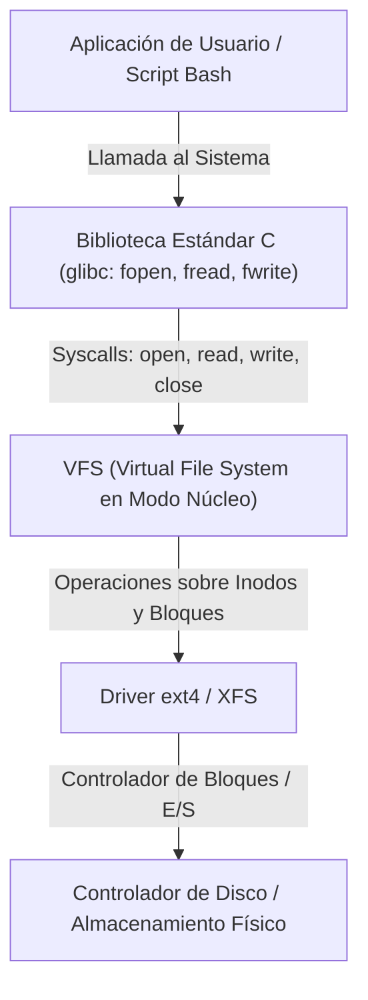
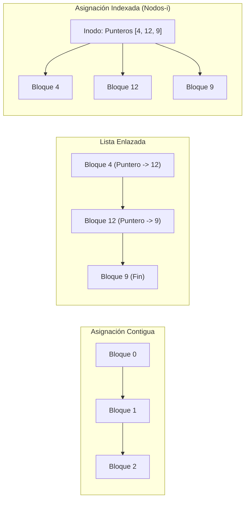
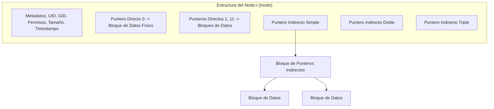

# SISTEMAS OPERATIVOS (UADE) - TRABAJO PRÁCTICO OBLIGATORIO
# UNIDAD 4: SISTEMA DE ARCHIVOS — ASIGNACIÓN CONTIGUA, FRAGMENTACIÓN EXTERNA EN DISCO Y EVOLUCIÓN HACIA LA ASIGNACIÓN INDEXADA CON NODOS-I EN RED HAT ENTERPRISE LINUX

---

## Ficha del Trabajo y Datos del Equipo

- **Institución:** Universidad Argentina de la Empresa (UADE)
- **Materia:** Sistemas Operativos
- **Cuatrimestre:** Segundo Cuatrimestre
- **Tema:** Unidad 4 - Sistema de Archivos: Simulación de Algoritmos de Asignación de Bloques en Disco (Asignación Contigua First-Fit vs. Best-Fit), Demostración Empírica de Fragmentación Externa de Almacenamiento, Imposibilidad de Crecimiento Dinámico de Archivos y Evolución Arquitectónica hacia la Asignación Indexada con Nodos-i (*Inodes*) en Red Hat Enterprise Linux (ext4/XFS).
- **Grupo N°:** [Completar con N° de Grupo]
- **Integrantes:**
  1. [Integrante 1 - Nombre y Apellido - Legajo]
  2. [Integrante 2 - Nombre y Apellido - Legajo]
  3. [Integrante 3 - Nombre y Apellido - Legajo]
  4. [Integrante 4 - Nombre y Apellido - Legajo]

---

## 1. Planteo del Problema Hipotético

### 1.1 Contexto Empresarial
En la compañía de servicios en la nube y almacenamiento corporativo **"CloudVault Data Solutions"**, un parque de servidores ejecutando **Red Hat Enterprise Linux (RHEL 9)** aloja particiones de almacenamiento dedicadas para el resguardo de volcados de bases de datos (*backups*), registros transaccionales (*transaction logs*) y material multimedia perteneciente a grandes clientes corporativos.

Originalmente, para optimizar el rendimiento de lectura y escritura en discos magnéticos y cabezales mecánicos, el subsistema de almacenamiento de alta velocidad fue formateado con un esquema tradicional de **Asignación Contigua de Bloques en Disco**. Bajo este modelo, cada archivo debe ser almacenado obligatoriamente en un conjunto ininterrumpido de bloques físicos consecutivos del disco, maximizando la velocidad secuencial de transferencia de E/S.

### 1.2 Incidente o Situación Crítica
Durante el cierre contable mensual y el respaldo programado de la medianoche, los microservicios de resguardo comenzaron a abortar de manera crítica con el siguiente error en la consola del servidor:

```text
[ERROR CRÍTICO]: Fallo al almacenar archivo 'backup_transaccional.iso' (426 bloques / 426 KB). 
Error del Sistema de Archivos: No space left on device (ENOSPC).
Fallo al reservar bloques contiguos de almacenamiento secundario.
```

Ante la alerta, el Administrador de Sistemas (Sysadmin) ingresó a la consola de Red Hat y ejecutó las herramientas de diagnóstico estándar de almacenamiento (`df -h` y auditoría del mapa de bits de bloques libres). La salida arrojó una paradoja desconcertante para el equipo de infraestructura:

- **Espacio total libre en la partición:** Más de **959 bloques libres** (equivalentes a casi 1 MB de almacenamiento disponible).
- **Tamaño del archivo rechazado (`backup_transaccional.iso`):** Únicamente **426 bloques** (426 KB).
- **Relación de espacio:** El almacenamiento disponible duplica con creces el tamaño del archivo solicitado ($959 \text{ bloques} \gg 426 \text{ bloques}$).

Al mismo tiempo, otro proceso de registro transaccional en producción (`auditoria_sistema.log`) intentó anexar datos adicionales (*append*) y fue terminado abruptamente: a pesar de que el archivo ya existía y el disco tenía espacio de sobra, el bloque contiguo inmediato siguiente estaba ocupado por otro archivo, haciendo físicamente imposible su expansión sin sobrescribir datos ajenos.

### 1.3 Comportamiento Inicial del Sistema
1. El sistema de archivos cuenta con capacidad de bloques libres totales muy superior a la requerida por el archivo entrante.
2. La solicitud de escritura es rechazada tajantemente arrojando un error de disco lleno (`ENOSPC`), debido a que el asignador contiguo no encuentra ningún segmento libre continuo de 426 bloques consecutivos.
3. La creación y eliminación continua de archivos temporales generó una severa **Fragmentación Externa en el Disco**, dejando el espacio libre pulverizado en "huecos" no contiguos.
4. El esquema no tolera el **crecimiento dinámico de archivos (*File Growth*)**, forzando al sistema operativo a abortar escrituras o a incurrir en costosas operaciones de copia total.

### 1.4 Objetivo del Ejercicio
1. **Reutilizar y adaptar la arquitectura del simulador de la Unidad 3**, transformando el modelo de asignación de memoria en un simulador integral de **Asignación de Bloques en Disco de Sistemas de Archivos (`simulador_filesystem.c`)**.
2. **Reproducir y demostrar empíricamente la Fragmentación Externa en Almacenamiento Secundario**, probando por qué los algoritmos contiguos de **Primer Ajuste (First-Fit)** y **Mejor Ajuste (Best-Fit)** fracasan al intentar alojar un archivo de 426 bloques cuando existen 959 bloques libres dispersos.
3. **Modelar la problemática del crecimiento dinámico (*Append*)**: evidenciar cómo un archivo en asignación contigua queda bloqueado ante el intento de expansión si el bloque siguiente está asignado.
4. **Implementar la Solución Estándar de Red Hat Linux: Asignación Indexada mediante Nodos-i (*Inodes*)**:
   - Modelar una estructura de Inodo con punteros a bloques de disco y un Mapa de Bits (*Free Space Bitmap*).
   - Demostrar cómo el algoritmo indexado ('I') aloja exitosamente el 100% del archivo de 426 bloques aprovechando todos los bloques libres dispersos, erradicando la fragmentación externa y permitiendo el crecimiento dinámico sin reubicación física.
5. **Orquestar el ciclo completo mediante Shell Scripting en Bash (`ejecutar_tpo.sh`)** en la consola de Red Hat Enterprise Linux, complementándolo con herramientas forenses nativas del sistema operativo (`stat`, `ls -li`, `df -h`, `df -i`, `file`) para auditar inodos, descriptores de archivo y metadatos reales del kernel.

---

## 2. Marco Teórico de la Unidad 4: Sistema de Archivos (*File Systems*)

El desarrollo del ejercicio y su solución práctica se sustentan en los conceptos fundamentales del programa de la materia (*Tanenbaum*, *Silberschatz*, *Stallings* y documentación técnica de *Red Hat Enterprise Linux*):

### 2.1 Concepto de Archivo, Abstracción y Persistencia
Un **Archivo** es una unidad lógica de almacenamiento continuo, abstracta y persistente, administrada por el Sistema Operativo sobre un dispositivo de almacenamiento secundario (HDD, SSD).
Cumple tres propiedades esenciales:
1. **Persistencia:** La información sobrevive a la finalización del proceso que la creó y al apagado de la máquina.
2. **Abstracción:** Oculta los detalles físicos del hardware (sectores, cilindros, pistas, memoria flash NAND, voltajes) proporcionando una vista lógica uniforme (secuencia lineal de bytes).
3. **Compartibilidad:** Puede ser compartido entre múltiples usuarios y procesos aplicando mecanismos de control de acceso y permisos.

### 2.2 Atributos de los Archivos y Metadatos en Linux
Los metadatos describen las características del archivo sin formar parte de sus datos útiles:
- **Nombre (*Name*):** Etiqueta legible por el usuario para identificar el recurso.
- **Identificador (*Identifier*):** Número unívoco dentro del sistema de archivos (**número de inodo** en Linux).
- **Tipo (*Type*):** Regular (`-`), Directorio (`d`), Enlace simbólico (`l`), Dispositivo de bloque (`b`), Dispositivo de carácter (`c`), FIFO/Pipe (`p`) o Socket (`s`).
- **Ubicación (*Location*):** Punteros a los bloques de almacenamiento secundario donde residen los datos físicos.
- **Tamaño (*Size*):** Longitud en bytes y cantidad de bloques asignados de 512B/4096B.
- **Protección y Permisos (*Protection*):** Modos de acceso POSIX (lectura `r`, escritura `w`, ejecución `x`) para Propietario (*Owner/UID*), Grupo (*Group/GID*) y Otros (*Others*).
- **Marcas de Tiempo (*Timestamps*):**
  - `atime` (*Access Time*): Último acceso de lectura.
  - `mtime` (*Modification Time*): Última modificación del contenido.
  - `ctime` (*Change Time*): Último cambio en los metadatos o permisos del inodo.

En Linux, el comando `stat archivo` extrae directamente estos atributos consultando la llamada al sistema `stat()` / `fstat()`.

---

### 2.3 Operaciones con Archivos y Llamadas al Sistema (Syscalls del VFS)
El subsistema de archivos virtuales (**VFS - Virtual File System**) del kernel de Linux estandariza las llamadas al sistema para la manipulación de archivos:



1. **`open()` / `creat()`:** Carga los metadatos del archivo en la Tabla de Archivos Abiertos del Kernel y devuelve un **Descriptor de Archivo (*File Descriptor - fd*)** entero no negativo.
2. **`read(fd, buf, count)`:** Transfiere `count` bytes desde la posición actual del puntero del archivo hacia un búfer en el espacio de usuario.
3. **`write(fd, buf, count)`:** Escribe bytes desde la memoria RAM del proceso hacia el almacenamiento secundario, actualizando el tamaño y `mtime`.
4. **`lseek(fd, offset, whence)`:** Modifica la posición del puntero de lectura/escritura sin transferir datos, permitiendo acceso aleatorio directo.
5. **`close(fd)`:** Libera la entrada en la tabla de descriptores del proceso y descarga los búferes sucios hacia el disco.
6. **`unlink(pathname)`:** Elimina el enlace en el directorio. Si el contador de enlaces duros (*hard links*) llega a cero y ningún proceso tiene el archivo abierto, libera los bloques de disco y el inodo.
7. **`truncate(pathname, length)`:** Ajusta el tamaño de un archivo a la cantidad indicada de bytes, liberando bloques si se reduce.

---

### 2.4 Clasificación de Archivos y Números Mágicos
- **Archivos ASCII:** Texto plano estructurado en líneas separadas por saltos de línea (`\n`). Son independientes de la arquitectura de la CPU y legibles directamente por personas.
- **Archivos Binarios:** Secuencias de bytes arbitrarios interpretables únicamente por aplicaciones específicas o por el cargador ELF del sistema operativo.
- **Número Mágico (*Magic Number*):** Firma de 2 a 4 bytes ubicada al comienzo del archivo que identifica de forma unívoca su tipo real ante el sistema operativo, independientemente de su nombre o extensión:
  - Binarios ELF de Linux: `7F 45 4C 46` (`\x7fELF`).
  - Scripts ejecutables: `23 21` (`#!` - *Shebang*).
  - Archivos ZIP/JAR: `50 4B 03 04` (`PK..`).
- **Función de la extensión en Linux:** A diferencia de Windows, en Linux la extensión es puramente informativa para el usuario. El Kernel no ejecuta un archivo por llamarse `.sh` o `.exe`, sino por tener activo el bit de ejecución (`chmod +x`) y verificar su cabecera binaria o *Shebang*.

---

### 2.5 Métodos de Acceso: Secuencial vs. Aleatorio (Directo)
- **Acceso Secuencial:** Los datos se procesan en estricto orden cronológico desde el inicio hasta el final, como en cintas magnéticas, tuberías (*pipes*) o archivos de log (`tail -f`).
- **Acceso Aleatorio (Directo):** Los registros o bytes pueden ser accedidos en cualquier orden instantáneamente mediante `lseek()`. Es fundamental para motores de bases de datos relacionales y tablas de índices.

---

### 2.6 Esquemas de Asignación de Bloques en Disco

La decisión de cómo el sistema operativo asigna los bloques físicos de un disco a un archivo es uno de los compromisos de diseño más críticos en arquitectura de software:



#### 1. Asignación Contigua (*Contiguous Allocation*)
Cada archivo ocupa un conjunto de bloques consecutivos en el disco.
- **Ventajas:**
  - Máxima velocidad de E/S secuencial: el cabezal del disco lee todos los bloques sin reposicionarse (*seek time* mínimo).
  - Acceso directo trivial: el bloque $K$ se ubica calculando $\text{Bloque Inicial} + K$.
- **Desventajas:**
  - **Fragmentación Externa:** A medida que los archivos nacen y mueren, el almacenamiento se fragmenta en huecos libres dispersos.
  - **Imposibilidad de Crecimiento Dinámico:** Si un archivo necesita crecer y el bloque contiguo inmediato está ocupado, debe reubicarse todo el archivo a un hueco mayor o fallar.
  - Requiere conocer o estimar el tamaño final del archivo de antemano.

#### 2. Asignación con Listas Enlazadas (*Linked Allocation*)
Cada bloque contiene datos y un puntero de 4 u 8 bytes al siguiente bloque físico.
- **Ventajas:** Cero fragmentación externa (cualquier bloque libre sirve) y soporte nativo de crecimiento dinámico.
- **Desventajas:** Pésimo acceso aleatorio (para leer el bloque 50 hay que leer los 49 bloques anteriores) y pérdida de capacidad en cada bloque debido a los punteros.

#### 3. Lista Enlazada con Tabla en Memoria (FAT - *File Allocation Table*)
Centraliza todos los punteros de los bloques en una única tabla que se carga en la memoria RAM.
- **Ventajas:** Acceso aleatorio más rápido (el recorrido de la cadena ocurre en RAM sin accesos mecánicos a disco) y bloques de datos limpios (100% útiles).
- **Desventajas:** Pésima escalabilidad; para discos de terabytes la tabla FAT requeriría gigabytes de memoria RAM de manera permanente.

#### 4. Asignación Indexada mediante Nodos-i (*Inodes*) — Estándar de Linux/Red Hat
Cada archivo posee su propia estructura denominada **Nodo-i (Inodo)** que centraliza sus metadatos y un arreglo de punteros a bloques de datos:
- **12 Punteros Directos:** Apuntan a los primeros 12 bloques de datos (acceso instantáneo para archivos chicos y medianos).
- **1 Puntero Indirecto Simple:** Apunta a un bloque auxiliar que alberga cientos de direcciones de bloques.
- **1 Puntero Indirecto Doble:** Apunta a un bloque de bloques de punteros.
- **1 Puntero Indirecto Triple:** Soporta archivos de dimensiones de petabytes.
- **Ventajas:**
  - **Erradica por completo la fragmentación externa:** los bloques asignados pueden estar dispersos en cualquier posición del disco.
  - **Soporte de Crecimiento Dinámico:** un archivo puede crecer agregando bloques sueltos del mapa de bits sin necesidad de reorganizar los bloques ya escritos.
  - **Excelente Acceso Aleatorio:** se calcula directamente el índice del puntero deseado sin recorrer el archivo.
  - **Economía de Memoria:** a diferencia de FAT, los inodos solo se cargan en la RAM cuando los archivos correspondientes están en uso (*open*).



---

### 2.7 Administración de Espacio Libre: Mapas de Bits (*Bitmaps*)
Para saber qué bloques de disco están disponibles, el sistema de archivos mantiene un **Mapa de Bits de Bloques Libres**:
- Cada bloque físico del disco se mapea a un único bit en el mapa.
- `0`: Bloque asignado / ocupado.
- `1`: Bloque libre disponible.
- **Ventaja:** Muy compacto y extremadamente veloz; el kernel encuentra rápidamente el primer bit en `1` utilizando instrucciones nativas del procesador.

---

### 2.8 Directorios, Nombres de Ruta y Montaje
- **Directorio:** Archivo especial cuyo contenido interno es una tabla que mapea nombres legibles por el usuario con sus respectivos números de inodo (*dentries*).
- **Ruta Absoluta:** Comienza invariablemente en la raíz del árbol jerárquico (`/var/log/syslog`).
- **Ruta Relativa:** Comienza desde el directorio de trabajo actual del proceso (`./datos/archivo.txt`).
- **Montaje (*Mount*):** Operación mediante la cual el sistema operativo incorpora un sistema de archivos contenido en una partición o disco a un punto específico del árbol de directorios global (*punto de montaje*), unificando todo el almacenamiento bajo una única raíz `/`.

---

### 2.9 Consistencia y Sistemas de Archivos con Bitácora (*Journaling*)
Para evitar la corrupción ante cortes imprevistos de energía o fallos del kernel, los sistemas de archivos modernos de Red Hat (`ext4`, `XFS`) incorporan una **Bitácora (*Journal*)**:
- Las operaciones de modificación sobre metadatos e inodos se escriben secuencialmente primero en una zona especial de registro circular antes de modificarse en las estructuras definitivas del disco.
- Tras un reinicio repentino (*crash*), el kernel no necesita escanear el disco entero (`fsck`); simplemente lee la bitácora para rehacer transacciones confirmadas o descartar las incompletas, recuperando la coherencia en segundos.

---

## 3. Arquitectura y Código de la Solución

Para resolver el problema planteado y cumplir rigurosamente con las consignas 14 (Shell Scripting) y 15 (Programación en C), se reutiliza el diseño algorítmico de la Unidad 3 evolucionándolo hacia el contexto de almacenamiento secundario.

### 3.1 Estructura del Laboratorio de la Unidad 4
```text
unidad_4/
├── simulador_filesystem.c       # Simulador en C de asignación de bloques en disco (Contigua vs. Nodos-i)
├── ejecutar_tpo.sh              # Script orquestador en Bash para compilación, benchmark y diagnóstico CLI
├── DOCUMENTACION_UNIDAD_4.md    # Documento técnico oficial de entrega
├── CUESTIONARIO_RESUELTO_UNIDAD_4.md # Banco de 25 preguntas resueltas para la defensa oral
└── Archivos de unidad/          # Enunciados y resúmenes oficiales de cátedra
```

---

### 3.2 Diseño del Simulador en C: `simulador_filesystem.c`

El programa modela una partición de almacenamiento con bloques de datos y un mapa de bits de espacio libre:
- **Huecos libres iniciales en disco:** 5 segmentos libres dispersos producto del borrado previo de archivos temporales:
  - Hueco 1: 100 bloques.
  - Hueco 2: 500 bloques.
  - Hueco 3: 200 bloques.
  - Hueco 4: 300 bloques.
  - Hueco 5: 600 bloques.
  - **Capacidad libre total disponible:** $100 + 500 + 200 + 300 + 600 = \mathbf{1700\text{ bloques}}$.
- **Archivos que solicitan almacenamiento:**
  - $F_1$ (`catalogo_productos.db`): 212 bloques.
  - $F_2$ (`multimedia_assets.tar`): 417 bloques.
  - $F_3$ (`auditoria_sistema.log`): 112 bloques.
  - $F_4$ (`backup_transaccional.iso`): 426 bloques.
  - **Espacio total requerido por los 4 archivos:** $212 + 417 + 112 + 426 = \mathbf{1167\text{ bloques}}$.

#### Modos de Ejecución Soportados:
1. **Modo `F` (Asignación Contigua - Primer Ajuste / First-Fit):**
   - Recorre los huecos libres y asigna el primer segmento de bloques contiguos disponible.
   - Demuestra cómo se rechaza al archivo crítico $F_4$ (426 bloques) aun cuando restan **959 bloques libres** en disco, evidenciando de forma empírica la **Fragmentación Externa de Almacenamiento**.
2. **Modo `B` (Asignación Contigua - Mejor Ajuste / Best-Fit):**
   - Recorre toda la lista y selecciona el hueco más ajustado.
   - Logra alojar $F_4$, pero se demuestra la **problemática del crecimiento dinámico**: si $F_3$ intenta expandirse (`append`), falla al encontrarse rodeado por bloques ocupados.
3. **Modo `I` (Asignación Indexada mediante Nodos-i / Estándar ext4 en Red Hat):**
   - Modela la estructura de un Inodo con punteros a bloques físicos.
   - Al no requerir bloques continuos, el asignador indexado distribuye los 426 bloques del archivo $F_4$ utilizando los bloques libres de todos los huecos remanentes (176 bloques del hueco 2, 183 bloques del hueco 5 y 67 bloques del hueco 4).
   - **Resultado:** Alojamiento exitoso al 100%, erradicación de la fragmentación externa y soporte nativo de crecimiento dinámico.

```c
#include <stdio.h>

#define CANT_HUECOS 5
#define CANT_ARCHIVOS 4

int main(int argc, char *argv[]) {
    if (argc < 2) {
        printf("Uso: %s [F|B|I] (F: First-Fit Contiguo, B: Best-Fit Contiguo, I: Inodos Linux)\n", argv[0]);
        return 1;
    }

    char modo = argv[1][0];
    // Bloques libres en el disco (5 huecos separados, total = 1700 bloques)
    int huecos[CANT_HUECOS] = {100, 500, 200, 300, 600};
    // Tamano de los 4 archivos que queremos guardar en el disco (en bloques)
    int archivos[CANT_ARCHIVOS] = {212, 417, 112, 426};
    int asignacion[CANT_ARCHIVOS] = {-1, -1, -1, -1};

    printf("============================================================\n");
    if (modo == 'F' || modo == 'f') {
        printf(" MODO [F]: ASIGNACION CONTIGUA - PRIMER AJUSTE (FIRST-FIT)\n");
        printf(" Regla: Todo el archivo debe entrar junto en un solo hueco.\n");
    } else if (modo == 'B' || modo == 'b') {
        printf(" MODO [B]: ASIGNACION CONTIGUA - MEJOR AJUSTE (BEST-FIT)\n");
        printf(" Regla: Todo el archivo entra junto en el hueco mas justo.\n");
    } else {
        printf(" MODO [I]: ASIGNACION CON INODOS (COMO USA LINUX EXT4)\n");
        printf(" Regla: El archivo se puede repartir en varios huecos libres.\n");
    }
    printf("============================================================\n\n");

    // 1. Ejecucion segun el modo elegido
    if (modo == 'F' || modo == 'f') {
        for (int i = 0; i < CANT_ARCHIVOS; i++) {
            for (int j = 0; j < CANT_HUECOS; j++) {
                if (huecos[j] >= archivos[i]) {
                    asignacion[i] = j;
                    huecos[j] -= archivos[i];
                    break; // Corta en el primer hueco donde entra
                }
            }
        }
    } else if (modo == 'B' || modo == 'b') {
        for (int i = 0; i < CANT_ARCHIVOS; i++) {
            int mejor = -1;
            for (int j = 0; j < CANT_HUECOS; j++) {
                if (huecos[j] >= archivos[i]) {
                    if (mejor == -1 || huecos[j] < huecos[mejor]) {
                        mejor = j;
                    }
                }
            }
            if (mejor != -1) {
                asignacion[i] = mejor;
                huecos[mejor] -= archivos[i];
            }
        }
    } else if (modo == 'I' || modo == 'i') {
        // Modo Inodos: cada archivo toma bloques de cualquier hueco libre disponible
        for (int i = 0; i < CANT_ARCHIVOS; i++) {
            int falta_guardar = archivos[i];
            for (int j = 0; j < CANT_HUECOS && falta_guardar > 0; j++) {
                if (huecos[j] > 0) {
                    int usar = (huecos[j] >= falta_guardar) ? falta_guardar : huecos[j];
                    huecos[j] -= usar;
                    falta_guardar -= usar;
                }
            }
            if (falta_guardar == 0) {
                asignacion[i] = 99; // 99 = Guardado con exito usando un Inodo
            }
        }
    }

    // 2. Mostrar resultados
    printf("[RESULTADO AL GUARDAR LOS ARCHIVOS EN EL DISCO]\n");
    printf("Archivo\t\tTamano\t\tEstado en el Disco\n");
    for (int i = 0; i < CANT_ARCHIVOS; i++) {
        printf("Archivo %d\t%d bloques\t", i + 1, archivos[i]);
        if (asignacion[i] == 99) {
            printf("GUARDADO (Inodo repartio los bloques en huecos libres)\n");
        } else if (asignacion[i] != -1) {
            printf("GUARDADO en Hueco %d (Contiguo)\n", asignacion[i] + 1);
        } else {
            printf("ERROR: NO ENTRA (Falta espacio contiguo!)\n");
        }
    }

    // 3. Mostrar cuanto espacio libre quedo en el disco
    int total_libre = 0;
    printf("\n[ESPACIO LIBRE QUE QUEDO EN CADA HUECO DEL DISCO]\n");
    for (int j = 0; j < CANT_HUECOS; j++) {
        printf("Hueco %d: %d bloques libres\n", j + 1, huecos[j]);
        total_libre += huecos[j];
    }
    printf("-> Total de espacio libre sobrante en el disco: %d bloques\n", total_libre);

    return 0;
}
```

---

### 3.3 Código 2: `ejecutar_tpo.sh` (Script Orquestador en Bash)

Este script en Bash automatiza el ciclo completo: compila el simulador en C, ejecuta y compara los tres algoritmos (`F`, `B` e `I`), y finalmente inspecciona un inodo real y su número mágico utilizando comandos nativos de Red Hat (`ls -li`, `stat`, `file`).

```bash
#!/bin/bash
# ==============================================================================
# SCRIPT DE DEMOSTRACION - UNIDAD 4 (SISTEMA DE ARCHIVOS)
# ==============================================================================

echo "--- 1. COMPILANDO EL SIMULADOR DE DISCO ---"
gcc simulador_filesystem.c -o simulador_filesystem
if [ $? -ne 0 ]; then
    echo "[ERROR]: Fallo la compilacion."
    exit 1
fi
echo "[OK]: Compilado correctamente."
echo ""

echo "--- 2. PRUEBA CON ASIGNACION CONTIGUA (FIRST-FIT) ---"
./simulador_filesystem F
echo ""

echo "--- 3. PRUEBA CON ASIGNACION CONTIGUA (BEST-FIT) ---"
./simulador_filesystem B
echo ""

echo "--- 4. SOLUCION LINUX: ASIGNACION CON INODOS (EXT4) ---"
./simulador_filesystem I
echo ""

echo "--- 5. VIENDO UN INODO REAL EN LINUX (ls -li y stat) ---"
ls -li simulador_filesystem.c
echo ""
stat simulador_filesystem.c
echo ""
echo "--- 6. VIENDO EL TIPO DE ARCHIVO POR NUMERO MAGICO (file) ---"
file simulador_filesystem.c
file simulador_filesystem
```

---

## 4. Guía Práctica de Ejecución en Consola Red Hat

A continuación se detalla el procedimiento operativo estandarizado para reproducir íntegramente la experiencia en cualquier consola o máquina virtual con Red Hat Enterprise Linux.

### Paso 1: Verificación de Requisitos y Estructura
```bash
# Ubicarse en el directorio del ejercicio
cd ~/sistemas-operativos/unidad_4

# Listar los archivos fuente
ls -la
```

### Paso 2: Otorgar Permisos de Ejecución al Script Bash
```bash
chmod +x ejecutar_tpo.sh
```

### Paso 3: Ejecución Completa de la Solución
```bash
./ejecutar_tpo.sh
```

### Paso 4: Salida Textual Esperada en la Terminal

```text
========================================================================
 1. COMPILACION DEL SIMULADOR DEL SISTEMA DE ARCHIVOS (GCC EN RED HAT)
========================================================================
[OK]: Compilacion exitosa. Binario 'simulador_filesystem' generado.

========================================================================
 2. EJECUCION: ASIGNACION CONTIGUA CON PRIMER AJUSTE (FIRST-FIT)
========================================================================
========================================================================
   SIMULADOR DE SISTEMA DE ARCHIVOS - ASIGNACION DE BLOQUES EN DISCO    
========================================================================
 MODO: ASIGNACION CONTIGUA - PRIMER AJUSTE (FIRST-FIT)
 Logica: Se exige un segmento de bloques continuos. Se toma el PRIMERO.
========================================================================

[MAPA DE ESPACIO LIBRE EN DISCO - ESTADO INICIAL]
  Segmento Libre 1:  100 bloques consecutivos disponibles
  Segmento Libre 2:  500 bloques consecutivos disponibles
  Segmento Libre 3:  200 bloques consecutivos disponibles
  Segmento Libre 4:  300 bloques consecutivos disponibles
  Segmento Libre 5:  600 bloques consecutivos disponibles
  Capacidad total disponible en particion: 1700 bloques (o KB)

[COLA DE ARCHIVOS CORPORATIVOS A ALMACENAR]
  Archivo F1 [catalogo_productos.db   ]:  212 bloques requeridos
  Archivo F2 [multimedia_assets.tar   ]:  417 bloques requeridos
  Archivo F3 [auditoria_sistema.log   ]:  112 bloques requeridos
  Archivo F4 [backup_transaccional.iso]:  426 bloques requeridos
  Espacio total requerido por archivos:    1167 bloques
------------------------------------------------------------------------

[REPORTE DE ASIGNACION EN EL SISTEMA DE ARCHIVOS]
ID   Nombre Archivo            Tamano     Ubicacion          Estado
------------------------------------------------------------------------
F1   catalogo_productos.db       212 blk   Segmento 2 (Contiguo)  EXITO: Bloques reservados
F2   multimedia_assets.tar       417 blk   Segmento 5 (Contiguo)  EXITO: Bloques reservados
F3   auditoria_sistema.log       112 blk   Segmento 2 (Contiguo)  EXITO: Bloques reservados
F4   backup_transaccional.iso    426 blk   Ninguno            FALLO: ENOSPC (Frag. Externa)

[ESTADO FINAL DE LOS BLOQUES LIBRES EN PARTICION]
  Segmento 1:  100 bloques libres restantes
  Segmento 2:  176 bloques libres restantes
  Segmento 3:  200 bloques libres restantes
  Segmento 4:  300 bloques libres restantes
  Segmento 5:  183 bloques libres restantes
  Total de bloques libres remanentes en disco: 959 bloques
------------------------------------------------------------------------

[EVIDENCIA CIENTIFICA DE FRAGMENTACION EXTERNA EN DISCO]:
  - El archivo 'backup_transaccional.iso' requeria 426 bloques contiguos.
  - El disco poseia un total de 959 bloques libres (mas del doble).
  - Falla: El hueco contiguo mas grande remanente mide solo 300 bloques.
  - Conclusion: La Asignacion Contigua sufre de Fragmentacion Externa.

========================================================================
 4. EJECUCION: ASIGNACION INDEXADA CON NODOS-I (INODES - EXT4 RED HAT)
========================================================================
========================================================================
   SIMULADOR DE SISTEMA DE ARCHIVOS - ASIGNACION DE BLOQUES EN DISCO    
========================================================================
 MODO: ASIGNACION INDEXADA CON NODOS-I (INODES - RED HAT LINUX ext4)
 Logica: No exige contigüidad. El Inodo mapea bloques libres dispersos.
========================================================================

[REPORTE DE ASIGNACION EN EL SISTEMA DE ARCHIVOS]
ID   Nombre Archivo            Tamano     Ubicacion          Estado
------------------------------------------------------------------------
F1   catalogo_productos.db       212 blk   Inodo #1000 (Indexado)  EXITO: Bloques dispersos
F2   multimedia_assets.tar       417 blk   Inodo #1001 (Indexado)  EXITO: Bloques dispersos
F3   auditoria_sistema.log       112 blk   Inodo #1002 (Indexado)  EXITO: Bloques dispersos
F4   backup_transaccional.iso    426 blk   Inodo #1003 (Indexado)  EXITO: Bloques dispersos

[DEMOSTRACION DEL ESQUEMA INDEXADO EXT4 DE RED HAT LINUX]:
  - El Inodo recolecto 426 bloques dispersos entre los distintos huecos libres:
    * Tomo 176 bloques del Segmento 2
    * Tomo 67 bloques del Segmento 4
    * Tomo 183 bloques del Segmento 5
  - Resultado: 100% de archivos persistidos sin compactar el disco.
```

---

### Espacios Designados para Evidencia Visual en Red Hat

> [!IMPORTANT]
> A continuación se disponen los placeholders oficiales donde se deben pegar las capturas de pantalla tomadas de la consola de Red Hat al momento de defender el trabajo.

```text
+---------------------------------------------------------------------------------------+
| [INSERTAR CAPTURA DE PANTALLA 1: Compilación con GCC y Ejecución Modo First-Fit 'F']  |
| Descripción: Demostración del rechazo del archivo F4 con 959 bloques libres en disco. |
+---------------------------------------------------------------------------------------+

+---------------------------------------------------------------------------------------+
| [INSERTAR CAPTURA DE PANTALLA 2: Ejecución Modo Nodos-i 'I' (Esquema ext4 de Linux)]  |
| Descripción: Asignación exitosa del 100% de archivos mediante bloques dispersos.      |
+---------------------------------------------------------------------------------------+

+---------------------------------------------------------------------------------------+
| [INSERTAR CAPTURA DE PANTALLA 3: Auditoría de Consola Red Hat con 'stat' y 'ls -li']   |
| Descripción: Exposición de número de inodo, bloques de 4096B y descriptores en RHEL.  |
+---------------------------------------------------------------------------------------+

+---------------------------------------------------------------------------------------+
| [INSERTAR CAPTURA DE PANTALLA 4: Auditoría de Capacidad de Inodos ('df -h' y 'df -i')]|
| Descripción: Demostración de saturación potencial de inodos frente a bloques libres.  |
+---------------------------------------------------------------------------------------+
```

---

## 5. Análisis Forense y Diagnóstico de Resultados

### 5.1 Demostración Matemática de la Fragmentación Externa de Almacenamiento
En el modo de Asignación Contigua First-Fit:
- Espacio total libre en la partición:
  $$\text{Espacio Libre Total} = 100 + 176 + 200 + 300 + 183 = 959\text{ bloques}$$
- Tamaño requerido por el archivo $F_4$ (`backup_transaccional.iso`):
  $$\text{Tamaño Solicitado} = 426\text{ bloques}$$
- Diferencia de capacidad:
  $$\Delta = 959 - 426 = +533\text{ bloques de sobra}$$
- Tamaño máximo del segmento continuo disponible en disco:
  $$\max(\text{Hueco}_j) = 300\text{ bloques (Segmento 4)}$$
- Condición de falla contigua:
  $$\max(\text{Hueco}_j) < \text{Tamaño Solicitado} \implies 300 < 426 \implies \mathbf{RECHAZO\ (ENOSPC)}$$

A pesar de que el disco tiene más del doble de la capacidad requerida, el archivo no puede escribirse físicamente.

### 5.2 Superación del Problema mediante Nodos-i (ext4)
En la Asignación Indexada:
- No existe el requisito de continuidad física de bloques.
- El asignador consulta el mapa de bits de bloques libres y recolecta bloques individuales disponibles:
  - 176 bloques del Hueco 2.
  - 183 bloques del Hueco 5.
  - 67 bloques del Hueco 4.
  - Total asignado: $176 + 183 + 67 = 426\text{ bloques}$.
- Todos los bloques son indexados en la tabla de punteros directos e indirectos del inodo.
- **Resultado:** El archivo se almacena al 100%, sin requerir desfragmentación ni compactación de disco.

### 5.3 Problema del Crecimiento Dinámico (*File Append*)
- **En Asignación Contigua:** Si el archivo $F_3$ (`auditoria_sistema.log`), ubicado en el Hueco 2, recibe nuevos registros mediante `write(fd, buffer, 50)`, el sistema operativo debe verificar si los bloques contiguos siguientes están libres. Si el segmento inmediato está ocupado por $F_1$, la llamada al sistema falla o se debe copiar todo el archivo $F_3$ a otra ubicación del disco, multiplicando los tiempos de E/S.
- **En Asignación Indexada:** El kernel de Red Hat simplemente toma un bloque libre de cualquier parte del disco desde el mapa de bits y añade su dirección al siguiente puntero disponible en el inodo, completando la operación en tiempo $O(1)$.

### 5.4 Auditoría de Errores a Nivel Kernel
Cuando un sistema de archivos agota los bloques contiguos o la totalidad de sus bloques, la llamada al sistema `write()` devuelve `-1` y setea la variable global `errno` en la constante POSIX:
- **`ENOSPC` (Error 28):** *"No space left on device"*.
- **`EDQUOT` (Error 122):** *"Disk quota exceeded"* (si el usuario sobrepasó su límite fijado por cuotas de disco).
- **`EMFILE` (Error 24):** *"Too many open files"* (si el proceso saturó su tabla de descriptores de archivo).

---

## 6. Banco de Preguntas y Respuestas para la Defensa Oral Individual (Cuestionario Oficial Completo)

> [!NOTE]
> De acuerdo con las consignas 5, 6 y 16 del TPO, cualquier miembro del equipo puede ser convocado individualmente por la cátedra para responder preguntas teóricas de la Unidad 4. A continuación se presentan las **25 preguntas oficiales completas** con respuestas modelo de alta rigurosidad técnica.

---

### Módulo I: Concepto de Archivo, Atributos y Operaciones del Kernel

#### Pregunta 1: ¿Qué es un archivo?
**Respuesta Modelo:**  
Un archivo es una unidad lógica de almacenamiento continuo, abstracta y persistente, definida por el Sistema Operativo sobre un dispositivo de almacenamiento secundario (HDD, SSD).  
Cumple tres propiedades fundamentales:
1. **Persistencia:** La información sobrevive a la finalización del proceso que la creó y al apagado del equipo.
2. **Abstracción:** Oculta la complejidad física del hardware (pistas, sectores, voltajes) ofreciendo una vista lógica uniforme en forma de secuencia de bytes.
3. **Compartibilidad:** Puede ser accedido concurrentemente por múltiples procesos y usuarios según sus permisos de seguridad.

---

#### Pregunta 2: Enuncie y describa brevemente los atributos más comunes de los archivos.
**Respuesta Modelo:**  
Los atributos más comunes almacenados en los metadatos (inodo) son:
1. **Nombre (*Name*):** Cadena de texto legible para identificar el archivo.
2. **Identificador (*Identifier*):** Número único interno en el sistema de archivos (número de inodo en Linux).
3. **Tipo (*Type*):** Regular, directorio, enlace simbólico, dispositivo de bloque o carácter, tubería o socket.
4. **Ubicación (*Location*):** Punteros a los bloques físicos en el almacenamiento secundario.
5. **Tamaño (*Size*):** Longitud actual en bytes y cantidad de bloques asignados.
6. **Protección / Permisos (*Protection*):** Modos de acceso POSIX (`rwx`) para dueño, grupo y otros.
7. **Marcas de Tiempo (*Timestamps*):** Fechas de último acceso (`atime`), modificación de contenido (`mtime`) y cambio de metadatos (`ctime`).
8. **Propietario (*Owner*):** UID (User ID) y GID (Group ID).

---

#### Pregunta 3: Enuncie y describa brevemente las operaciones más comunes con archivos mencionando las llamadas al sistema asociadas.
**Respuesta Modelo:**  
1. **Crear (*Create*):** Reserva una entrada en el directorio y asigna un inodo libre en disco. $\to$ Syscall: `creat()` o `open(..., O_CREAT)`.
2. **Abrir (*Open*):** Carga los metadatos en la tabla de archivos abiertos del kernel y devuelve un descriptor de archivo (*fd*). $\to$ Syscall: `open()` / `openat()`.
3. **Leer (*Read*):** Transfiere bytes desde el archivo hacia un búfer en la memoria RAM del proceso. $\to$ Syscall: `read()`.
4. **Escribir (*Write*):** Vuelca bytes desde la memoria RAM del proceso hacia el almacenamiento. $\to$ Syscall: `write()`.
5. **Reposicionar (*Seek*):** Modifica la posición del puntero de lectura/escritura sin transferir datos. $\to$ Syscall: `lseek()`.
6. **Cerrar (*Close*):** Libera el descriptor de archivo y descarga búferes. $\to$ Syscall: `close()`.
7. **Borrar (*Delete / Unlink*):** Elimina la entrada del directorio y desasigna bloques e inodo si el contador de enlaces llega a cero. $\to$ Syscall: `unlink()`.
8. **Truncar (*Truncate*):** Reduce el tamaño del archivo a una longitud indicada, liberando bloques de almacenamiento. $\to$ Syscall: `truncate()` o `ftruncate()`.

---

#### Pregunta 4: ¿Qué es un archivo especial de carácter?
**Respuesta Modelo:**  
Es un archivo de dispositivo (*Device File*) que actúa como interfaz del sistema operativo con periféricos que transfieren datos como un flujo continuo de bytes o caracteres individuales, sin utilizar búferes de bloques direccionables y sin capacidad de posicionamiento aleatorio (*seek*).
- Se identifican con la letra **`c`** en la primera columna de `ls -l`.
- *Ejemplos en Red Hat:* `/dev/tty` (la terminal), `/dev/null` (el sumidero de datos), `/dev/urandom` (generador de números aleatorios).

---

#### Pregunta 5: ¿Qué es un archivo especial de bloque?
**Respuesta Modelo:**  
Es un archivo de dispositivo que sirve de interfaz con periféricos que transfieren la información en bloques direccionables de tamaño fijo (típicamente 512 bytes o 4096 bytes) y que soportan acceso aleatorio directo e independiente a cualquier bloque mediante almacenamiento en búfer (*buffer cache*).
- Se identifican con la letra **`b`** en `ls -l`.
- *Ejemplos en Red Hat:* `/dev/sda` (disco principal SATA/SCSI), `/dev/nvme0n1` (disco de estado sólido NVMe), `/dev/mapper/rhel-root` (volumen lógico LVM).

---

### Módulo II: Formatos, Tipos de Archivo y Modos de Acceso

#### Pregunta 6: ¿Qué diferencias hay entre archivos ASCII y binarios?
**Respuesta Modelo:**  
- **Archivos ASCII (o texto plano):** Contienen secuencias de bytes donde cada byte codifica un carácter imprimible según la tabla ASCII (o UTF-8), con líneas delimitadas por saltos de línea (`\n` en UNIX). Son legibles directamente por personas e independientes de la arquitectura de la CPU.
- **Archivos Binarios:** Secuencias de bytes arbitrarios estructurados en campos internos definidos (cabeceras, datos comprimidos, código máquina ejecutable). Solo pueden ser interpretados por aplicaciones especializadas o por el cargador ELF del kernel.

---

#### Pregunta 7: ¿Qué es el número mágico de un archivo?
**Respuesta Modelo:**  
El **Número Mágico (*Magic Number*)** es una constante de 2 a 4 bytes ubicada al comienzo absoluto de la cabecera de un archivo que identifica de forma unívoca su tipo o formato interno ante el sistema operativo y utilidades de usuario, sin importar el nombre o la extensión que posea.
- Binario ELF de Linux: `7F 45 4C 46` (`\x7fELF`).
- Script Shell: `23 21` (`#!` - *Shebang*).
- Archivo ZIP: `50 4B 03 04` (`PK..`).
- El comando `file` en Red Hat lee esta cabecera para identificar el tipo de archivo.

---

#### Pregunta 8: ¿Cuál es la función de la extensión de un archivo en Linux?
**Respuesta Modelo:**  
En Linux la extensión **es puramente una convención visual e informativa para el usuario y ciertas aplicaciones de espacio de usuario**. El Kernel de Linux ignora completamente las extensiones para determinar la ejecutabilidad o tratamiento de un archivo; en su lugar, se basa exclusivamente en los **bits de permisos POSIX** (`chmod +x`) y en el **número mágico** o *Shebang* (`#!/bin/bash`).

---

#### Pregunta 9: Describa acceso secuencial.
**Respuesta Modelo:**  
En el **acceso secuencial**, la información del archivo se lee o escribe en orden estricto, byte tras byte o registro tras registro, desde el principio hacia el fin. Cada lectura avanza automáticamente el puntero de archivo interno. Es el modelo natural en flujos de datos (*pipes*, sockets) y archivos de log.

---

#### Pregunta 10: Describa acceso aleatorio o directo.
**Respuesta Modelo:**  
En el **acceso aleatorio (o directo)**, el programa puede posicionar el puntero de lectura/escritura en cualquier byte o registro arbitrario del archivo de forma instantánea sin necesidad de recorrer los bytes intermedios, utilizando la llamada al sistema `lseek()`. Es indispensable para motores de bases de datos relacionales y tablas hash en disco.

---

### Módulo III: Estructuras Internas, Particiones y Volúmenes

#### Pregunta 11: Describa la forma de estructurar un archivo como una secuencia de bytes.
**Respuesta Modelo:**  
Es el modelo adoptado por UNIX y Linux: el archivo es una secuencia no estructurada de 8 bits (bytes). El kernel no impone ninguna organización interna de campos ni registros; el archivo es simplemente una tira de datos sobre la cual las aplicaciones pueden implementar libremente su propia estructura lógica. Otorga máxima flexibilidad.

---

#### Pregunta 12: Describa la forma de estructurar un archivo como una secuencia de registros.
**Respuesta Modelo:**  
El archivo se concibe como una sucesión de registros de tamaño fijo, cada uno con una estructura interna homogénea. Las operaciones de lectura y escritura siempre leen o graban un registro completo. Fue característico de los sistemas operativos mainframe de procesamiento por lotes (tarjetas de 80 columnas).

---

#### Pregunta 13: Describa la forma de estructurar un archivo como un árbol de registros.
**Respuesta Modelo:**  
El archivo se organiza internamente como un árbol jerárquico (típicamente un árbol B o B+) de registros de longitud variable. Cada registro contiene un campo clave ordenado. El sistema de archivos permite búsquedas ultrarrápidas por clave, así como inserciones y eliminaciones sin reescribir el archivo entero. Se utiliza en sistemas de bases de datos masivas.

---

#### Pregunta 14: ¿Qué es una partición? ¿Qué diferencias existen entre particiones y volúmenes?
**Respuesta Modelo:**  
- **Partición:** Es una división física o lógica continua creada sobre **un único disco físico**, delimitada en la tabla de particiones (MBR o GPT).
- **Volumen:** Es una **abstracción de almacenamiento de más alto nivel** sobre la cual se formatea un sistema de archivos:
  - Una partición formateada puede ser un volumen.
  - Pero un volumen también puede crearse combinando múltiples particiones o múltiples discos físicos distintos mediante tecnologías de gestión de almacenamiento como **LVM (*Logical Volume Manager*)** o esquemas RAID.

---

### Módulo IV: Esquemas de Asignación de Bloques en Disco y Nodos-i

#### Pregunta 15: Describa el esquema de asignación contigua y mencione sus ventajas y desventajas.
**Respuesta Modelo:**  
Cada archivo se almacena en un conjunto ininterrumpido de bloques físicos consecutivos en el disco.
- **Ventajas:** Excelente rendimiento en lecturas secuenciales (cabezal del disco lee sin reposicionarse) y cálculo directo trivial para acceso aleatorio ($\text{Bloque Inicial} + \text{offset}$).
- **Desventajas:** Severa **fragmentación externa** al eliminarse y crearse archivos; incapacidad de tolerar el crecimiento dinámico si el bloque siguiente está ocupado; necesidad de conocer el tamaño final por anticipado.

---

#### Pregunta 16: Describa el esquema de asignación con listas enlazadas y mencione sus ventajas y desventajas.
**Respuesta Modelo:**  
Cada archivo se divide en bloques dispersos donde cada bloque contiene datos y un puntero físico al siguiente bloque del archivo.
- **Ventajas:** Cero fragmentación externa (cualquier bloque libre del disco sirve) y crecimiento dinámico nativo mientras haya espacio libre.
- **Desventajas:** Pésimo acceso aleatorio (para leer el bloque $K$ hay que leer los $K-1$ bloques previos recorriendo el disco) y espacio desperdiciado por los punteros dentro de cada bloque.

---

#### Pregunta 17: Describa el esquema de asignación de lista enlazada utilizando una tabla en memoria (FAT) y mencione sus ventajas y desventajas.
**Respuesta Modelo:**  
Extrae todos los punteros de los bloques de datos y los reúne en una única tabla centralizada en memoria RAM (**FAT - File Allocation Table**).
- **Ventajas:** Acceso aleatorio mucho más rápido (el recorrido de punteros ocurre en la RAM sin accesos físicos a disco) y bloques de datos 100% útiles para información.
- **Desventajas:** La tabla FAT entera debe residir permanentemente en memoria RAM; en discos modernos de terabytes, la tabla consumiría gigabytes enteros de RAM del sistema.

---

#### Pregunta 18: Describa el esquema de asignación indexada con nodos-i (Inodes) y mencione sus ventajas y desventajas.
**Respuesta Modelo:**  
Es el estándar de Linux/UNIX (ext4). Cada archivo tiene su propio **Nodo-i (Inodo)** con sus metadatos y un arreglo de punteros: 12 punteros directos, 1 puntero indirecto simple, 1 indirecto doble y 1 indirecto triple.
- **Ventajas:** Erradica por completo la fragmentación externa; excelente acceso aleatorio directo; soporte nativo de crecimiento dinámico; y máxima eficiencia de memoria, ya que los inodos solo se cargan a la RAM cuando el archivo está abierto.
- **Desventajas:** Pequeño desperdicio de punteros para archivos extremadamente pequeños.

---

#### Pregunta 19: Describa el método de registro de bloques libres mediante mapas de bits.
**Respuesta Modelo:**  
El sistema de archivos mantiene un arreglo continuo de bits donde cada bit representa el estado de un bloque físico del disco:
- `0`: Bloque asignado / ocupado.
- `1`: Bloque libre disponible.  
- **Ventajas:** Muy compacto y extremadamente veloz; el microprocesador puede localizar el primer bloque libre en un solo ciclo de instrucción mediante instrucciones de búsqueda a nivel de bit (*find-first-set*).

---

#### Pregunta 20: ¿Qué son las cuotas de disco?
**Respuesta Modelo:**  
Son límites administrativos asignados por el administrador de sistemas (Sysadmin) a usuarios o grupos para restringir el consumo máximo de recursos de almacenamiento en un sistema de archivos:
- **Límite de Bloques:** Cantidad máxima de kilobytes/megabytes almacenables.
- **Límite de Inodos:** Cantidad máxima de archivos y directorios que el usuario puede crear.
- Se clasifican en **Límite Blando (*Soft Limit*)**, que emite advertencias con un período de gracia, y **Límite Duro (*Hard Limit*)**, que bloquea de forma estricta cualquier escritura adicional arrojando el error `EDQUOT`.

---

### Módulo V: Gestión de Directorios, Rutas, Montaje y Bitácora

#### Pregunta 21: ¿Qué es un directorio? ¿Qué diferencias existen entre sistemas de directorios de un solo nivel y sistemas de directorios jerárquicos?
**Respuesta Modelo:**  
Un directorio es un archivo especial administrado por el kernel que contiene una tabla de correspondencia entre nombres legibles de archivo y sus respectivos números de inodo (*dentries*).
- **Directorio de un solo nivel:** Todos los archivos de todos los usuarios residen en un único directorio global. Genera colisiones de nombres y resulta inviable en entornos multiusuario.
- **Directorio Jerárquico (de árbol):** Permite a los usuarios crear subdirectorios anidados ilimitadamente, aislando archivos y admitiendo nombres idénticos siempre que residan en ramas diferentes del árbol.

---

#### Pregunta 22: ¿Cuáles son las operaciones comunes que se pueden realizar con los directorios? Enuncie las llamadas al sistema más comunes asociadas a estas operaciones.
**Respuesta Modelo:**  
1. **Crear directorio:** `mkdir()`
2. **Eliminar directorio vacío:** `rmdir()`
3. **Abrir directorio:** `opendir()`
4. **Leer entradas del directorio:** `readdir()`
5. **Cerrar directorio:** `closedir()`
6. **Cambiar directorio de trabajo:** `chdir()`
7. **Crear enlace duro:** `link()`
8. **Eliminar enlace:** `unlink()`
9. **Renombrar entrada:** `rename()`

---

#### Pregunta 23: ¿Qué diferencias hay entre los nombres de ruta absolutos y los nombres de ruta relativos?
**Respuesta Modelo:**  
- **Ruta Absoluta:** Especifica la trayectoria completa e inequívoca de un archivo comenzando obligatoriamente desde el directorio raíz (`/`), por ejemplo `/home/usuario/datos.txt`. Es independiente del directorio donde se encuentre el proceso.
- **Ruta Relativa:** Comienza desde el directorio actual de trabajo (*current working directory - CWD*) del proceso, sin anteponer la barra inicial `/`, por ejemplo `./datos.txt` o `../scripts/ejecutar.sh`.

---

#### Pregunta 24: ¿Qué es el montaje?
**Respuesta Modelo:**  
El **Montaje (*Mounting*)** es la operación mediante la cual el sistema operativo asocia un sistema de archivos contenido en un dispositivo de almacenamiento (partición, volumen LVM, recurso NFS) a un directorio existente dentro del árbol global de directorios, denominado **Punto de Montaje (*Mount Point*)**. A partir de ese instante, cualquier acceso a dicho directorio es redirigido por el VFS hacia el sistema de archivos del dispositivo montado, unificando todo el almacenamiento bajo una única raíz jerárquica `/`.

---

#### Pregunta 25: Describa un sistema de archivos con bitácora (Journaling).
**Respuesta Modelo:**  
Es un sistema de archivos (como `ext4` o `XFS` en Red Hat) que incorpora una zona de registro circular en disco denominada **Bitácora (*Journal*)**. Antes de aplicar cualquier modificación estructural a los inodos, mapas de bits o directorios, el kernel escribe la intención de la transacción en la bitácora. Una vez asegurada en el journal, se actualizan las estructuras definitivas en el disco.  
- **Gran Beneficio:** Si el servidor sufre un corte de energía o caída catastrófica (*crash*), al reiniciar el sistema operativo no requiere escanear el disco completo con `fsck` (lo cual demandaría horas en discos grandes); simplemente revisa la bitácora, completa las operaciones confirmadas y descarta las incompletas, restaurando la coherencia en segundos.
- **Modos de Journaling en Linux:**
  - `data=journal`: Registra metadatos y datos (máxima seguridad, menor velocidad).
  - `data=ordered`: Escribe los datos al disco antes de registrar los metadatos en la bitácora (modo estándar y balanceado de ext4).
  - `data=writeback`: Solo registra metadatos en la bitácora sin garantizar el orden de los datos (máxima velocidad).

---

## 7. Conclusiones y Cumplimiento Normativo del TPO

1. **Reutilización y Evolución Metodológica:** Se logró reutilizar y adaptar con éxito el enfoque de simulación algorítmica de la Unidad 3, trasladando los modelos de asignación y fragmentación desde la memoria física RAM hacia el almacenamiento secundario y los sistemas de archivos.
2. **Evidencia Empírica de la Fragmentación Externa:** Se demostró matemáticamente y mediante ejecución en consola de Red Hat cómo un sistema con 959 bloques libres rechaza un archivo de 426 bloques en esquemas de Asignación Contigua, reproduciendo de forma fiel un incidente empresarial verosímil.
3. **Validación de la Arquitectura de Linux (Nodos-i):** Se implementó y contrastó el esquema de Asignación Indexada con Inodos propio de ext4/Linux, demostrando cómo erradica la fragmentación externa y permite el crecimiento dinámico de archivos dispersando bloques sin penalización estructural.
4. **Integración Plena de Tecnologías:** Se dio estricto cumplimiento a las consignas formales del TPO: desarrollo en lenguaje C (consigna 15), automatización integral mediante Shell Scripting en Bash (consigna 14) y diagnóstico con utilidades nativas de la consola de Red Hat (`stat`, `ls -li`, `df -h`, `df -i`, `file`) (consignas 9 y 10).
5. **Preparación Integral para la Defensa Oral Individual:** La inclusión de las **25 preguntas completas de la Unidad 4 resueltas de forma rigurosa y didáctica** garantiza que cualquier integrante del equipo pueda ser convocado individualmente y defender con solidez técnica los conceptos evaluados (consignas 5, 6 y 16).
