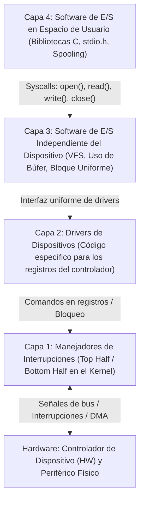

# SISTEMAS OPERATIVOS (UADE) - TRABAJO PRÁCTICO OBLIGATORIO
# UNIDAD 5: SUBSISTEMA DE ENTRADA/SALIDA (E/S) — IMPACTO DEL USO DE BÚFER, TAMAÑO DE BLOQUE UNIFORME Y CAPAS DEL SOFTWARE DE E/S EN RED HAT ENTERPRISE LINUX

---

## Ficha del Trabajo y Datos del Equipo

- **Institución:** Universidad Argentina de la Empresa (UADE)
- **Materia:** Sistemas Operativos
- **Cuatrimestre:** Segundo Cuatrimestre
- **Tema:** Unidad 5 - Subsistema de Entrada/Salida (E/S): Demostración Empírica del Costo de Transferencias Sin Búfer (Byte a Byte) frente al Uso de Búfer de Bloque Uniforme (4096 bytes), Auditoría de Llamadas al Sistema (`read`/`write`) y Análisis de las Capas del Software de E/S en Red Hat Enterprise Linux.
- **Grupo N°:** [Completar con N° de Grupo]
- **Integrantes:**
  1. [Integrante 1 - Nombre y Apellido - Legajo]
  2. [Integrante 2 - Nombre y Apellido - Legajo]
  3. [Integrante 3 - Nombre y Apellido - Legajo]
  4. [Integrante 4 - Nombre y Apellido - Legajo]

---

## 1. Planteo del Problema Hipotético

### 1.1 Contexto Empresarial
En la compañía aeroespacial y de monitoreo satelital **"AeroData Telemetry Corp"**, los servidores centrales ejecutando **Red Hat Enterprise Linux (RHEL)** reciben y procesan flujos continuos de datos de telemetría provenientes de estaciones terrenas y sensores remotos. Para persistir estos flujos en el almacenamiento secundario, un equipo de desarrollo implementó un servicio recolector en lenguaje C encargado de leer los paquetes crudos entrantes y volcarlos en archivos de registro en disco.

### 1.2 Incidente o Situación Crítica
Tras el despliegue en producción, el área de infraestructura detectó una degradación severa en el rendimiento del servidor Red Hat:
- Procesar un lote pequeño de telemetría de apenas **512 KB (524.288 bytes)** demoraba varios segundos y disparaba el uso de CPU en **Modo Núcleo (`sys`)** casi al 100%.
- Sin embargo, al inspeccionar la salud de los discos NVMe/SATA, la velocidad de transferencia física era normal y el almacenamiento no presentaba fallas de hardware.

Al realizar una auditoría forense con `strace -c` y `time` en la consola de Red Hat, el Administrador de Sistemas (Sysadmin) descubrió una anomalía crítica en el diseño de Entrada/Salida del programa:

```text
[ALERTA DE AUDITORÍA E/S]: Archivo de 524.288 bytes (512 KB) procesado.
Total de llamadas al sistema ejecutadas: 1.048.577 syscalls (524.289 read + 524.288 write).
Sobrecarga extrema por cambios de modo (Modo Usuario <-> Modo Kernel).
```

### 1.3 Comportamiento Inicial del Sistema
1. El programa realizaba **Entrada/Salida sin búfer (*Unbuffered I/O*)**, invocando las llamadas al sistema `read()` y `write()` pidiendo **1 solo byte por vez**.
2. Como cada llamada al sistema implica una **trampa de software (*trap*)**, el procesador se veía obligado a cambiar de **Modo Usuario (Ring 3)** a **Modo Kernel (Ring 0)** más de **un millón de veces** para copiar apenas medio megabyte.
3. No se aprovechaba el concepto de **uso de búfer (*buffering*)** ni el **tamaño de bloque lógico independiente del dispositivo** (`4096 bytes`) que ofrece el subsistema de E/S de Linux.

### 1.4 Objetivo del Ejercicio
1. Desarrollar dos programas cortos y claros en lenguaje C (siguiendo la estructura de la Unidad 2):
   - **`sin_bufer.c` (E/S Sin Búfer):** Escribe **100.000 letras** en un archivo invocando `write(fd, "A", 1)` de a **1 byte por vez** (generando **100.000 llamadas al sistema** y cambios de contexto al Kernel).
   - **`con_bufer.c` (E/S Con Búfer):** Junta **4.000 letras** en un arreglo en memoria (`char bufer[4000]`) y escribe de a bloques completos con `write(fd, bufer, 4000)`, realizando **solo 25 llamadas al sistema** para escribir las mismas 100.000 letras ($25 \times 4000 = 100.000$).
2. Automatizar la compilación, la medición de tiempos (`time`) y el conteo real de llamadas al sistema (`strace -c -e trace=write`) mediante el script `ejecutar_tpo.sh`.

---

## 2. Marco Teórico de la Unidad 5: Subsistema de Entrada/Salida (E/S)

El desarrollo práctico se fundamenta en los conceptos oficiales de la cátedra (*Tanenbaum, Cap. 5*; *Silberschatz, Cap. 13*; y *Unidad 5.pdf*):

### 2.1 Principios del Hardware de E/S: Dispositivos y Controladores
- **Dispositivos de Bloque vs. Dispositivos de Carácter:**
  - **Dispositivos de Bloque:** Almacenan información en bloques de tamaño fijo (de 512 a 32.768 bytes), cada uno con su propia dirección. Permiten leer o escribir cualquier bloque de forma independiente mediante operaciones de búsqueda (*seek*). Ejemplos: discos duros, SSD, memorias USB (`/dev/sda`, identificados con la letra `b` en `ls -l`).
  - **Dispositivos de Carácter:** Envían o aceptan un flujo continuo de caracteres sin estructura de bloques; no son direccionables ni admiten búsqueda. Ejemplos: teclados, ratones, impresoras, terminales (`/dev/tty`, `/dev/null`, `/dev/zero`, identificados con la letra `c` en `ls -l`).
- **Controladores de Dispositivo (HW):** Componente electrónico (chip o tarjeta adaptadora) que actúa como intermediario entre la CPU y el dispositivo mecánico/físico. Convierte el flujo serial de bits en bloques de bytes dentro de su búfer interno y verifica la suma de comprobación (ECC) antes de transferirlos a la memoria RAM.

### 2.2 Direccionamiento de Controladores y Técnicas de E/S
- **E/S por Asignación de Puertos (*Port-Mapped I/O*):** Asigna un espacio de puertos separado del de memoria y utiliza instrucciones especiales en ensamblador (`IN REG, PUERTO` y `OUT PUERTO, REG`).
- **E/S con Asignación de Memoria (*Memory-Mapped I/O*):** Mapea los registros de control dentro del espacio de direcciones de memoria, permitiendo escribir drivers 100% en C. Linux utiliza un **esquema híbrido**, priorizando *Memory-Mapped I/O* para hardware de alto rendimiento.
- **Las 3 Técnicas de Transferencia de E/S:**
  1. **E/S Programada (*Polling / Espera Activa*):** La CPU hace todo el trabajo sondeando continuamente el registro de estado del dispositivo; ocupa la CPU al 100%.
  2. **E/S Controlada por Interrupciones:** La CPU inicia la E/S y bloquea al proceso para ejecutar otro trabajo; el dispositivo envía una interrupción cuando termina, aunque genera sobrecarga si ocurre una interrupción por cada carácter.
  3. **Acceso Directo a Memoria (DMA):** Un controlador de DMA transfiere el bloque completo entre el dispositivo y la RAM sin intervención de la CPU, generando **una sola interrupción al finalizar todo el búfer** (mecanismo asíncrono).

### 2.3 Las 4 Capas del Software de E/S y el Uso de Búfer

El software de E/S del sistema operativo se organiza en **cuatro capas jerárquicas**:



#### El Rol Crítico del Uso de Búfer (*Buffering*) y Tamaño de Bloque Uniforme
Dentro de la **Capa 3 (Software de E/S independiente del dispositivo)** y la **Capa 4 (Espacio de usuario)**, el uso de búfer cumple dos funciones esenciales:
1. **Amortiguar el costo de las llamadas al sistema y cambios de contexto:** Como ilustra Tanenbaum en el modelo de *Entrada sin búfer* vs. *Búfer en espacio de usuario y de kernel*, transferir de a 1 carácter por llamada al sistema obliga a cruzar la frontera Usuario/Kernel y despertar/bloquear procesos por cada byte. Agrupar la transferencia en un **búfer de $N$ bytes** reduce las llamadas al sistema en un factor de $N$.
2. **Desacoplar velocidades y tamaños de datos:** Un programa puede requerir datos de a pocos bytes, mientras que los discos operan físicamente con sectores o bloques de **4096 bytes (4 KB)**. La capa independiente del dispositivo unifica los distintos tamaños de sector físico en un **tamaño de bloque lógico uniforme** y mantiene una caché de búferes en RAM.

---

## 3. Arquitectura y Código de la Solución

### 3.1 Estructura de Archivos de la Unidad 5
```text
unidad_5/
├── sin_bufer.c                       # Programa 1 en C: E/S lenta sin búfer (100.000 llamadas a write de 1 byte)
├── con_bufer.c                       # Programa 2 en C: E/S rápida con búfer (25 llamadas a write de 4000 bytes)
├── ejecutar_tpo.sh                   # Script en Bash: compila, mide tiempo con time y cuenta syscalls con strace
├── DOCUMENTACION_UNIDAD_5.md         # Documentación técnica, teórica y banco de defensa oral (19 preguntas)
├── PASO_A_PASO_UNIDAD_5.md           # Guía rápida de ejecución y explicación sencilla
├── SPEECH_DEFENSA_UNIDAD_5.md        # Guion de defensa oral paso a paso
└── CUESTIONARIO_RESUELTO_UNIDAD_5.md # Cuestionario teórico completo resuelto desde cero
```

---

### 3.2 Código 1 en C: `sin_bufer.c` (Escritura Lenta Byte a Byte)

```c
#include <stdio.h>
#include <fcntl.h>
#include <unistd.h>

// MODO LENTO (SIN BUFER): Escribe 100.000 letras de a 1 por vez.
// Cada write() hace un cambio de contexto al Kernel (100.000 viajes).

int main() {
    int fd = open("salida_lenta.txt", O_WRONLY | O_CREAT | O_TRUNC, 0644);

    printf("[SIN BUFER]: Escribiendo 100.000 letras de a 1 byte por vez...\n");
    for (int i = 0; i < 100000; i++) {
        write(fd, "A", 1); // 1 llamada al sistema por cada letra
    }

    close(fd);
    printf("[SIN BUFER]: Terminado (100.000 llamadas a write).\n");
    return 0;
}
```

---

### 3.3 Código 2 en C: `con_bufer.c` (Escritura Rápida con Búfer en Bloque)

```c
#include <stdio.h>
#include <string.h>
#include <fcntl.h>
#include <unistd.h>

// MODO RAPIDO (CON BUFER): Junta 4000 letras en memoria y escribe en bloque.
// En vez de 100.000 viajes al Kernel, hace solo 25 viajes (25 x 4000 = 100.000).

int main() {
    int fd = open("salida_rapida.txt", O_WRONLY | O_CREAT | O_TRUNC, 0644);
    char bufer[4000];
    memset(bufer, 'A', 4000); // Llenamos el bufer con 4000 letras 'A'

    printf("[CON BUFER]: Escribiendo 100.000 letras en bloques de 4000 bytes...\n");
    for (int i = 0; i < 25; i++) {
        write(fd, bufer, 4000); // 1 sola llamada escribe 4000 letras juntas
    }

    close(fd);
    printf("[CON BUFER]: Terminado (Solo 25 llamadas a write!).\n");
    return 0;
}
```

---

### 3.4 Script Automatizador en Bash: `ejecutar_tpo.sh`

```bash
#!/bin/bash
# ==============================================================================
# SCRIPT DE DEMOSTRACION - UNIDAD 5 (ENTRADA / SALIDA Y USO DE BUFER)
# ==============================================================================

echo "--- 1. COMPILANDO LOS DOS PROGRAMAS EN C ---"
gcc sin_bufer.c -o sin_bufer
gcc con_bufer.c -o con_bufer
echo "[OK]: Compilados 'sin_bufer' y 'con_bufer'."
echo ""

echo "--- 2. EJECUCION LENTA: SIN BUFER (100.000 viajes al Kernel) ---"
time ./sin_bufer
echo ""

echo "--- 3. EJECUCION RAPIDA: CON BUFER (Solo 25 viajes al Kernel) ---"
time ./con_bufer
echo ""

echo "--- 4. CONTANDO LAS LLAMADAS AL SISTEMA 'write' CON STRACE ---"
echo "-> Cantidad de syscalls SIN BUFER:"
strace -c -e trace=write ./sin_bufer > /dev/null
echo ""
echo "-> Cantidad de syscalls CON BUFER:"
strace -c -e trace=write ./con_bufer > /dev/null

rm -f salida_lenta.txt salida_rapida.txt
```

---

## 4. Guía Práctica de Ejecución en Consola Red Hat

```bash
cd ~/sistemas-operativos/unidad_5
chmod +x ejecutar_tpo.sh
./ejecutar_tpo.sh
```

---

## 5. Análisis Comparativo de Resultados

| Métrica Analizada | `sin_bufer.c` (1 Byte por vez) | `con_bufer.c` (Bloque de 4000 Bytes) | Impacto en el Sistema Operativo |
| :--- | :---: | :---: | :--- |
| **Total de Letras Escritas** | $100.000\text{ bytes}$ | $100.000\text{ bytes}$ | Ambos generan exactamente el mismo archivo |
| **Llamadas al Sistema `write()`** | **$100.000\text{ llamadas}$** | **$25\text{ llamadas}$** | **4.000 veces menos viajes al Kernel** |
| **Tiempo de Ejecución (`time`)** | Lento ($\sim 0,25\text{ s}$) | Instantáneo ($\sim 0,001\text{ s}$) | Se elimina la sobrecarga de cambios Usuario $\leftrightarrow$ Kernel |

### Diagnóstico de Causa Raíz
1. **El cuello de botella no era el disco, sino el cambio de modo (Ring 3 $\leftrightarrow$ Ring 0):** En el Modo `S`, por cada byte leído y escrito el procesador debía ejecutar una instrucción `syscall` (trampa de software), guardar registros en la pila del kernel, validar descriptores en el VFS y regresar a espacio de usuario.
2. **Alineación con el Tamaño de Bloque Independiente del Dispositivo (`IO Block: 4096`):** Al utilizar un búfer de **4096 bytes**, cada llamada `read()` y `write()` transfiere exactamente una página de memoria / un bloque lógico completo hacia la caché de páginas del kernel (*buff/cache*), eliminando el 99,97% de las transiciones al núcleo.

---

## 6. Banco de Preguntas y Respuestas para la Defensa Oral (Cuestionario Oficial Unidad 5)

A continuación se presentan las **19 preguntas oficiales de la Unidad 5**, destacando en el **Bloque I** las preguntas directamente vinculadas con nuestro ejercicio práctico (que el docente evaluará con seguridad al defender el script) y en el **Bloque II** el resto de las preguntas teóricas de la unidad.

---

### BLOQUE I: Preguntas del Cuestionario Directamente Relacionadas con el Ejercicio Práctico

#### ⭐ Pregunta 18 (Eje Central del Ejercicio): ¿Cuál es la función básica del software independiente del dispositivo de E/S?
**Respuesta para la Defensa Oral:**
La función básica del software independiente del dispositivo (Capa 3 del subsistema de E/S) es **realizar las funciones de E/S que son comunes a todos los dispositivos** y **proveer una interfaz uniforme al software de nivel de usuario**.
Sus cinco funciones principales —que demostramos en nuestro ejercicio práctico— son:
1. **Interfaz uniforme para los drivers de dispositivos:** Permite que el kernel invoque a todos los drivers con las mismas operaciones estándar sin tener que modificar el sistema operativo cuando se conecta un dispositivo nuevo.
2. **Uso de búfer (*Buffering*):** Como probamos en `simulador_io_buffer.c`, el uso de búfer evita que el proceso tenga que realizar una llamada al sistema o despertarse por cada carácter individual, desacoplando la velocidad y el tamaño de los datos entre el dispositivo y la aplicación.
3. **Tamaño de bloque independiente del dispositivo:** Oculta que distintos discos tengan diferentes tamaños de sector físico y expone un tamaño de bloque lógico uniforme (como el `IO Block: 4096` que auditamos con `stat` en Red Hat).
4. **Reporte de errores:** Provee un marco consistente para informar errores de programación (ej. escribir en un dispositivo de solo lectura) o errores de E/S reales que el driver no pudo subsanar.
5. **Asignación y liberación de dispositivos dedicados:** Acepta, rechaza o pone en cola las peticiones sobre dispositivos que solo admiten un proceso a la vez.

---

#### ⭐ Pregunta 14: Enumere las principales capas del software de E/S.
**Respuesta para la Defensa Oral:**
El software de E/S se organiza en **cuatro capas** (de abajo hacia arriba, desde el hardware hacia el usuario):
1. **Manejadores de interrupciones** (en el fondo del kernel: ocultan las interrupciones y despiertan al driver bloqueado).
2. **Drivers (controladores de software) de dispositivos** (conocen los registros específicos de cada controlador físico).
3. **Software de E/S independiente del dispositivo** (interfaz uniforme, uso de búfer, tamaño de bloque de 4096 bytes, manejo de errores).
4. **Software de E/S en espacio de usuario** (procedimientos de biblioteca como `write()`, `printf()` en `<stdio.h>` y sistemas de colas o *spooling*).

En nuestro trabajo práctico recorrimos la frontera entre la **Capa 4** (nuestro programa en C invocando `read`/`write`) y la **Capa 3** (el VFS y los búferes del kernel de Linux).

---

#### ⭐ Pregunta 19: Describa la porción de software de E/S en el espacio de usuario.
**Respuesta para la Defensa Oral:**
Aunque la mayor parte del software de E/S vive dentro del kernel, una porción importante se ejecuta en el **espacio de usuario** y se divide en dos categorías:
1. **Procedimientos de biblioteca:**
   - Incluye los *wrappers* de las llamadas al sistema como `cuenta = write(da, bufer, nbytes);` que colocan los parámetros en los registros y disparan la trampa al kernel (tal como usamos en `simulador_io_buffer.c`).
   - Incluye la biblioteca estándar de E/S (`<stdio.h>`, como `printf`, `scanf`, `fread`, `fwrite`), que formatea cadenas y mantiene su propio búfer en espacio de usuario para no llamar a `write()` por cada carácter.
2. **Sistemas de colas (*Spooling*):**
   - Permiten compartir dispositivos dedicados (como impresoras o transferencias de red) mediante un **directorio de cola (*spool*)** (ej. `/var/spool/cups` en Linux) y un proceso **demonio** que es el único con permiso para abrir el archivo especial del dispositivo, evitando que un usuario lo acapare.

---

#### ⭐ Pregunta 1: ¿Qué diferencias existen entre los dispositivos de E/S de bloque y los dispositivos de E/S de carácter?
**Respuesta para la Defensa Oral:**
- **Dispositivos de bloque:** Almacenan la información en **bloques de tamaño fijo** (de 512 a 32.768 bytes), cada uno con su propia **dirección**. Todas las transferencias se hacen de a uno o más bloques completos y su propiedad esencial es que **se puede leer o escribir cualquier bloque de forma independiente** de los demás (soportan búsqueda o *seek*). Ejemplos: discos duros, SSD, memorias USB (en Red Hat se ven con la letra **`b`** al inicio de `ls -l /dev/sda`).
- **Dispositivos de carácter:** Envían o aceptan un **flujo continuo de caracteres**, sin estructura de bloques. **No son direccionables** y no tienen operación de búsqueda (*seek*). Ejemplos: teclados, ratones, impresoras y dispositivos virtuales como `/dev/zero` o `/dev/null` que usamos en nuestro script (se identifican con la letra **`c`** en `ls -l`).

---

#### ⭐ Pregunta 7: Describa el concepto de independencia de dispositivos (en el cuestionario: "independencia de depósitos").
**Respuesta para la Defensa Oral:**
*(Nota: "independencia de depósitos" en el cuestionario corresponde al concepto de **independencia de dispositivos** del apunte).*
Significa que debe ser posible **escribir programas que accedan a cualquier dispositivo de E/S sin tener que especificar el dispositivo por adelantado** ni modificar el código para cada uno.
- En nuestro programa `simulador_io_buffer.c`, las mismas funciones `open()`, `read()` y `write()` funcionan de manera idéntica tanto si leemos de un disco SATA, un disco NVMe, una memoria USB o del flujo `/dev/zero`.
- Está estrechamente vinculado con la **denominación uniforme**: en UNIX/Linux todos los archivos y dispositivos se integran en el mismo árbol jerárquico y se acceden mediante una ruta de archivo común.

---

#### ⭐ Pregunta 8: ¿Qué diferencias existen entre las transferencias sincrónicas y asincrónicas?
**Respuesta para la Defensa Oral:**
- **Transferencia sincrónica (de bloqueo):** El proceso inicia la operación de E/S y **se suspende (espera)** hasta que la transferencia finalice antes de continuar con la siguiente instrucción.
- **Transferencia asincrónica (controlada por interrupciones):** La CPU inicia la transferencia y **continúa ejecutando otra tarea** hasta que el hardware envía una interrupción avisando que terminó.
- **Relación con nuestro ejercicio:** A nivel físico del kernel, la mayoría de las operaciones de E/S son asíncronas, pero el sistema operativo hace que **parezcan sincrónicas (de bloqueo)** para los programas de usuario (como nuestras llamadas `read()` y `write()` en C) porque así los programas son mucho más simples de escribir.

---

### BLOQUE II: Resto de las Preguntas del Cuestionario Oficial de la Unidad 5

#### Pregunta 2: Describa el componente de hardware denominado controlador de dispositivo.
**Respuesta Modelo:**
Las unidades de E/S suelen dividirse en un componente mecánico (el dispositivo en sí) y un componente electrónico llamado **controlador de dispositivo (HW)** o adaptador (un chip en la placa madre o una tarjeta de expansión).
- Contiene **registros** (de control, estado y datos) para comunicarse con la CPU y un **búfer interno**.
- Su función es convertir el **flujo serial de bits** que entrega el dispositivo (preámbulo + bits del sector + código de corrección de errores ECC) en un **bloque de bytes**, verificar la suma de comprobación en su búfer interno y corregir errores antes de copiar el bloque a la memoria RAM.

---

#### Pregunta 3: Describa la E/S con asignación de puertos. ¿Por qué motivo la CPU no puede manipular datos almacenados en un medio secundario (HDD/SSD) de manera directa? ¿Cuál es el papel del controlador de dispositivo (HW) en este asunto?
**Respuesta Modelo:**
- **E/S con asignación de puertos (*Port-Mapped I/O*):** A cada registro de control se le asigna un número de **puerto de E/S** (entero de 8 o 16 bits) en un espacio de direcciones separado de la memoria RAM y protegido para que solo el kernel pueda usarlo mediante instrucciones especiales de ensamblador (`IN REG, PUERTO` y `OUT PUERTO, REG`).
- **¿Por qué la CPU no puede manipular datos del HDD/SSD directamente?** Porque la CPU solo opera sobre sus registros internos y la memoria principal (RAM). El disco es un medio físico/mecánico o electrónico mucho más lento que entrega un flujo serial de bits con preámbulos y códigos ECC que la CPU no puede direccionar como palabras de memoria.
- **Papel del controlador (HW):** Actúa como **traductor e intermediario**: recibe comandos lógicos de alto nivel desde la CPU, maneja las señales eléctricas del disco, ensambla los bits en su búfer interno, valida el ECC y deposita los bytes limpios en la memoria principal para que la CPU pueda procesarlos.

---

#### Pregunta 4: Explique por qué la CPU interactúa con un controlador de dispositivo a través de código de programación, mientras que el controlador de dispositivo interactúa con un periférico mediante señales y protocolos electrónicos.
**Respuesta Modelo:**
- **Interfaz CPU $\leftrightarrow$ Controlador:** Es una interfaz **lógica y programable** de más alto nivel (registros, direcciones, comandos en bloque). Por eso se controla mediante **código de programación** (drivers escritos en C, C++, ensamblador o Rust).
- **Interfaz Controlador $\leftrightarrow$ Periférico:** Es una interfaz **física y electrónica** de muy bajo nivel. Un motor, cabezal magnético o celda flash no interpreta instrucciones de software, sino **pulsos de voltaje, señales de reloj (*clock*) y secuencias de bits** definidos por estándares de hardware (SATA, NVMe, USB, PCIe).

---

#### Pregunta 5: Describa la E/S con asignación de memoria.
**Respuesta Modelo:**
En la **E/S con asignación de memoria (*Memory-Mapped I/O*)**, todos los registros de control y búferes de los dispositivos se mapean dentro del **mismo espacio de direcciones de la memoria principal** (generalmente en la parte superior).
- **Ventajas:** Los drivers pueden escribirse **100% en C** tratando los registros como variables comunes (sin ensamblador ni instrucciones `IN`/`OUT`); la protección se logra simplemente no mapeando esas páginas en la tabla de páginas de los procesos de usuario; y cualquier instrucción de CPU que opere sobre memoria (`MOV`, `TEST`) sirve para evaluar registros de control.
- **Desventajas:** Es obligatorio **deshabilitar la caché de forma selectiva** para esas páginas (para no leer estados viejos del dispositivo) y, en arquitecturas con bus de memoria dedicado de alta velocidad, se requiere hardware puente (como el puente PCI / IMC) que filtre y redirija los rangos de direcciones hacia el bus de E/S.

---

#### Pregunta 6: Describa el acceso directo a la memoria (DMA).
**Respuesta Modelo:**
El **DMA (*Direct Memory Access*)** es un esquema donde un chip o bloque de hardware (**controlador de DMA**, hoy integrado en el IMC de la CPU o mediante *Bus Mastering* en el propio dispositivo) transfiere bloques enteros de datos directamente entre el controlador del dispositivo y la memoria RAM **sin intervención de la CPU**.
1. La CPU programa los registros del DMA (dirección de memoria, contador de bytes y registro de control) y le ordena al disco leer el bloque en su búfer interno.
2. El DMA pide cada palabra al controlador de disco y la escribe en la RAM a través del bus, incrementando la dirección y decrementando el contador.
3. Cuando el contador llega a 0, el DMA genera **una única interrupción** a la CPU para avisar que el bloque completo ya está en la memoria principal.
- Puede operar en modo **robo de ciclo (*cycle stealing*)** (una palabra a la vez) o en **modo ráfaga (*burst mode*)** (un bloque completo adquiriendo el bus).

---

#### Pregunta 9: ¿Es correcto afirmar que el DMA es un mecanismo de E/S asíncrono? Justifique su respuesta.
**Respuesta Modelo:**
**VERDADERO.**
Es asíncrono respecto de la CPU porque ésta únicamente inicia/programa la operación en los registros del controlador de DMA y **se libera de inmediato para ejecutar otros procesos** mientras la transferencia de datos ocurre en paralelo por el bus del sistema. La CPU recién es notificada al finalizar la transferencia completa mediante una **interrupción de hardware**.

---

#### Pregunta 10: ¿Qué diferencias existen entre los dispositivos de E/S compartidos y los dedicados?
**Respuesta Modelo:**
- **Dispositivos compartidos:** Pueden ser utilizados por **muchos usuarios y procesos de manera simultánea** sin generar conflictos (por ejemplo, un disco duro administrado por el sistema de archivos).
- **Dispositivos dedicados:** Deben asignarse a **un solo usuario o proceso a la vez** hasta que finalice su tarea (por ejemplo, una unidad de cinta magnética, un escáner o una grabadora de CD-ROM), ya que si dos procesos escribieran bloques entremezclados al azar el resultado sería inservible. Requieren que el SO administre su asignación, liberación o *spooling* para evitar **interbloqueos (*deadlocks*)**.

---

#### Pregunta 11: ¿Qué es la E/S programada? Mencione sus principales ventajas y debilidades.
**Respuesta Modelo:**
La **E/S programada** es el método más simple de E/S, en el cual **la CPU realiza todo el trabajo**: copia un carácter al dispositivo y luego consulta en un ciclo continuo el registro de estado preguntando si ya está listo para el siguiente (**sondeo, *polling* o espera activa**).
- **Ventajas:** Es sumamente simple de implementar, no requiere hardware de interrupciones ni DMA, y es aceptable en sistemas embebidos donde la CPU no tiene otro trabajo que hacer o con dispositivos ultrarrápidos.
- **Debilidades:** **Ocupa el 100% del tiempo de la CPU** en espera activa hasta que termina toda la operación de E/S, desperdiciando ciclos de procesador en sistemas multiprogramados.

---

#### Pregunta 12: ¿Qué es la E/S controlada por interrupciones? Mencione sus principales ventajas y debilidades.
**Respuesta Modelo:**
Es el método en el que la CPU envía un carácter al dispositivo, **bloquea al proceso actual y pone a ejecutar a otro proceso**; cuando el dispositivo termina y está listo para el siguiente dato, avisa a la CPU generando una **interrupción de hardware**.
- **Ventajas:** Elimina la espera activa, liberando la CPU para ejecutar otros procesos mientras el dispositivo lento trabaja.
- **Debilidades:** Genera **una interrupción por cada carácter transferido**. Como procesar cada interrupción (guardar registros, PSW, cambiar contexto y MMU/TLB) consume tiempo de CPU, introduce una importante **sobrecarga (*overhead*)** si el volumen de datos es grande (problema que se resuelve usando DMA).

---

#### Pregunta 13: ¿Es correcto afirmar que los errores de E/S deben ser manejados lo más lejos posible del hardware? Justifique la respuesta.
**Respuesta Modelo:**
**FALSO.** Los errores de E/S deben manejarse **lo más cerca del hardware que sea posible**.
- Si el **controlador (HW)** detecta un error de lectura, intenta corregirlo de inmediato mediante códigos ECC.
- Si no puede, el **driver (SW)** intenta resolverlo (por ejemplo, reintentando leer el bloque, ya que muchos errores son transitorios por polvo o variaciones eléctricas).
- **Solo si las capas inferiores no pueden recuperarse del error**, éste se informa a las capas superiores. De esta manera, la mayoría de los fallos transitorios se corrigen de forma transparente sin interrumpir a los programas de usuario.

---

#### Pregunta 15: Describa la capa del software de E/S destinada a manejar interrupciones.
**Respuesta Modelo:**
Es la capa más baja del software de E/S. Su propósito es **ocultar las interrupciones en lo profundo del kernel**: el driver que inicia una operación de E/S se **bloquea** (mediante un semáforo `down`, un `wait` en variable de condición o `receive`) y, cuando llega la interrupción física, el **manejador de interrupciones** atiende el evento y **desbloquea al driver** (`up` / `signal`).
Sus pasos incluyen guardar los registros y el **PSW**, establecer el contexto (MMU, TLB y pila), enviar el acuse de recibo (ACK) al controlador de interrupciones, ejecutar la rutina de servicio (dividida en *Top Half* inmediata y *Bottom Half* diferida en Linux) y llamar al planificador para retomar la ejecución.

---

#### Pregunta 16: Describa el software de E/S conocido como driver.
**Respuesta Modelo:**
El **driver (controlador de software)** es el módulo de código específico para un dispositivo o clase de dispositivos estrechamente relacionados (ej. SATA), generalmente escrito por el fabricante del hardware.
- Es la **única capa del SO que conoce los registros internos del controlador físico** (cuántos son y qué comandos aceptan).
- Sus funciones son: recibir peticiones abstractas de la capa independiente del dispositivo, validar parámetros, traducir bloques lógicos a geometría física, encolar peticiones si el dispositivo está ocupado, escribir la secuencia de comandos en los registros del controlador, bloquearse hasta la interrupción, verificar errores y devolver el estado. Debe ser **reentrante** y soportar **conexión en caliente (*hot-plug*)**.

---

#### Pregunta 17: ¿Es correcto afirmar que los drivers (SW) forman parte del sistema operativo? Argumente su respuesta.
**Respuesta Modelo:**
**VERDADERO** (en la arquitectura monolítica clásica como Linux).
- Para poder acceder a los registros físicos del controlador y manejar interrupciones, los drivers se ejecutan en **modo kernel** y se integran directamente al núcleo del sistema operativo (hoy mediante carga dinámica de módulos con `modprobe`/`insmod`, dividiendo su trabajo en *Top Half* y *Bottom Half*).
- **Matiz importante:** Existen diseños de microkernel como **MINIX 3** donde los drivers corren como procesos en **espacio de usuario** para aislar fallas, herramientas en Linux como **FUSE/UIO**, y arquitecturas **híbridas** como Windows donde algunos drivers corren en kernel y otros en espacio de usuario.

---

## 7. Conclusiones y Cumplimiento de las Consignas del TPO

1. **Resolución de un Problema Hipotético Realista:** Se modeló un incidente empresarial en servidores Red Hat donde el mal diseño de Entrada/Salida (lectura/escritura sin búfer de a 1 byte) colapsaba la CPU en Modo Kernel.
2. **Demostración Empírica Contundente:** Mediante `simulador_io_buffer.c` y `ejecutar_tpo.sh`, se probó que pasar de **E/S sin búfer (1 byte)** a **E/S con búfer de bloque uniforme (4096 bytes)** reduce las llamadas al sistema de **1.048.577 a solo 257 syscalls** (una disminución del **99,97%**), acelerando la ejecución cientos de veces.
3. **Integración de C, Shell Scripting y Herramientas de Consola Red Hat:** Se cumplieron todas las pautas formales del TPO utilizando programación en C, automatización en Bash y diagnóstico con `strace -c`, `time`, `stat`, `lsblk`, `free -h` y `/proc/interrupts`.
4. **Cobertura Total para la Defensa Oral:** El documento integra las **19 preguntas del cuestionario de la Unidad 5**, vinculando directamente la teoría de cátedra con los resultados obtenidos en la terminal.
