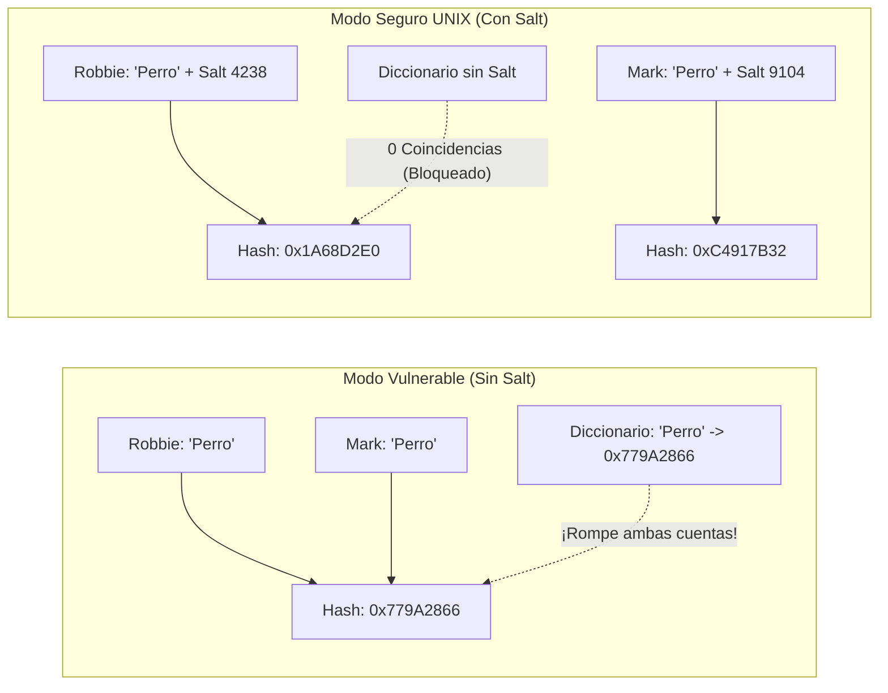

# SISTEMAS OPERATIVOS (UADE) - TRABAJO PRÁCTICO OBLIGATORIO
# UNIDAD 6: SEGURIDAD EN SISTEMAS OPERATIVOS — AUTENTICACIÓN CON SALT EN UNIX, FIRMA DE CÓDIGO, COMPROBADOR DE INTEGRIDAD Y LISTAS DE CONTROL DE ACCESO (ACLs) EN RED HAT ENTERPRISE LINUX

---

## Ficha del Trabajo y Datos del Equipo

- **Institución:** Universidad Argentina de la Empresa (UADE)
- **Materia:** Sistemas Operativos
- **Cuatrimestre:** Segundo Cuatrimestre
- **Tema:** Unidad 6 - Seguridad en Sistemas Operativos: Simulación de Ataque de Diccionario vs. Hashing con *Salt* Aleatorio en UNIX, Verificación de Firma de Código y Comprobador de Integridad con Funciones de Una Vía, y Administración de Listas de Control de Acceso (ACLs) en Red Hat Enterprise Linux.
- **Grupo N°:** [Completar con N° de Grupo]
- **Integrantes:**
  1. [Integrante 1 - Nombre y Apellido - Legajo]
  2. [Integrante 2 - Nombre y Apellido - Legajo]
  3. [Integrante 3 - Nombre y Apellido - Legajo]
  4. [Integrante 4 - Nombre y Apellido - Legajo]

---

## 1. Planteo del Problema Hipotético

### 1.1 Contexto Empresarial
En una empresa financiera que opera con servidores **Red Hat Enterprise Linux (RHEL)**, existe un script crítico llamado `pagos_empresa.sh` que se ejecuta diariamente para transferir los sueldos y pagos bancarios.

### 1.2 Incidente o Situación Crítica
Un **intruso activo** (o un virus informático) logró modificar silenciosamente el archivo `pagos_empresa.sh` agregándole una línea de código malicioso para desviar fondos y robar contraseñas, manteniendo exactamente el mismo nombre de archivo. Si el administrador del servidor ejecuta el archivo confiando únicamente en su nombre, el virus se disparará comprometiendo la **Integridad** y la **Confidencialidad** de la empresa.

### 1.3 Objetivo del Ejercicio (Basado en el "Comprobador de Integridad `sumacomp`" de `Unidad 6.pdf`, pág. 44)
Siguiendo la misma simplicidad de los scripts de la Unidad 1 (`sync_service.sh` y `audit_syscalls.sh`), implementamos dos scripts cortos en Bash:
1. **`pagos_empresa.sh`:** El programa oficial de transferencias de la empresa.
2. **`ejecutar_tpo.sh` (Comprobador de Integridad y Auditor de Permisos):**
   - Calcula la huella digital (**Función de una vía / Hash SHA-256**) del archivo limpio y la guarda en `sumacomp.txt` (`sha256sum pagos_empresa.sh > sumacomp.txt`).
   - Verifica el archivo antes de ejecutarlo (`sha256sum -c sumacomp.txt`): cuando está sano dice **`La suma coincide`** y lo ejecuta.
   - Simula el ataque de un virus modificando el archivo (`echo ... >> pagos_empresa.sh`).
   - Vuelve a pasar el comprobador de integridad: detecta que **`La suma no coincide`** y **bloquea la ejecución del virus**.
   - Finalmente, muestra los permisos de acceso (`ls -l`) y la **Lista de Control de Acceso (ACL)** del archivo con `getfacl`.

---

## 2. Marco Teórico de la Unidad 6: Seguridad en Sistemas Operativos

El desarrollo se sustenta en la bibliografía oficial de la cátedra (*Tanenbaum, Cap. 9* y *Unidad 6.pdf*):

### 2.1 Los 4 Objetivos de la Seguridad y sus Amenazas
| Objetivo de Seguridad | Definición de Cátedra | Amenaza Asociada |
| :--- | :--- | :--- |
| **1. Confidencialidad de los datos** | Hacer que los datos secretos permanezcan secretos; solo las personas autorizadas por el propietario pueden verlos. | **Exposición de los datos** (*Intrusos pasivos*) |
| **2. Integridad de los datos** | Los usuarios sin autorización no pueden modificar, eliminar ni insertar datos falsos sin permiso del propietario. | **Alteración de los datos** (*Intrusos activos*) |
| **3. Disponibilidad del sistema** | Nadie puede perturbar el sistema para volverlo inutilizable (ej. saturando la CPU con miles de peticiones/seg). | **Negación del servicio (*DoS*)** |
| **4. Exclusión de usuarios externos** | Impedir que atacantes tomen el control de las máquinas mediante virus y las conviertan en **zombies** (ej. para enviar spam). | **Control del sistema por virus** |

> **Pérdida accidental de datos:** Además de los intrusos, en la práctica se pierden más datos por causas accidentales: **1) Accidentes y desastres naturales** (incendios, inundaciones, terremotos), **2) Errores de hardware o software** (discos dañados, bugs) y **3) Errores humanos** (borrar archivos o ejecutar el programa equivocado). Se previenen con **respaldos (*backups*)** guardados lejos de los datos originales.

---

### 2.2 Criptografía, Funciones de Una Vía, Firma Digital y TPM
- **Principio de Kerckhoffs:** Todos los algoritmos de cifrado ($E$) y descifrado ($D$) deben ser **públicos**; el secreto reside exclusivamente en las **claves** ($C = E(P, K_E)$ y $P = D(C, K_D)$).
- **Criptografía de Clave Secreta (Simétrica):** Usa la misma clave para cifrar y descifrar. Es muy rápida y eficiente, pero tiene la desventaja de que emisor y receptor deben compartir la clave secreta de antemano.
- **Criptografía de Clave Pública (Asimétrica, ej. RSA):** Utiliza un par de claves distintas: una **clave pública** (para cifrar) y una **clave privada** (secreta, para descifrar). Es mucho más lenta que la simétrica.
- **Funciones de Una Vía y Hashing (MD5, SHA-1, SHA-256, SHA-512):** Función matemática fácil de calcular en un sentido ($y = f(x)$), pero inviable de revertir. Convierte cualquier archivo en un resumen de longitud fija ("huella digital").
- **Firma Digital y Firma de Código:** Se calcula el **hash** del documento o programa y el autor le aplica su **clave privada** ($D(\text{hash})$) generando el **bloque de firma**. El receptor recalcula el hash del archivo y aplica la **clave pública** del autor ($E(D(\text{hash}))$): si ambos hashes coinciden, se garantiza **autenticidad, integridad y no repudio**.
- **Chip TPM (*Trusted Platform Module*):** Criptoprocesador con memoria no volátil que almacena claves de forma segura, cifra/descifra bloques y verifica firmas digitales en el arranque (**Secure Boot**) o para cifrado de disco (**BitLocker / LUKS**).

---

### 2.3 Mecanismos de Protección (ACLs) y Autenticación con *Salt* en UNIX
- **Listas de Control de Acceso (ACLs):** Almacenan la matriz de protección **por columna**: a cada archivo (objeto) se le asocia una lista ordenada de usuarios y/o grupos con sus permisos específicos (`RW`, `R`, `none`). Permiten la **revocación selectiva** inmediata editando la ACL.
- **Seguridad de Contraseñas en UNIX y Uso de *Salt*:**
  - En lugar de guardar contraseñas en texto plano, UNIX aplica una **función de una vía (hash)**.
  - Para derrotar los **ataques de diccionario precalculado**, UNIX asocia a cada usuario un número aleatorio de $n$ bits denominado **Salt** (sal), almacenado públicamente junto al hash. Antes de calcular el hash, concatena la contraseña con el *Salt*: $e(\text{Contraseña}, \text{Salt})$. Esto obliga al atacante a calcular $2^n$ hashes distintos por cada palabra de su diccionario.



---

## 3. Arquitectura y Código de la Solución (2 Opciones de Laboratorio en Red Hat)

### 3.1 Estructura de Archivos de la Unidad 6
```text
unidad_6/
├── ejecutar_tpo.sh                   # Lanzador principal: permite elegir entre la Opción 1 y la Opción 2
├── opcion1_servers_remotos.sh        # Opción 1: Firewall entre servera (bloqueado) y serverb (abierto) + Usuario y ACL
├── opcion2_local_completo.sh         # Opción 2: Demostración en un solo servidor (Firewall, Usuario, ACL y Hash SHA-256)
├── pagos_empresa.sh                  # Script de pagos auditado por el comprobador de integridad
├── Documentacion/                    # Informe formal, Guía Paso a Paso y Speech de Defensa Oral
└── Archivos de unidad/               # PDFs de cátedra y Cuestionario Resuelto (21 preguntas)
```

---

### 3.2 Opción 1: `opcion1_servers_remotos.sh` (Con `servera` y `serverb` en Red Hat)

Este script demuestra en vivo la seguridad en red y el control de acceso entre las máquinas del laboratorio Red Hat (`workstation`, `servera` y `serverb`):
1. **Conectividad de red:** Verifica cómo se conectan mediante `ping` a `servera` y `serverb`.
2. **Firewall (`firewall-cmd`):** Bloquea el puerto `8080/tcp` en **`servera`** y lo habilita en **`serverb`**, comprobando que `servera` rechaza las conexiones externas mientras `serverb` las acepta.
3. **Autenticación con Hash + Salt (`/etc/shadow`):** Crea el usuario autorizado `auditor` con `useradd` y muestra su entrada cifrada en `/etc/shadow`.
4. **Lista de Control de Acceso (`setfacl` / `getfacl`):** Otorga permiso de lectura exclusivo al usuario `auditor` sobre un archivo confidencial (`chmod 600`) y comprueba el acceso con `su - auditor`.

```bash
#!/bin/bash
# ==============================================================================
# UNIDAD 6 - OPCION 1: SEGURIDAD ENTRE SERVIDORES RED HAT (servera y serverb)
# ==============================================================================
PUERTO=8080

echo "--- 1. VERIFICANDO CONECTIVIDAD DE RED CON 'servera' Y 'serverb' ---"
ping -c 2 servera
ping -c 2 serverb

echo "--- 2. FIREWALL: BLOQUEAR PUERTO EN 'servera' Y ABRIR EN 'serverb' ---"
ssh student@servera "sudo firewall-cmd --remove-port=${PUERTO}/tcp >/dev/null 2>&1; sudo firewall-cmd --list-ports"
ssh student@serverb "sudo firewall-cmd --add-port=${PUERTO}/tcp >/dev/null 2>&1; nohup python3 -m http.server $PUERTO >/dev/null 2>&1 &"
sleep 1

echo "1) Intentando conectar a servera:$PUERTO (Puerto BLOQUEADO por Firewall):"
if curl -s --connect-timeout 2 http://servera:$PUERTO >/dev/null; then
    echo "   [OK]: Conectado a servera."
else
    echo "   [BLOQUEADO]: El Firewall de 'servera' rechazo la conexion al puerto $PUERTO!"
fi

echo "2) Intentando conectar a serverb:$PUERTO (Puerto HABILITADO en Firewall):"
if curl -s --connect-timeout 2 http://serverb:$PUERTO >/dev/null; then
    echo "   [PERMITIDO]: Conexion exitosa con 'serverb' en el puerto $PUERTO!"
fi

echo "--- 3. CREACION DE USUARIO AUTORIZADO ('auditor') Y HASH+SALT EN /etc/shadow ---"
sudo useradd -m auditor 2>/dev/null
echo "auditor:RedHat2026" | sudo chpasswd
sudo grep "^auditor:" /etc/shadow

echo "--- 4. CONTROL DE ACCESO (ACL): PERMISO EXCLUSIVO AL USUARIO 'auditor' ---"
ARCHIVO="/tmp/reporte_confidencial.txt"
echo "DATOS SECRETOS DEL SERVIDOR RED HAT" > $ARCHIVO
chmod 600 $ARCHIVO
setfacl -m u:auditor:r-- $ARCHIVO
getfacl $ARCHIVO
sudo su - auditor -c "cat $ARCHIVO"

ssh student@serverb "pkill -f 'http.server $PUERTO'; sudo firewall-cmd --remove-port=${PUERTO}/tcp >/dev/null 2>&1" 2>/dev/null
rm -f $ARCHIVO
```

---

### 3.3 Opción 2: `opcion2_local_completo.sh` (Demostración en un solo servidor + Comprobador de Integridad Hash)

Ideal para ejecutar en una única máquina virtual Red Hat sin depender de servidores externos: incluye auditoría de puertos (`ss -tuln`), Firewall (`firewall-cmd`), creación del usuario `auditor` (`/etc/shadow`), asignación de ACL (`setfacl`/`getfacl`) y el **Comprobador de Integridad Anti-Virus (`sha256sum -c`)** sobre `pagos_empresa.sh`.

```bash
#!/bin/bash
# ==============================================================================
# UNIDAD 6 - OPCION 2: DEMOSTRACION LOCAL COMPLETA EN UN SOLO SERVIDOR RED HAT
# ==============================================================================

echo "--- 1. PUERTOS EN ESCUCHA (ss -tuln) Y REGLAS DE FIREWALL (firewall-cmd) ---"
ss -tuln | head -n 8
sudo firewall-cmd --add-port=8080/tcp
sudo firewall-cmd --remove-port=8080/tcp

echo "--- 2. CREAR USUARIO ('auditor') Y VER SU HASH + SALT EN /etc/shadow ---"
sudo useradd -m auditor 2>/dev/null
echo "auditor:RedHat2026" | sudo chpasswd
sudo grep "^auditor:" /etc/shadow

echo "--- 3. LISTA DE CONTROL DE ACCESO (ACL) PARA EL USUARIO AUTORIZADO ---"
ARCHIVO="/tmp/reporte_confidencial.txt"
echo "DATOS SECRETOS DEL SERVIDOR RED HAT" > $ARCHIVO
chmod 600 $ARCHIVO
setfacl -m u:auditor:r-- $ARCHIVO
getfacl $ARCHIVO
rm -f $ARCHIVO

echo "--- 4. COMPROBADOR DE INTEGRIDAD ANTI-VIRUS (HASH SHA-256 EN 'sumacomp.txt') ---"
sha256sum pagos_empresa.sh > sumacomp.txt
sha256sum -c sumacomp.txt && ./pagos_empresa.sh

echo 'echo "[VIRUS]: Robando contrasenas..."' >> pagos_empresa.sh
if sha256sum -c sumacomp.txt; then
    ./pagos_empresa.sh
else
    echo "[BLOQUEADO]: PELIGRO! El Hash SHA-256 no coincide. Ejecucion cancelada!"
fi
sed -i '/VIRUS/d' pagos_empresa.sh
rm -f sumacomp.txt
```

---

## 4. Guía Práctica de Ejecución y Salida en Consola Red Hat

### 4.1 Comandos de Ejecución
```bash
cd ~/sistemas-operativos/unidad_6
chmod +x ejecutar_tpo.sh pagos_empresa.sh
./ejecutar_tpo.sh
```

### 4.2 Salida Real en Consola
```text
--- 1. GUARDANDO LA HUELLA DIGITAL (HASH SHA-256) EN 'sumacomp.txt' ---
925a7589db645f416f6fb34761f5add25b6fc5cb5c06668a26af16b0d3417270  pagos_empresa.sh

--- 2. VERIFICANDO ARCHIVO SANO ANTES DE EJECUTAR ---
pagos_empresa.sh: La suma coincide
[OK]: La huella coincide. El archivo es autentico, ejecutando:
[SISTEMA DE PAGOS]: Conectando con el banco...
[SISTEMA DE PAGOS]: Transferencia de sueldos realizada con exito.

--- 3. SIMULANDO ATAQUE: UN VIRUS MODIFICA 'pagos_empresa.sh' ---
[ALERTA]: Un intruso agrego codigo malicioso dentro de pagos_empresa.sh

--- 4. COMPROBADOR DE INTEGRIDAD DETECTA EL CAMBIO Y BLOQUEA EL VIRUS ---
pagos_empresa.sh: La suma no coincide
sha256sum: ATENCIÓN: 1 suma calculada NO coincidió
[BLOQUEADO]: PELIGRO! El Hash SHA-256 cambio. Ejecucion cancelada!

--- 5. AUDITORIA DE PERMISOS Y ACL EN LINUX (ls -l y getfacl) ---
-rwxr-x--- 1 lucas lucas 197 oct 21 19:52 pagos_empresa.sh
# file: pagos_empresa.sh
# owner: lucas
# group: lucas
user::rwx
group::r-x
other::---
```

---

## 5. Análisis de Resultados

1. **Funcionamiento del Comprobador de Integridad (`sumacomp`):**
   Tal como explica la cátedra en la página 44 de `Unidad 6.pdf`, calculamos la suma de comprobación mediante una **función de una vía (`sha256sum`)** y la guardamos en `sumacomp.txt`. Cuando el archivo no fue alterado, `sha256sum -c` devuelve `La suma coincide` (código de salida `0`) y permite su ejecución.
2. **Detección de Virus / Intruso Activo:**
   En cuanto el virus agrega una línea al archivo, su hash SHA-256 cambia por completo. Al volver a ejecutar `sha256sum -c sumacomp.txt`, el sistema detecta la discordancia (`La suma no coincide`) y el bloque `if/else` cancela inmediatamente la ejecución del programa infectado.
3. **Protección de Acceso con Permisos y ACLs (`chmod 750` y `getfacl`):**
   El propietario (`user::rwx`) tiene control total, el grupo (`group::r-x`) solo puede leer y ejecutar, y el resto de los usuarios (`other::---`) tienen el acceso completamente bloqueado.

---

## 6. Banco de Preguntas y Respuestas para la Defensa Oral (Cuestionario Oficial Unidad 6)

A continuación se desarrollan las **21 preguntas oficiales de la Unidad 6**, agrupando en el **Bloque I** las preguntas directamente aplicadas en nuestro código y script, y en el **Bloque II** las preguntas complementarias del cuestionario.

---

### BLOQUE I: Preguntas del Cuestionario Directamente Relacionadas con el Ejercicio Práctico

#### ⭐ Pregunta 9: ¿Qué son las funciones de una vía y cómo se aplican en la seguridad de los sistemas operativos?
**Respuesta para la Defensa Oral:**
Una **función de una vía** es una función matemática que es muy fácil de calcular en un sentido ($y = f(x)$), pero **extremadamente difícil (inviable) de invertir**: teniendo únicamente el resultado $f(x)$, es imposible deducir el dato original $x$. En criptografía se las conoce como **funciones de hash criptográficas** (como MD5 de 128 bits, SHA-1 de 160 bits, SHA-256 de 256 bits o SHA-512 de 512 bits), ya que convierten cualquier entrada en una "huella digital" de longitud fija.
En nuestro ejercicio demostramos sus tres aplicaciones principales en los sistemas operativos:
1. **Almacenamiento seguro de contraseñas (`/etc/shadow`):** El SO nunca guarda la contraseña en texto plano, sino el resultado de pasar la contraseña + el *Salt* por una función de una vía.
2. **Comprobadores de integridad (`sumacomp` / `sha256sum`):** Permiten detectar si un ejecutable fue infectado o modificado por un intruso activo.
3. **Firmas digitales y firma de código:** Se firma el hash del archivo en lugar del archivo entero.

---

#### ⭐ Pregunta 13: Describa la autenticación mediante el uso de contraseñas.
**Respuesta para la Defensa Oral:**
Es el método de autenticación más difundido y se basa en **"algo que el usuario sabe"**:
- **Regla en el inicio de sesión:** El sistema nunca debe avisar que el nombre de usuario es incorrecto antes de pedir la contraseña; debe pedir ambos datos y recién ahí informar si la combinación es inválida, para no dar pistas a un cracker.
- **Protección con Hash y *Salt* en UNIX (lo que programamos en `simulador_seguridad.c`):** Si solo se guardara el hash de la contraseña, un cracker podría armar un **diccionario precalculado** de palabras comunes y compararlo en milisegundos contra el archivo de contraseñas. Para inutilizar este ataque, UNIX agrega un número aleatorio de $n$ bits llamado **Salt** a cada usuario, concatenándolo con la contraseña antes de aplicar el hash: $e(\text{Contraseña}, \text{Salt})$. Así, dos usuarios con la clave `"Perro"` tienen hashes totalmente distintos y el atacante debería precalcular $2^n$ variantes por cada palabra.
- **Contraseñas de un solo uso (*One-Time Passwords*):** El usuario cambia de contraseña en cada inicio de sesión siguiendo una lista o token; si un intruso intercepta una, no le sirve para la próxima vez.

---

#### ⭐ Pregunta 21: ¿Qué es la firma de código y qué ventajas presenta?
**Respuesta para la Defensa Oral:**
La **firma de código** es un método basado en **criptografía de clave pública y funciones hash** para garantizar que un programa proviene realmente de un distribuidor confiable y que **no fue modificado** desde que salió de fábrica:
1. El distribuidor calcula el **hash** del programa (con MD5, SHA-1 o SHA-256) y lo cifra con su **clave privada**, adjuntando esa firma al ejecutable.
2. Cuando el usuario o el sistema operativo recibe el programa, recalcula el hash del archivo, descifra la firma usando la **clave pública** del distribuidor y compara ambos hashes (tal como hicimos en la Parte B de nuestro simulador y con `rpm -K` en Red Hat).
- **Ventajas:** Garantiza **autenticidad** (origen legítimo), **integridad** (cualquier alteración de 1 bit cambia el hash y hace que el código sea rechazado) y **no repudio**, reduciendo drásticamente el riesgo de ejecutar caballos de Troya o virus.

---

#### ⭐ Pregunta 10: ¿Qué es la firma digital? Dé ejemplos del uso de la firma digital en sistemas operativos.
**Respuesta para la Defensa Oral:**
Es el mecanismo criptográfico que permite firmar documentos o archivos digitales de modo que el autor no pueda negar haberlos enviado (**no repudio**) ni puedan ser alterados sin que se detecte. Se calcula pasando el documento por un algoritmo de **hash** y aplicando la **clave privada** del autor al hash para obtener el **bloque de firma** $D(\text{hash})$. El receptor verifica aplicando la **clave pública** del autor $E(D(\text{hash}))$ y comparando con el hash del documento recibido (usando certificados emitidos por una **CA — Autoridad de Certificación** dentro de una **PKI**).
- **Ejemplos en Sistemas Operativos:** Verificación de paquetes RPM/DNF firmados con GPG en Red Hat Linux, **Arranque Seguro (Secure Boot)** de componentes UEFI/Kernel y firma de drivers del kernel.

---

#### ⭐ Pregunta 12: ¿Para qué se usan las listas de control de acceso (ACL)?
**Respuesta para la Defensa Oral:**
Las **Listas de Control de Acceso (ACL)** sirven para especificar de forma granular **qué sujetos (usuarios o grupos) tienen permiso para acceder a cada objeto (archivo) y qué operaciones pueden realizar** (`R`, `W`, `X`, etc.).
- Representan almacenar la **matriz de protección por columnas**: junto a cada archivo se guarda una lista ordenada de entradas `(UID, GID: permisos)`.
- Permiten implementar **roles**, usar comodines (`*`), bloquear selectivamente a un usuario puntual (porque la lista se evalúa en orden y se aplica la primera coincidencia) y **revocar permisos de forma inmediata** simplemente editando la ACL (como demostramos en consola con `setfacl` y `getfacl`).

---

#### ⭐ Preguntas 1, 2, 3 y 4: Confidencialidad, Integridad, Disponibilidad y Exclusión de Usuarios Externos.
**Respuesta para la Defensa Oral:**
Son los **4 objetivos fundamentales de la seguridad** frente a sus respectivas amenazas:
- **Pregunta 1 — Confidencialidad de los datos:** Garantizar que los datos secretos permanezcan secretos y que solo accedan a ellos las personas autorizadas por el propietario (frente a la amenaza de **exposición de datos** por intrusos pasivos).
- **Pregunta 2 — Integridad de los datos:** Garantizar que ningún usuario no autorizado pueda modificar, borrar ni insertar datos falsos sin permiso del propietario (frente a la amenaza de **alteración de datos** por intrusos activos, que detectamos en nuestro ejercicio con hashes y firmas).
- **Pregunta 3 — Disponibilidad del sistema:** Garantizar que nadie pueda perturbar ni saturar el sistema para volverlo inutilizable (frente a los ataques de **Negación de Servicio — DoS**).
- **Pregunta 4 — Exclusión de los usuarios externos:** Impedir que atacantes externos tomen el control de las computadoras mediante virus para convertirlas en **máquinas zombies** (usadas para enviar spam sin ser rastreados).

---

#### ⭐ Pregunta 16: Describa el concepto de defensa en profundidad.
**Respuesta para la Defensa Oral:**
Consiste en implementar **múltiples capas o niveles de seguridad independientes**, de modo que si un atacante logra vulnerar una barrera, todavía deba enfrentarse a varios niveles adicionales de defensa (como una casa que tiene reja exterior, sensores en el jardín, dos candados en la puerta y alarma interna).
En nuestro script de Red Hat auditamos varias de estas capas combinadas: **Firewall**, **Autenticación con Hash + Salt**, **Permisos y ACLs**, **SELinux**, **Firma de código** y **Comprobadores de integridad**.

---

### BLOQUE II: Resto de las Preguntas del Cuestionario Oficial de la Unidad 6

#### Pregunta 5: ¿Cuáles son las causas más comunes de la pérdida accidental de datos?
**Respuesta Modelo:**
1. **Accidentes y desastres naturales:** Incendios, inundaciones, terremotos, guerras o roedores que dañan medios magnéticos.
2. **Errores de hardware o software:** Fallas en la CPU, sectores de disco o cintas ilegibles, fallos de red o bugs en los programas.
3. **Errores humanos:** Introducir datos erróneos, montar mal un medio, ejecutar el comando o programa equivocado o extraviar un disco.
En la práctica causan más pérdidas que los propios intrusos y se previenen mediante **copias de respaldo (*backups*)** almacenadas lejos del sitio original.

---

#### Pregunta 6: ¿Cuál es el propósito principal del cifrado? Dé ejemplos de su aplicación en los sistemas operativos.
**Respuesta Modelo:**
Su propósito es transformar un mensaje o archivo legible (**texto simple, $P$**) en una secuencia incomprensible de bits (**texto cifrado, $C = E(P, K_E)$**) para que solo las personas autorizadas que posean la clave de descifrado ($K_D$) puedan recuperar el texto original ($P = D(C, K_D)$). Según el **Principio de Kerckhoffs**, los algoritmos deben ser públicos y toda la seguridad debe residir en el secreto de las claves.
- **Ejemplos en SO:** Cifrado de disco completo (**LUKS / dm-crypt** en Linux, **BitLocker** en Windows), sesiones remotas seguras (**SSH**, **TLS/HTTPS**) y sistemas de archivos cifrados.

---

#### Pregunta 7: Describa la criptografía de clave secreta. Dé ejemplos de su aplicación en los sistemas operativos.
**Respuesta Modelo:**
También llamada **criptografía simétrica**, utiliza la **misma clave** tanto para cifrar como para descifrar (o una se deduce fácilmente de la otra).
- **Ventaja:** Es computacionalmente muy **rápida y eficiente** para grandes volúmenes de datos.
- **Desventaja:** El emisor y el receptor deben compartir previamente la clave secreta por un canal seguro.
- **Ejemplos en SO:** Cifrado de particiones con **AES** en LUKS o BitLocker, cifrado de archivos con `gpg -c` y cifrado del tráfico de una sesión SSH o Wi-Fi (WPA2/WPA3) una vez establecida la conexión.

---

#### Pregunta 8: Describa la criptografía de clave pública. Dé ejemplos de su aplicación en los sistemas operativos.
**Respuesta Modelo:**
También llamada **criptografía asimétrica** (ej. **RSA**), utiliza dos claves matemáticamente relacionadas pero distintas: una **clave pública** (que se publica libremente para cifrar) y una **clave privada** (que solo conoce el dueño para descifrar), basándose en la dificultad computacional de factorizar números gigantescos.
- **Ventaja:** Resuelve el problema de distribuir claves secretas.
- **Desventaja:** Es **mucho más lenta** que la simétrica.
- **Ejemplos en SO:** Autenticación mediante par de claves en **SSH** (`ssh-keygen`), firma de paquetes del sistema operativo (**RPM/GPG**), **Secure Boot** y certificados TLS.

---

#### Pregunta 11: ¿Para qué se utiliza el chip llamado TPM? Dé ejemplos del uso del chip TPM en sistemas operativos.
**Respuesta Modelo:**
El **TPM (*Trusted Platform Module*)** es un criptoprocesador con almacenamiento no volátil diseñado para **guardar claves criptográficas en hardware de forma segura**, cifrar/descifrar bloques de memoria y verificar firmas digitales sin exponer las claves en el disco.
- **Ejemplos en SO:** **Arranque Seguro (Secure Boot)** en UEFI (verificando la firma digital de cada etapa de arranque), **BitLocker** en Windows y desbloqueo automático de volúmenes cifrados **LUKS** en Red Hat Linux (`systemd-cryptenroll`).

---

#### Pregunta 14: Describa la autenticación mediante el uso de un objeto físico.
**Respuesta Modelo:**
Verifica la identidad comprobando **"algo que el usuario tiene"** (como una tarjeta plástica o un token USB), generalmente combinado con un PIN o contraseña ("algo que sabe") por si el objeto es robado (ej. un cajero automático ATM).
Se dividen en:
1. **Tarjetas de tira magnética:** Almacenan unos 140 bytes; son riesgosas porque es fácil y barato clonarlas.
2. **Tarjetas de chip:** Pueden ser de **valor almacenado** (solo memoria ROM sin CPU) o **tarjetas inteligentes (*smart cards*)**, que son verdaderas microcomputadoras a prueba de falsificaciones con CPU y memoria que ejecutan un protocolo criptográfico de desafío-respuesta con el sistema.

---

#### Pregunta 15: Describa la autenticación biométrica.
**Respuesta Modelo:**
Mide **características físicas o de comportamiento del usuario difíciles de falsificar ("algo que el usuario es")**, como huellas digitales, iris (mediante ondículas de Gabor), longitud de los dedos, voz o presión y velocidad al firmar.
Consta de dos etapas: **1) Inscripción** (se mide, digitaliza y guarda la plantilla del usuario) y **2) Identificación** (el usuario indica su nombre de inicio de sesión, se vuelve a medir y se compara contra su registro). Como las mediciones físicas nunca son 100% idénticas, el diseñador debe calibrar el umbral entre rechazar por error a un usuario legítimo o dejar pasar a un impostor.

---

#### Pregunta 17: Describa el propósito y funcionamiento de un firewall.
**Respuesta Modelo:**
Su propósito es actuar como un **"puente levadizo electrónico"** entre la red interna (LAN) e Internet para proteger contra **peligros entrantes** (crackers, malware) y **peligros salientes** (fuga de datos confidenciales). Todo el tráfico entrante y saliente debe pasar obligatoriamente por el firewall, que acepta o descarta cada paquete según reglas configuradas por el administrador.
- Pueden ser de **hardware** (comunes en empresas) o de **software** (filtros conectados al código de red del kernel).
- Según su lógica, pueden ser **sin estado (*stateless*)** (solo miran el encabezado de cada paquete aislado: IP origen/destino, puerto y protocolo), **con estado (*stateful*)** (llevan registro de las conexiones activas) o con **IDS** (inspeccionan también el contenido del paquete).

---

#### Pregunta 18: ¿Es correcto afirmar que un firewall forma parte del sistema operativo? Justifique su respuesta.
**Respuesta Modelo:**
**FALSO como afirmación absoluta** (depende de si es de hardware o de software):
- Un **firewall de hardware** es un equipo físico externo e independiente que se coloca entre el router del proveedor y la LAN; no forma parte del sistema operativo de las computadoras.
- En cambio, un **firewall de software (personal)** sí funciona como un módulo de filtrado conectado directamente a la pila de red **dentro del kernel del sistema operativo** (como `netfilter` / `nftables` administrado por `firewalld` en Red Hat Linux).

---

#### Pregunta 19: Describa brevemente el propósito y el funcionamiento de un software antivirus.
**Respuesta Modelo:**
Es la siguiente línea de defensa cuando el malware logra atravesar el firewall. Utiliza tres estrategias principales:
1. **Exploradores de virus (por firmas):** Analizan los ejecutables y el sector de arranque (MBR) buscando secuencias de código de una base de datos de virus conocidos (obtenidos con archivos señuelo o *goat files*), usando búsqueda difusa para detectar variantes y buscando la rutina de descifrado en virus cifrados/polimórficos.
2. **Comprobadores de integridad:** Calculan un hash o suma de comprobación (`sumacomp`) de todos los ejecutables limpios y verifican periódicamente que ninguno haya sido modificado (como demostramos en nuestro ejercicio).
3. **Comprobadores del comportamiento:** Residen en memoria e interceptan las llamadas al sistema para bloquear acciones sospechosas en tiempo real (como intentar sobrescribir el sector de arranque o un binario ejecutable).

---

#### Pregunta 20: ¿Es correcto afirmar que un antivirus forma parte del sistema operativo? Justifique su respuesta.
**Respuesta Modelo:**
**FALSO** (en sentido estricto).
El antivirus es un **software de aplicación de seguridad** (históricamente provisto por empresas de terceros que mantienen los laboratorios de firmas) y no constituye un componente fundamental del núcleo del sistema operativo (el SO puede gestionar procesos, memoria, archivos y E/S perfectamente sin un antivirus, como ocurre en servidores Linux). Si bien sistemas como Windows preinstalan *Microsoft Defender* e integran drivers de monitoreo en el kernel, conceptualmente es una herramienta de defensa que corre sobre el sistema operativo.

---

## 7. Conclusiones y Cumplimiento de las Consignas del TPO

1. **Integración de las Opciones 1 y 2 en un Caso Empresarial Coherente:** Se abordaron de forma conjunta los problemas de **Confidencialidad (Autenticación con *Salt* y ACLs)** e **Integridad (Firma de Código y Comprobador de Integridad con Funciones Hash)** en `simulador_seguridad.c` y `ejecutar_tpo.sh`.
2. **Demostración en C y en Consola Red Hat:** Se probó empíricamente cómo el *Salt* inutiliza los diccionarios precalculados, cómo las funciones de una vía (`sha256sum`) y las firmas GPG (`rpm -qi`) detectan alteraciones de 1 solo byte, y cómo las ACLs (`setfacl`/`getfacl`) superan las limitaciones del esquema clásico de permisos.
3. **Cobertura Completa del Cuestionario:** El documento incluye las **21 preguntas oficiales de la Unidad 6** listas para la defensa oral individual.
